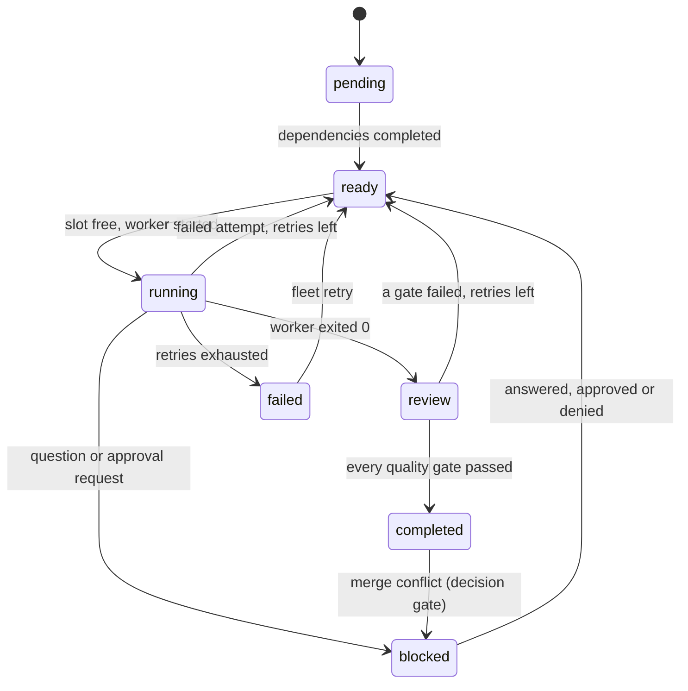

# agent-fleet

**Run many coding agents in parallel, each in its own git worktree and pty, with a task DAG, supervised
workers, decision gates, approvals and quality gates. One small, memory-bounded Rust binary: `fleet`.**

> An example project. It has **not been audited** and makes **no production claims**. It runs commands you
> configure with your user's permissions and does not sandbox them. Linux and macOS only (the macOS paths
> type-check but were not run). Read [SECURITY.md](SECURITY.md) before using it on anything you care about.

```text
fleet plan plan.toml  ->  fleet start  ->  one worker per ready task, in .fleet-worktrees/<run>/<task>
                                        ->  worker asks a question?   a person answers a decision gate
                                        ->  quality gates (exit code or refcheck-json) must pass
                                        ->  fleet merge <task>        an approval bound to the exact commit
                                        ->  merge --no-ff into fleet/<run>/integration
```

## What it does

- **Isolation.** Every task runs on its own branch `fleet/<run>/<task>` in its own git worktree under
  `<repo>/.fleet-worktrees/`, created from the run's base commit. Your checked-out branch, index and working tree
  are never touched. All git calls run with an empty environment and neutralized configuration (hooks, fsmonitor,
  filters, merge drivers, ssh and credential helpers cannot run planted code).
- **Any agent command.** A worker is a command from `fleet.toml` started in a pty with its own session and process
  group. Its environment is an explicit allowlist; the control socket and state directory are never visible to it.
- **A task DAG.** Dependencies, cycle rejection, a concurrency limit per run and globally, bounded automatic
  retries (a failed worker or a failed quality gate re-runs the task with the failure text added to its brief),
  and the work of finished dependencies is merged into a dependent's branch before it starts.
- **Humans stay in the loop.** A worker that is blocked writes `.fleet/question.json`; fleet opens a *decision gate*
  and resumes the task with your answer. Sensitive actions (merging, running a command a worker asked for) need an
  *approval* bound to a SHA-256 digest of the exact action, with an expiry, used once (an approved command is never run
  twice, not even across a daemon restart). Workers cannot create or grant approvals through the daemon's interfaces: the
  control socket needs a per-run token they never receive and refuses peers that are, or descend from, a worker or that
  cannot be identified. That is defence in depth, not a boundary against a hostile same-user process (see Limitations).
- **Quality gates.** Configured commands run in the worktree after the worker finishes. A task completes only when
  all pass. The `refcheck-json` format understands the report of the `refcheck` tool and fails on errors,
  unparseable output, the wrong shape or death by signal.
- **Goals and proof of work (NEO N1).** A goal ledger records what the objective is and what is left; a goal can carry
  a *verification contract* (commands, `refcheck-json`, file assertions, a diff constraint) that fleet runs itself,
  independently of the worker, in the task's worktree. A task such a goal names completes only after that run passed;
  what an agent reports is shown as `unverified` until there is evidence. See [NEO N1](#neo-n1-goals-and-verification).
- **Supervised and recoverable.** Idle and total timeouts, TERM then KILL of the whole process group, pid-reuse
  protection (pid *and* start time are verified before any signal), and an append-only hash-chained event log:
  after a crash (or `kill -9`) the daemon replays the log, stops sessions that survived and re-queues their tasks.
- **Bounded memory.** Worker output goes through a streaming sanitizer and redactor into a fixed-size ring buffer;
  see [Memory](#memory) for measured numbers with flooding workers.
- **A dashboard and an interactive attach.** `fleet tui` shows runs, the DAG, sanitized live output, approvals and
  gates; `fleet attach` is a real interactive terminal into a worker with a detach key.

It does not make agents smarter and it does not sandbox them. See [Limitations](#limitations).

## Quick start

Requirements: git 2.39+, Rust 1.95 (pinned in `rust-toolchain.toml`), Linux or macOS.

```bash
cargo build --release            # produces target/release/fleet
mkdir -p ~/.local/state/agent-fleet
cp examples/fleet.example.toml ~/.local/state/agent-fleet/fleet.toml   # then edit [workers.agent]
target/release/fleet daemon      # foreground; stop it with `fleet shutdown` from another terminal
```

In another terminal:

```bash
fleet plan examples/plan.example.toml     # creates run r1 with the four tasks of the example DAG
fleet start --run r1 --max-parallel 2
fleet status                              # or: fleet tui
fleet gate list                           # questions the workers asked
fleet gate resolve g1 --answer axum
fleet merge api                           # exits 5 and names the approval you must give
fleet approve a1 && fleet merge api
```

`fleet daemon` reads `fleet.toml` once at start, from `--config` or from the state directory, never from a
repository (configuration names commands to run, so a repository's contents must not be able to change it).

## A real run

The whole run below was produced by [`scripts/demo.sh`](scripts/demo.sh) in a throwaway container with a fake HOME
and a fake repository. The agents are [scripted shell scripts](examples/agents/fake-agent.sh): `api` asks which HTTP
framework to use, and `release` writes a bad changelog on its first attempt so its quality gate fails and the task is
retried with the gate's complaint in its brief. Nothing was edited afterwards.

<details>
<summary>Full output (click to expand)</summary>

```text

$ /target/release/fleet plan /tmp/tmp.rlHRSVIR8Q/plan.toml
plan loaded into run r1 (4 tasks)

$ /target/release/fleet start --run r1 --max-parallel 2
run r1 started

$ /target/release/fleet status
daemon pid 21 | v0.1.0 | up 2s | sessions 0/4 | undo unavailable | rss 3744 kB

run r1 [active] max-parallel 2
  objective  Add a users table, an API and docs
  repo       /tmp/tmp.rlHRSVIR8Q/repo (base HEAD @ d3407e08)
  branch     fleet/r1/integration
  tasks      pending 1, ready 0, running 0, review 1, completed 1, failed 0, blocked 1
  ID       STATUS     DEPS      TRY  WORKER  NOTE
  schema   completed  -         1    -       added the users table
  api      blocked    schema    1    -       blocked: question g1 - Which HTTP framework should the API …
  docs     review     schema    1    -       wrote the docs
  release  pending    api,docs  0    -

waiting for you
gate g1 [question] r1/api: Which HTTP framework should the API use?
  choices: axum | actix

recent
  #15 r1/api ready
  #16 r1/docs ready
  #17 r1/api dispatched (attempt 1)
  #18 r1/docs dispatched (attempt 1)
  #19 r1/api session exited
  #20 gate g1 opened for r1/api
  #21 r1/api blocked (question)
  #22 r1/docs session exited
  #23 r1/docs in review
  #24 r1/docs committed

$ /target/release/fleet gate list
gate g1 [question] r1/api: Which HTTP framework should the API use?
  choices: axum | actix

$ /target/release/fleet gate resolve g1 --answer axum
gate g1 resolved

$ /target/release/fleet status
daemon pid 21 | v0.1.0 | up 6s | sessions 0/4 | undo unavailable | rss 3872 kB

run r1 [finished] max-parallel 2
  objective  Add a users table, an API and docs
  repo       /tmp/tmp.rlHRSVIR8Q/repo (base HEAD @ d3407e08)
  branch     fleet/r1/integration
  tasks      pending 0, ready 0, running 0, review 0, completed 4, failed 0, blocked 0
  ID       STATUS     DEPS      TRY  WORKER  NOTE
  schema   completed  -         1    -       added the users table
  api      completed  schema    2    -       built the API with axum
  docs     completed  schema    1    -       wrote the docs
  release  completed  api,docs  2    -       wrote the changelog

recent
  #40 r1/release committed
  #41 r1/release gate changelog failed
  #42 r1/release retry 1 queued
  #43 r1/release note added
  #44 r1/release dispatched (attempt 2)
  #45 r1/release session exited
  #46 r1/release in review
  #47 r1/release committed
  #48 r1/release gate changelog passed
  #49 r1/release completed

$ /target/release/fleet tail release
agent: starting release
agent: the gate complained, fixing the changelog
agent: finished release

$ /target/release/fleet merge schema
fleet: merging r1/schema needs approval a1 (digest 06fc129ce711); approve it with `fleet approve a1` and run the merge again
run: fleet approve a1

$ /target/release/fleet merge docs
fleet: merging r1/docs needs approval a2 (digest e81233c20988); approve it with `fleet approve a2` and run the merge again
run: fleet approve a2

$ /target/release/fleet merge api
fleet: merging r1/api needs approval a3 (digest b257e4bc36d0); approve it with `fleet approve a3` and run the merge again
run: fleet approve a3

$ /target/release/fleet merge release
fleet: merging r1/release needs approval a4 (digest 6d34035e6a10); approve it with `fleet approve a4` and run the merge again
run: fleet approve a4

$ /target/release/fleet approval list
approval a1 [merge] r1/schema pending digest 06fc129ce711
  git: "merge" "fleet/r1/integration" "fleet/r1/schema" "1a5f8b9929514c59c2260b2a5768a8db0374f3e5"
  decide: fleet approve a1 | fleet deny a1
approval a2 [merge] r1/docs pending digest e81233c20988
  git: "merge" "fleet/r1/integration" "fleet/r1/docs" "0c42491fa129095f028efa19836116fdbe4f9bec"
  decide: fleet approve a2 | fleet deny a2
approval a3 [merge] r1/api pending digest b257e4bc36d0
  git: "merge" "fleet/r1/integration" "fleet/r1/api" "09ac132d23f09e5077aea5430bd821ccf7625d93"
  decide: fleet approve a3 | fleet deny a3
approval a4 [merge] r1/release pending digest 6d34035e6a10
  git: "merge" "fleet/r1/integration" "fleet/r1/release" "74564da74758b3d5ff4fc5ef9d796407e90e7b6c"
  decide: fleet approve a4 | fleet deny a4

$ /target/release/fleet approve a1
approval a1 approved

$ /target/release/fleet approve a2
approval a2 approved

$ /target/release/fleet approve a3
approval a3 approved

$ /target/release/fleet approve a4
approval a4 approved

$ /target/release/fleet merge schema
merged r1/schema (fleet/r1/schema) into fleet/r1/integration at 1403c660262b

$ /target/release/fleet merge docs
merged r1/docs (fleet/r1/docs) into fleet/r1/integration at 694a4e9418c2

$ /target/release/fleet merge api
merged r1/api (fleet/r1/api) into fleet/r1/integration at efedd2c8bb7e

$ /target/release/fleet merge release
merged r1/release (fleet/r1/release) into fleet/r1/integration at 341343a10f24

$ git log --oneline --graph fleet/r1/integration
*   341343a fleet: merge release into fleet/r1/integration: Write the changelog
|\  
| * 74564da fleet: release - Write the changelog
| * 9b0ca70 fleet: release - Write the changelog
| *   27b2266 Merge branch 'refs/heads/fleet/r1/docs' into fleet/r1/release
| |\  
* | | efedd2c fleet: merge api into fleet/r1/integration: Build the users API
|\| | 
| * | 09ac132 fleet: api - Build the users API
* | |   694a4e9 fleet: merge docs into fleet/r1/integration: Document the schema
|\ \ \  
| | |/  
| |/|   
| * | 0c42491 fleet: docs - Document the schema
| |/  
* | 1403c66 fleet: merge schema into fleet/r1/integration: Create the users table
|\| 
| * 1a5f8b9 fleet: schema - Create the users table
|/  
* d3407e0 initial commit

$ git status --short   # the working tree and branch of the repository are untouched
main

$ /target/release/fleet status
daemon pid 21 | v0.1.0 | up 6s | sessions 0/4 | undo unavailable | rss 3872 kB

run r1 [finished] max-parallel 2
  objective  Add a users table, an API and docs
  repo       /tmp/tmp.rlHRSVIR8Q/repo (base HEAD @ d3407e08)
  branch     fleet/r1/integration
  tasks      pending 0, ready 0, running 0, review 0, completed 4, failed 0, blocked 0
  ID       STATUS     DEPS      TRY  WORKER  NOTE
  schema   completed  -         1    -       added the users table
  api      completed  schema    2    -       built the API with axum
  docs     completed  schema    1    -       wrote the docs
  release  completed  api,docs  2    -       wrote the changelog

recent
  #57 approval a4 approved
  #58 approval a1 consumed
  #59 run r1 integration branch created
  #60 r1/schema merged
  #61 approval a2 consumed
  #62 r1/docs merged
  #63 approval a3 consumed
  #64 r1/api merged
  #65 approval a4 consumed
  #66 r1/release merged

$ /target/release/fleet events --limit 12
#55 approval a2 approved
#56 approval a3 approved
#57 approval a4 approved
#58 approval a1 consumed
#59 run r1 integration branch created
#60 r1/schema merged
#61 approval a2 consumed
#62 r1/docs merged
#63 approval a3 consumed
#64 r1/api merged
#65 approval a4 consumed
#66 r1/release merged
```

</details>

What to notice: the question became gate `g1` and the task resumed after `gate resolve`; `release` shows `TRY 2`
because its quality gate failed once; every merge first returned exit 5 with an approval id and a digest of the
exact merge (including the commit being merged); the repository's own branch and working tree were untouched
(`git status --short` empty, branch still `main`).

## NEO N1: goals and verification

NEO is a planned layer above the orchestrator (goal ledger, context compiler, knowledge store, token governor,
credential broker). **Only milestone N1 exists**: the goal ledger and verification contracts; see
[docs/neo.md](docs/neo.md) for what it does, the contract format and what is not there.

```text
fleet goals add --title <text> [--id <id>] [--parent <goal>] [--task <run>/<task>]... [--contract <file.json>]
fleet goals attach | status | list | show | remaining          (all with --json)
fleet verify <goal|task>                                         run the contracts now, record evidence
```

The output below was produced by [`scripts/neo-demo.sh`](scripts/neo-demo.sh) in a throwaway container with a fake HOME
and a fake repository. The agent is a [scripted shell script](examples/agents/neo-agent.sh) that reports `done` on every
attempt; its first attempt writes the wrong answer. The [contract](examples/neo/contract.json) has three mandatory
checks (the file says `ready`, a command, the work touches only `answer.txt`). Fleet runs it itself after the worker
finished: attempt 1 fails (evidence `e1`), the failing check is quoted in the brief of attempt 2, attempt 2 passes
(`e4` to `e6`), and only then does the task complete and the goal become verified. Nothing was edited afterwards.

<details>
<summary>Full output (click to expand)</summary>

```text

$ /target/release/fleet plan /tmp/tmp.4LBi0yoJBH/plan.toml
plan loaded into run r1 (1 tasks)

$ /target/release/fleet goals add --id feature --title The answer file says ready --intent answer.txt exists, says ready, and nothing else changed --task r1/answer --contract /work/examples/neo/contract.json
goal feature added (open), contract dd2a18ee6128

$ /target/release/fleet goals remaining
1 goals, 0 verified, 0 abandoned
open leaves:
  GOAL     STATUS  CONTRACT  TASKS                       TITLE
  feature  open    pending   r1/answer (ready, pending)  The answer file says ready
blockers:
  none
next ready tasks:
  r1/answer  (goal feature)  Write the answer file

$ /target/release/fleet start --run r1
run r1 started

$ /target/release/fleet status
daemon pid 20 | v0.1.0 | up 0s | sessions 0/2 | undo unavailable | rss 3860 kB

run r1 [finished] max-parallel 2
  objective  NEO demo
  repo       /tmp/tmp.4LBi0yoJBH/repo (base HEAD @ 5334a2a6)
  branch     fleet/r1/integration
  tasks      pending 0, ready 0, running 0, review 0, completed 1, failed 0, blocked 0
  ID      STATUS     DEPS  TRY  WORKER  NOTE
  answer  completed  -     2    -       done, every check passes

recent
  #19 r1/answer note added
  #20 r1/answer dispatched (attempt 2)
  #21 r1/answer session exited
  #22 r1/answer in review
  #23 r1/answer committed
  #24 evidence e4: goal feature check "answer" passed
  #25 evidence e5: goal feature check "tests" passed
  #26 evidence e6: goal feature check "scope" passed
  #27 goal feature is verified
  #28 r1/answer completed

$ /target/release/fleet goals show feature
goal feature [verified]
title:    The answer file says ready
reason:   every mandatory check of the contract passed
intent:
  > answer.txt exists, says ready, and nothing else changed
contract: passed (id dd2a18ee6128)
tasks:
  r1/answer  completed  verification: verified
checks (newest evidence of each):
  answer [file, mandatory] passed: the file contains the text
    answer.txt contains "ready"
  tests [command, mandatory] passed: exit code 0
    /bin/sh -c test -s answer.txt (expect exit 0)
  scope [diff, mandatory] passed: 1 changed path(s), all allowed
    changes only answer.txt
evidence history (newest first):
  EVIDENCE  CHECK   VERDICT  COMMIT        TASK    SUMMARY
  e6        scope   passed   6b36ed0886e4  answer  1 changed path(s), all allowed
  e5        tests   passed   6b36ed0886e4  answer  exit code 0
  e4        answer  passed   6b36ed0886e4  answer  the file contains the text
  e3        scope   passed   be0dfadda09e  answer  1 changed path(s), all allowed
  e2        tests   passed   be0dfadda09e  answer  exit code 0
  e1        answer  failed   be0dfadda09e  answer  the file does not contain the text

$ /target/release/fleet verify r1/answer
verification of r1/answer: PASSED
task r1/answer: verified
goal feature [verified] contract passed
  answer [file, mandatory] passed: the file contains the text
    answer.txt contains "ready"
  tests [command, mandatory] passed: exit code 0
    /bin/sh -c test -s answer.txt (expect exit 0)
  scope [diff, mandatory] passed: 1 changed path(s), all allowed
    changes only answer.txt

$ /target/release/fleet goals remaining
1 goals, 1 verified, 0 abandoned
nothing is left to do

$ /target/release/fleet verify-log
event log ok: 31 records, head 33ff83149917199bb07cbb5791a6806fc18496a57c9e0d2700d782b11f4f52ef
```

</details>

What the end-to-end tests ([`e2e_neo.rs`](crates/fleet-cli/tests/e2e_neo.rs)) additionally pin down with the real
binary: a worker that claims success with a wrong result never completes its task and its dependents never start; a
task whose worker finished is shown as `unverified` while the contract runs; the ledger and the evidence survive
`kill -9` of the daemon in the middle of a verification (the lost run recorded nothing and is repeated); a worker
cannot use any of the commands; a contract command planted in the worktree is never run; secrets in check output are
redacted before they reach the audit log.

## Concepts

| Term | Meaning |
| --- | --- |
| **Run** | One objective: a task DAG, a repository, a base commit and an integration branch. |
| **Task** | `pending` (waiting for dependencies), `ready`, `running`, `review` (gates pending), `completed`, `failed`, `blocked` (waiting for a person, a conflict resolution or a failed dependency). |
| **Worker** | A command from `fleet.toml` run in a pty for one attempt of a task. |
| **Decision gate** | A question a worker (or a merge conflict) puts to a person. `fleet gate list|resolve`. |
| **Approval** | A person's yes/no for one exact action, bound to a digest and an expiry. `fleet approve|deny`. |
| **Quality gate** | A configured command that must pass before a task completes. |
| **Goal** | A node of the goal ledger with a status, tasks and an optional verification contract. `verified` is reached only through evidence. `fleet goals`. |
| **Verification contract / evidence** | Checks fleet runs itself to decide whether a goal's work counts as done; the immutable record (verdict, redacted output, commit) of each run. `fleet verify`. |

The full glossary, the layer diagram and the context map are in [docs/domain.md](docs/domain.md); the reasons for the
main design decisions are the short ADRs in [docs/adr](docs/adr).



## Commands

```text
fleet - run many coding agents in parallel, each in its own git worktree

usage: fleet [global options] <command> [options]

global options (before or after the command):
  --state-dir <dir>   state directory (default: $XDG_STATE_HOME/agent-fleet or ~/.local/state/agent-fleet)
  --json              print the daemon's reply (or the error) as one JSON document
  -h, --help          show this help
  -V, --version       show the version

daemon:
  daemon [--config <fleet.toml>]     run the daemon in the foreground
  shutdown                           ask the daemon to stop
  doctor [--config <fleet.toml>]     check the setup (exit 13 when something fails)
  verify-log                         verify the event log's hash chain (exit 11 when tampered)

runs and tasks:
  run create --objective <text> --repo <path> [--base <ref>] [--id <id>] [--max-parallel N]
  task add --run <run> --title <text> [--spec <text>|-] [--after <task>]... [--worker <name>] [--id <id>]
                                     (--spec - reads the spec from stdin, at most 16 KiB)
  plan <file.toml|file.json> [--run <run>]
                                     load a whole task graph (with --run: into an existing run)
  start --run <run> [--max-parallel N]
  status [--run <run>]               runs, tasks, gates, approvals, recent events
  stop <task>                        stop the running worker
  retry <task>                       run a failed or stopped task again
  cancel <task>                      cancel a task that has not completed
  events [--limit N]                 recent audit events

working with a task (<task> is <run>/<task> or a unique task id):
  attach <task>                      interactive terminal session of the worker
  send <task> <text...> [--no-newline]
  tail <task> [--follow] [--lines N]

decisions:
  gate list                          open questions and conflicts
  gate resolve <id> --answer <text>  answer a gate (or give the answer as the rest of the line)
  approval list                      approvals and their digests
  approve <id> [--digest <hex>]      approve a pending action
  deny <id> [--digest <hex>]         deny it

results:
  merge <task>                       merge a reviewed task into the integration branch
  cleanup [--run <run>] [--branches] remove finished worktrees (and branches)
  undo <task> [--apply]              preview or revert the last worker changes (needs agent-undo)

goals and verification (NEO):
  goals add --title <text> [--id <id>] [--parent <goal>] [--intent <text>|-]
            [--task <run>/<task>]... [--contract <file.json>]
                                     add a goal to the ledger, optionally with its verification contract
  goals attach <goal> --contract <file.json>
                                     make a contract the acceptance criteria of a goal
  goals status <goal> <open|in_progress|blocked|abandoned> [--reason <text>]
                                     (verified is never set by hand: only recorded evidence does it)
  goals list                         the goal tree with status, contract and task verification
  goals show <goal>                  one goal: its checks, the newest evidence of each, the history
  goals remaining                    open leaves, blockers and the tasks that can start next
  verify <goal|task> [--task <run>/<task>] [--timeout <secs>]
                                     run the contracts independently of the worker and record
                                     evidence; exit 6 when a mandatory check did not pass

dashboard:
  tui                                terminal dashboard

exit codes: 0 ok, 1 internal, 2 usage, 3 daemon down, 4 not found, 5 approval required,
6 conflict, 7 invalid, 8 limit, 9 unavailable, 10 forbidden, 11 tampered, 12 timeout, 13 unhealthy
```

Everything talks to the daemon over a Unix socket with bounded newline-delimited JSON. With `--json` every command
prints one document with a stable `schema` field (`fleet.status/1`, `fleet.gate.list/1`, `fleet.merge/1`, ...) or
`{"schema":"fleet.error/1","error":{"code","message","subject"}}`; the exit code is the same in both modes:

| Code | Name | Meaning |
| --- | --- | --- |
| 0 | ok | |
| 1 | internal | unexpected I/O, git or internal failure |
| 2 | usage | bad command line |
| 3 | daemon_down | nothing is listening on the socket (`fleet daemon` first) |
| 4 | not_found | unknown run, task, gate or approval |
| 5 | approval_required | a person must decide first (the error names the approval) |
| 6 | conflict | wrong state for the action, a merge conflict, a second daemon, an expired approval |
| 7 | invalid | validation failed: bad name, cycle, oversized text, digest mismatch |
| 8 | limit | a hard limit was reached |
| 9 | unavailable | an optional feature is missing (`agent-undo`) |
| 10 | forbidden | refused: wrong user, or a request from a worker process |
| 11 | tampered | the event log failed its integrity check |
| 12 | timeout | the daemon did not answer in time |
| 13 | unhealthy | `fleet doctor` found a failing check |

`fleet status --json` has the top-level keys `schema, daemon, now_ms, runs, gates, approvals, recent`; the key sets of
the status, error and doctor documents are pinned by end-to-end tests
([`e2e_cli.rs`](crates/fleet-cli/tests/e2e_cli.rs)).

## Configuration

`fleet.toml` (see [examples/fleet.example.toml](examples/fleet.example.toml); unknown keys are errors):

| Section / key | Meaning | Default |
| --- | --- | --- |
| `[daemon] max_sessions` | concurrent worker sessions across all runs (hard cap 64) | 8 |
| `default_worker` | worker used by tasks that name none | none |
| `max_retries` | automatic retries per task (worker failures and failed gates); questions and daemon restarts do not use them | 2 |
| `kill_grace_secs` | SIGTERM, then SIGKILL after this long | 5 |
| `approval_ttl_secs` | an approval expires if nobody uses it | 900 |
| `sensitive` | actions that always need an approval: `merge`, `external-command` | both |
| `external_timeout_secs`, `question_grace_secs` | limit for approved commands; how long a worker that wrote a question may keep running | 600, 2 |
| `author_name`, `author_email` | identity of commits fleet makes | `fleet` / `fleet@localhost` |
| `ring_bytes` | output kept per session (hard cap 4 MiB) | 262144 |
| `[env] allow` | variables copied from the daemon's environment to workers, gates, git and approved commands | `PATH HOME USER LOGNAME LANG LC_ALL LC_CTYPE TERM TZ TMPDIR` |
| `[redact] literals, env_values, [[redact.rules]]` | extra redaction: literal strings, values of secret-looking daemon variables, `prefix` + `charset` (`alnum|hex|base64|token`) + `min_len` rules | built-in key shapes + env values |
| `[workers.<name>]` | `command`, `args`, `env_pass`, `env_set`, `timeout_secs`, `idle_timeout_secs` | |
| `[[gates]]` | `name`, `command`, `args`, `env_pass`, `env_set`, `format` (`exit` or `refcheck-json`), `timeout_secs` | exit, 600 s |

Arguments are templates, never shell: `{brief}` (the brief, at most 16 KiB), `{task}`, `{run}`, `{worktree}` and
`{brief_file}` are replaced inside each argument, `{{` and `}}` are literal braces. A **plan file**
(`fleet plan file.toml|json`) names workers but cannot define commands; an optional `[run]` table creates the run.

### What a worker sees and may write

Environment: only the allowlist plus `FLEET_RUN`, `FLEET_TASK`, `FLEET_WORKTREE`, `FLEET_BRIEF_FILE` (and `SHELL`,
which the pty library always adds). Working directory: its own worktree. The brief is in `.fleet/brief.md` and also
offered as `{brief}`. Before it exits it may write, in `.fleet/`:

```json
{"version":1,"status":"done","summary":"what I did"}                                        // result.json (or "failed")
{"version":1,"kind":"question","text":"Which framework?","choices":["axum","actix"]}        // question.json: a decision gate
{"version":1,"kind":"approval","text":"why","action":{"command":"/usr/bin/publish","args":["--tag","x"]}}   // an approval request
```

These files are read with lstat + `O_NOFOLLOW|O_NONBLOCK` checks, size caps and schema validation. An approved
command is run by the *daemon*, exactly as approved, with the allowlisted environment; its result goes into the task's
next brief. Uncommitted changes are committed by fleet (never with hooks, `--no-verify`).

## Dashboard

`fleet tui` (keys: `j/k` move, `Tab` focus, `Enter` attach or answer, `a`/`d` approve or deny the selected approval,
`s` stop, `t` retry, `m` merge, `?` help). A real screen from the demo's status document, rendered into a headless
buffer by the example in [crates/fleet-cli/examples/tui_screenshot.rs](crates/fleet-cli/examples/tui_screenshot.rs)
(the same rendering code the terminal uses):

```text
fleet 0.1.0 | runs 1 | pend 1 rdy 0 run 1 rev 0 ok 1 fail 0 blk 1 | sess 1/4 | undo off | rss 3M
┌Tasks (4)───────────────────────────────────────┐┌Output r1/schema──────────────────────────────────────────┐
│  TASK       STATUS    DEPS     TITLE           ││Create the users table attempt 1                          │
│> r1/schema  completed -        Create the users││summary: added the users table                            │
│  r1/api     blocked   <schema  Build the users ││gate changelog pass exit code 0                           │
│  r1/docs    running   <schema  Document the sch││agent: starting schema                                    │
│  r1/release pending   <api,doc Write the change││agent: finished schema                                    │
│                                                ││                                                          │
│                                                ││                                                          │
│                                                ││                                                          │
│                                                ││                                                          │
│                                                ││                                                          │
│                                                ││                                                          │
│                                                ││                                                          │
│                                                ││                                                          │
│                                                ││                                                          │
│                                                ││                                                          │
│                                                ││                                                          │
│                                                ││                                                          │
│                                                ││                                                          │
└────────────────────────────────────────────────┘└──────────────────────────────────────────────────────────┘
┌Approvals (0)───────────────────────────────────────────────────┐┌Decisions (1)─────────────────────────────┐
│none pending                                                    ││> g1 r1/api Which HTTP framework should th│
│                                                                ││                                          │
│                                                                ││                                          │
│                                                                ││                                          │
│                                                                ││                                          │
└────────────────────────────────────────────────────────────────┘└──────────────────────────────────────────┘
q quit  j/k move  Tab focus  Enter attach/answer  a/d approve/deny  s stop  t retry  m merge  r refresh  ? hel
```

## Architecture

Domain-driven layers in a cargo workspace; the compiler enforces the dependency rule and an architecture test checks
the manifests.

| Crate | Layer | Depends on |
| --- | --- | --- |
| `fleet-domain` | pure rules: runs/tasks (aggregate), decision gates, approvals, quality judgement, supervision rules, sanitizer, redactor, output buffer, events, hash chain | `std` only |
| `neo-verify` | NEO: verification contracts, checks, glob matcher, judging, evidence | `std`, `fleet-domain` |
| `neo-goals` | NEO: the goal ledger aggregate and its status machine | `std`, `fleet-domain`, `neo-verify` |
| `fleet-app` | use cases (`Orchestrator`, with a `neo` module for goals and verification), commands, read models, port traits, in-memory fakes and port contract suites | the three domain crates |
| `fleet-infra` | adapters: git, ptys, files, event log, job runner (gates, approved commands, verification contracts), sockets, TOML, daemon wiring | app, domain crates |
| `fleet-cli` | the `fleet` binary: argument parsing, rendering, dashboard, attach | all |

State is event-sourced: every change is a domain event, appended to a hash-chained log before it is applied;
a restart replays the log. Time, hashing and ids reach the domain only through arguments and small traits, so the
domain performs no I/O. See [docs/domain.md](docs/domain.md) and [docs/adr](docs/adr).

## Tests

1181 tests, all passing in the final run (fresh cargo volumes, offline after one `cargo fetch --locked`):

| Layer | What is tested | Tests |
| --- | --- | --- |
| Domain | pure unit tests of ids, DAG, runs/tasks, decision gates, approvals (consume-once, expiry, digest binding), quality judgement (`refcheck-json` edge cases), supervision and kill escalation, contract validation, sanitizer, redactor, output ring, events, hash chain, brief quoting, environment policy; NEO: contract schema (also with random documents), glob matcher (against an exponential reference), judging, evidence, the goal ledger with property tests of its status machine (tree shape, verified only through evidence, replay equals live state, evidence immutable) | 308 |
| Application | the orchestrator driven through commands with in-memory fakes for all ports: lifecycle, supervision and timeouts, decisions and approvals (never run twice across a restart), merging and conflicts, recovery and orphan reconciliation, quality gates; NEO: goal commands and views, the completion rule (failing then passing contract, no completion without evidence, restart, job cap, a goal added mid-run), `verify`; plus the port contract suites against the fakes (now including verification jobs) | 268 |
| Adapters | every real adapter in temp dirs (git hardening with planted hooks/filters/drivers, merge-by-approved-commit, symlink/FIFO/oversize worker files, pty sessions and the input queue, process identity, hash-chained log, sockets with token and fail-closed admission, redaction of gate and command output, agent-undo path rules, config; NEO: running contracts with real processes, files and git, `open_beneath`) and the same contract suites against the real file adapters | 364 |
| Soak | bounded memory with flooding workers | 1 |
| End to end | the real binary and daemon (flow, crash recovery, tampering, security incl. a worker that tries to approve, CLI, JSON schemas, exit codes), dashboard rendering on a headless backend, architecture rules (now also for the NEO crates: dependency direction, no clock, no I/O, no `unwrap`); NEO: the ledger and contracts through the binary | 240 |

Run them layer by layer inside the development container (see [Development](#development)):
`scripts/test-layers.sh`. All tests run without network access, in temp directories, with std's test harness only;
the git and pty behaviour is tested against real git and real ptys, and the end-to-end tests drive the real binary.

### Coverage

Measured for real with rustc's source-based instrumentation (`-C instrument-coverage`) and `llvm-profdata`/`llvm-cov`
from the official `llvm-tools` component (`scripts/coverage.sh`, no third-party coverage crate). It counts library and
binary code, excluding the unit-test modules inside source files, `tests/`, examples, the in-memory fakes and test
helpers:

```text
layer               lines  covered  percent
domain               4681     4562    97.5%
application          2484     2339    94.2%
infrastructure       3706     3392    91.5%
cli                  2881     2595    90.1%
overall             13752    12888    93.7%
```

Targets were domain ≥ 95 %, application ≥ 90 %, overall ≥ 85 %. Honest gaps: the event loop of the terminal dashboard
(`tui/mod.rs`, about a quarter covered) and the interactive part of `attach.rs` need a real tty and are not exercised
by the automated tests (their pure parts, the model, key handling, rendering and input scanning, are); the recovery
tests kill the daemon with SIGKILL, which writes no coverage profile, so the crash paths count as covered only through
the application-layer tests of the same logic.

## Memory

`crates/fleet-infra/tests/soak.rs` runs the daemon in the test process with 8 workers that print as fast as their
terminals allow (output with escape sequences, a bidi override and a token-shaped string, so sanitizing and redaction
run on every byte) and samples the process's resident memory from `/proc/self/statm` every 500 ms. Each session's ring
buffer is capped (64 KiB in the test). A 120 second run in release mode, in the Linux container:

```text
soak: 8 workers x 120s, 32562 MiB of terminal output (271 MiB/s), rss start 4372 kB, steady min 6096 kB / max 6944 kB / first 6208 kB, growth after warm-up 736 kB, 240 samples
test result: ok. 1 passed; 0 failed; 0 ignored; 0 measured; 0 filtered out; finished in 120.54s
```

Memory is flat after the buffers fill: it did not grow with the volume of output (about 32 GiB went through the daemon). The test fails if memory grows by more than 4 MiB after warm-up. By default it runs 20 seconds;
`FLEET_SOAK_SECS=120 cargo test --release -p fleet-infra --test soak -- --nocapture` reproduces the numbers above
(your throughput will differ). Bounds elsewhere: messages 64 KiB, frames 32 KiB, files read from workers 64 KiB,
gate output 4 MiB, event log 64 MiB, at most 64 sessions, 64 runs, 1024 tasks, 64 connections.

## Limitations

- Workers are not sandboxed: they run as you. fleet limits what they share and what they can make the daemon do.
- The control plane (per-run token, fail-closed peer admission, hidden default state directory) keeps workers off the
  socket in practice, but a worker is the same user: it can read `/proc` and the token file, detach from its process
  tree and connect as a plain process of yours. Run workers under another user, in a container or in a VM for a hard
  guarantee. Approvals bind what *fleet* runs (the merge commit; an absolute command path and its arguments), not what
  a worker does on its own, and an approved command runs in the worker's worktree, so approve only commands that do not
  execute files from their working directory.
- Redaction is pattern based and covers terminal, gate and command output and worker-written summaries and questions;
  the audit log is tamper evident, not tamper proof (deleting both log files erases history).
- Some git work (committing a worker's output, merges) runs synchronously on the engine thread; a pathological worktree
  can stall supervision for up to the git timeout. Workers have no CPU, memory, process or disk limits.
- SIGINT/SIGTERM are not handled (that needs `unsafe` or another dependency): they stop the daemon at once and the next
  start reconciles. `fleet shutdown` is the graceful way.
- macOS: the code type-checks for `aarch64-apple-darwin` but was **not run**; pty, peer-credential and `ps`-based
  process-identity behaviour there is unverified. Windows is not supported.
- NEO N1 is the goal ledger and verification only: no context compiler, knowledge store, token governor or credential
  broker. A verification contract is only as strong as its checks, and its commands are not sandboxed (a check that runs
  `make test` runs the worker's Makefile as you); see [docs/neo.md](docs/neo.md).
- Not verified here: real coding agents (only scripted ones), very large repositories, concurrent daemons on
  network file systems, and any adversary that can already run code as your user.

The full list, the threat model and the dependency policy are in [SECURITY.md](SECURITY.md).

## Secrets and hooks

Never commit `.env` files, keys or tokens: `.gitignore` blocks the usual secret file names (`.env`, `.env.*` except
`.env.example`/`.env.sample`, `*.pem`, `*.key`, `id_rsa*`, `.netrc`, `credentials.json`, `*.tfstate`, ...). A dependency-free
scanner, [`scripts/secret-scan.sh`](scripts/secret-scan.sh), backs this up:

- `--staged` scans the lines about to be committed (the pre-commit hook), `--tree` scans every tracked file (pre-push and
  CI), `--history` scans the added lines of every reachable commit (CI).
- It flags private-key blocks, cloud and Git hosting tokens, JWTs, passwords in URLs, quoted secret assignments and forbidden
  file names. A finding prints the file, line number and rule name, never the value.
- A reviewed, known-safe fixture goes into [`.secret-scan-allow`](.secret-scan-allow) as `<path> <rule>  # reason` (one entry
  each), or carries the marker `secret-scan: allow` on its line. This repository has two entries: the PEM marker lines that
  the redactor's tests use (placeholder bodies, no key material).

Install the hooks once per clone with [lefthook](https://github.com/evilmartians/lefthook): `lefthook install`
(configuration in [`lefthook.yml`](lefthook.yml)). CI runs the same scanner in a separate `secret-scan` job.

If a secret is ever committed, **rotate it first** (treat it as compromised, whether or not the commit was pushed), then
remove it from the tree and rewrite the history if it was not published.

## Verification

What was run for this repository, all inside containers (the official Rust 1.95 image pinned by digest plus git, with
dependencies fetched once and everything else offline): `cargo fmt --check`, `cargo clippy --all-targets -- -D
warnings`, the test suites above, the release build, `scripts/demo.sh` and `scripts/neo-demo.sh`, and
`check-crates-age` (121 locked crates, every version published on or before 2026-10-24: 0 too new). The soak numbers in
[Memory](#memory) are from the earlier 120 second run; the final run used the default 20 seconds. A secret scan of the
working tree and the whole git history (key shapes, private-key headers, long hex/base64 strings, absolute home paths)
found no keys or secrets: the only hits are PEM header lines used as redaction-test fixtures (header and a fake body, no key material), `Cargo.lock` checksums and fake `/home/...` paths in tests.

## Development

Build and test without installing a toolchain: build the development image once, then run commands in a throwaway
container with the repository mounted (the cargo registry and target directory live in docker volumes):

```bash
docker build -f docker/Dockerfile.dev -t fleet-dev docker/
docker volume create fleet-cargo; docker volume create fleet-target
docker run --rm -u 0 -v fleet-cargo:/cargo -v fleet-target:/target fleet-dev chown "$(id -u):$(id -g)" /cargo /target
run() { docker run --rm --user "$(id -u):$(id -g)" -v "$PWD:/work" -v fleet-cargo:/cargo -v fleet-target:/target -w /work \
  -e HOME=/tmp/home -e CARGO_HOME=/cargo -e CARGO_TARGET_DIR=/target ${DOCKER_NET:+--network=$DOCKER_NET} fleet-dev sh -c "$*"; }
run 'cargo fetch --locked'                       # needs network, once
DOCKER_NET=none run 'cargo fmt --all -- --check && cargo clippy --workspace --all-targets --locked --offline -- -D warnings'
DOCKER_NET=none run 'scripts/test-layers.sh'     # layered suites
DOCKER_NET=none run 'scripts/coverage.sh'        # coverage per layer
DOCKER_NET=none run 'cargo build --release --locked --offline && scripts/demo.sh /target/release/fleet'
DOCKER_NET=none run 'scripts/neo-demo.sh /target/release/fleet'   # the NEO N1 demo
```

Layout: `crates/fleet-domain`, `crates/neo-verify`, `crates/neo-goals`, `crates/fleet-app`, `crates/fleet-infra`,
`crates/fleet-cli`, `docs/`, `examples/`, `scripts/`, `docker/`.

## License

MIT, see [LICENSE](LICENSE). Copyright (c) 2026 Kien Phan.
