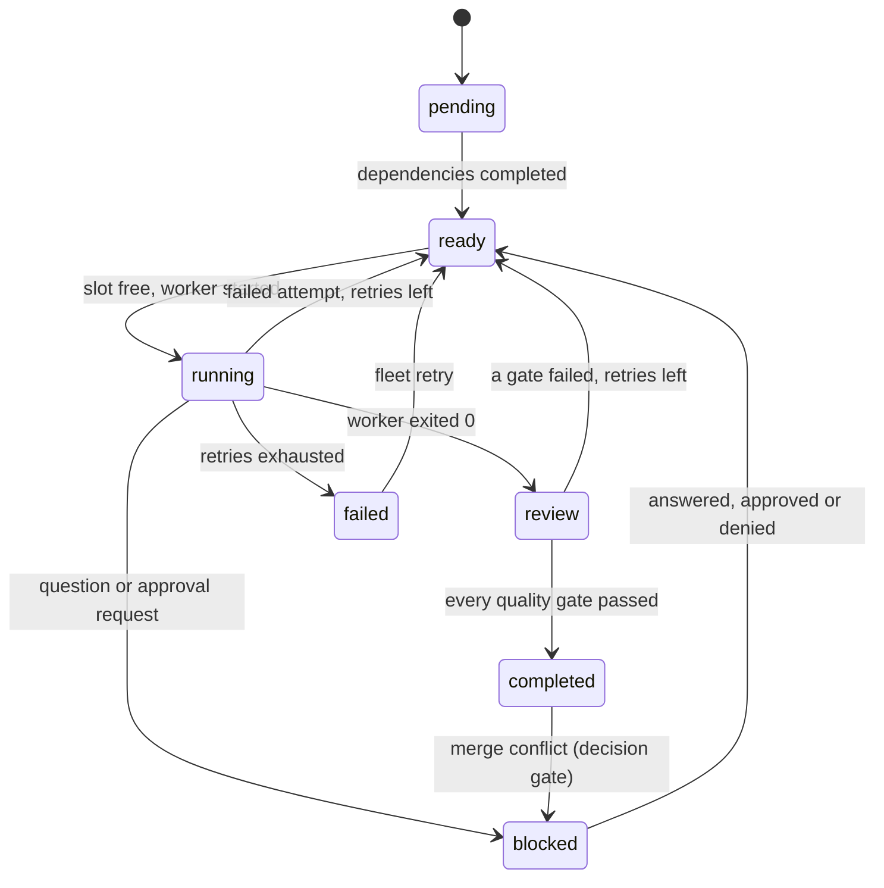

# agent-fleet

**Run many coding agents in parallel, each in its own git worktree and pty, with a task DAG, supervised
workers, decision gates, approvals and quality gates. One small, memory-bounded Rust binary: `fleet`.**

> An example project. It has **not been audited** and makes **no production claims**. It runs commands you
> configure with your user's permissions and does not sandbox them. Linux and macOS only (the macOS paths
> type-check but were not run). Read [SECURITY.md](SECURITY.md) before using it on anything you care about.

```text
fleet plan plan.toml  ->  fleet start  ->  one worker per ready task, in .fleet-worktrees/<run>/<task>
                                        ->  worker asks a question?   a person answers a decision gate
                                        ->  quality gates (exit code or refcheck-json) must pass
                                        ->  fleet merge <task>        an approval bound to the exact commit
                                        ->  merge --no-ff into fleet/<run>/integration
```

## What it does

- **Isolation.** Every task runs on its own branch `fleet/<run>/<task>` in its own git worktree under
  `<repo>/.fleet-worktrees/`, created from the run's base commit. Your checked-out branch, index and working tree
  are never touched. All git calls run with an empty environment and neutralized configuration (hooks, fsmonitor,
  filters, merge drivers, ssh and credential helpers cannot run planted code).
- **Any agent command.** A worker is a command from `fleet.toml` started in a pty with its own session and process
  group. Its environment is an explicit allowlist; the control socket and state directory are never visible to it.
- **A task DAG.** Dependencies, cycle rejection, a concurrency limit per run and globally, bounded automatic
  retries (a failed worker or a failed quality gate re-runs the task with the failure text added to its brief),
  and the work of finished dependencies is merged into a dependent's branch before it starts.
- **Humans stay in the loop.** A worker that is blocked writes `.fleet/question.json`; fleet opens a *decision gate*
  and resumes the task with your answer. Sensitive actions (merging, running a command a worker asked for) need an
  *approval* bound to a SHA-256 digest of the exact action, with an expiry, used once (an approved command is never run
  twice, not even across a daemon restart). Workers cannot create or grant approvals through the daemon's interfaces: the
  control socket needs a per-run token they never receive and refuses peers that are, or descend from, a worker or that
  cannot be identified. That is defence in depth, not a boundary against a hostile same-user process (see Limitations).
- **Quality gates.** Configured commands run in the worktree after the worker finishes. A task completes only when
  all pass. The `refcheck-json` format understands the report of the `refcheck` tool and fails on errors,
  unparseable output, the wrong shape or death by signal.
- **Supervised and recoverable.** Idle and total timeouts, TERM then KILL of the whole process group, pid-reuse
  protection (pid *and* start time are verified before any signal), and an append-only hash-chained event log:
  after a crash (or `kill -9`) the daemon replays the log, stops sessions that survived and re-queues their tasks.
- **Bounded memory.** Worker output goes through a streaming sanitizer and redactor into a fixed-size ring buffer;
  see [Memory](#memory) for measured numbers with flooding workers.
- **A dashboard and an interactive attach.** `fleet tui` shows runs, the DAG, sanitized live output, approvals and
  gates; `fleet attach` is a real interactive terminal into a worker with a detach key.
- **An optional local web dashboard.** `fleet daemon --web 127.0.0.1:0` serves the same views in a browser (runs and DAG,
  live output, the approval and gate queue, send input, merge, event log with chain status, health), behind a per-start
  token, a strict Host check, CSRF protection and a refusal of worker processes and of everything the daemon started
  (gates, approved commands, git). It is a hand-written HTTP server on `std::net`, loopback only unless you say
  otherwise, with no new dependency. Its credentials are defence in depth, not a boundary against code running as you. See
  [Web dashboard](#web-dashboard).

It does not make agents smarter and it does not sandbox them. See [Limitations](#limitations).

## Quick start

Requirements: git 2.39+, Rust 1.95 (pinned in `rust-toolchain.toml`), Linux or macOS.

```bash
cargo build --release            # produces target/release/fleet
mkdir -p ~/.local/state/agent-fleet
cp examples/fleet.example.toml ~/.local/state/agent-fleet/fleet.toml   # then edit [workers.agent]
target/release/fleet daemon      # foreground; stop it with `fleet shutdown` from another terminal
                                 # add --web 127.0.0.1:0 for the browser dashboard (prints a login URL once)
```

In another terminal:

```bash
fleet plan examples/plan.example.toml     # creates run r1 with the four tasks of the example DAG
fleet start --run r1 --max-parallel 2
fleet status                              # or: fleet tui
fleet gate list                           # questions the workers asked
fleet gate resolve g1 --answer axum
fleet merge api                           # exits 5 and names the approval you must give
fleet approve a1 && fleet merge api
```

`fleet daemon` reads `fleet.toml` once at start, from `--config` or from the state directory, never from a
repository (configuration names commands to run, so a repository's contents must not be able to change it).

## A real run

The whole run below was produced by [`scripts/demo.sh`](scripts/demo.sh) in a throwaway container with a fake HOME
and a fake repository. The agents are [scripted shell scripts](examples/agents/fake-agent.sh): `api` asks which HTTP
framework to use, and `release` writes a bad changelog on its first attempt so its quality gate fails and the task is
retried with the gate's complaint in its brief. Nothing was edited afterwards.

<details>
<summary>Full output (click to expand)</summary>

```text

$ /target/release/fleet plan /tmp/tmp.rlHRSVIR8Q/plan.toml
plan loaded into run r1 (4 tasks)

$ /target/release/fleet start --run r1 --max-parallel 2
run r1 started

$ /target/release/fleet status
daemon pid 21 | v0.1.0 | up 2s | sessions 0/4 | undo unavailable | rss 3744 kB

run r1 [active] max-parallel 2
  objective  Add a users table, an API and docs
  repo       /tmp/tmp.rlHRSVIR8Q/repo (base HEAD @ d3407e08)
  branch     fleet/r1/integration
  tasks      pending 1, ready 0, running 0, review 1, completed 1, failed 0, blocked 1
  ID       STATUS     DEPS      TRY  WORKER  NOTE
  schema   completed  -         1    -       added the users table
  api      blocked    schema    1    -       blocked: question g1 - Which HTTP framework should the API …
  docs     review     schema    1    -       wrote the docs
  release  pending    api,docs  0    -

waiting for you
gate g1 [question] r1/api: Which HTTP framework should the API use?
  choices: axum | actix

recent
  #15 r1/api ready
  #16 r1/docs ready
  #17 r1/api dispatched (attempt 1)
  #18 r1/docs dispatched (attempt 1)
  #19 r1/api session exited
  #20 gate g1 opened for r1/api
  #21 r1/api blocked (question)
  #22 r1/docs session exited
  #23 r1/docs in review
  #24 r1/docs committed

$ /target/release/fleet gate list
gate g1 [question] r1/api: Which HTTP framework should the API use?
  choices: axum | actix

$ /target/release/fleet gate resolve g1 --answer axum
gate g1 resolved

$ /target/release/fleet status
daemon pid 21 | v0.1.0 | up 6s | sessions 0/4 | undo unavailable | rss 3872 kB

run r1 [finished] max-parallel 2
  objective  Add a users table, an API and docs
  repo       /tmp/tmp.rlHRSVIR8Q/repo (base HEAD @ d3407e08)
  branch     fleet/r1/integration
  tasks      pending 0, ready 0, running 0, review 0, completed 4, failed 0, blocked 0
  ID       STATUS     DEPS      TRY  WORKER  NOTE
  schema   completed  -         1    -       added the users table
  api      completed  schema    2    -       built the API with axum
  docs     completed  schema    1    -       wrote the docs
  release  completed  api,docs  2    -       wrote the changelog

recent
  #40 r1/release committed
  #41 r1/release gate changelog failed
  #42 r1/release retry 1 queued
  #43 r1/release note added
  #44 r1/release dispatched (attempt 2)
  #45 r1/release session exited
  #46 r1/release in review
  #47 r1/release committed
  #48 r1/release gate changelog passed
  #49 r1/release completed

$ /target/release/fleet tail release
agent: starting release
agent: the gate complained, fixing the changelog
agent: finished release

$ /target/release/fleet merge schema
fleet: merging r1/schema needs approval a1 (digest 06fc129ce711); approve it with `fleet approve a1` and run the merge again
run: fleet approve a1

$ /target/release/fleet merge docs
fleet: merging r1/docs needs approval a2 (digest e81233c20988); approve it with `fleet approve a2` and run the merge again
run: fleet approve a2

$ /target/release/fleet merge api
fleet: merging r1/api needs approval a3 (digest b257e4bc36d0); approve it with `fleet approve a3` and run the merge again
run: fleet approve a3

$ /target/release/fleet merge release
fleet: merging r1/release needs approval a4 (digest 6d34035e6a10); approve it with `fleet approve a4` and run the merge again
run: fleet approve a4

$ /target/release/fleet approval list
approval a1 [merge] r1/schema pending digest 06fc129ce711
  git: "merge" "fleet/r1/integration" "fleet/r1/schema" "1a5f8b9929514c59c2260b2a5768a8db0374f3e5"
  decide: fleet approve a1 | fleet deny a1
approval a2 [merge] r1/docs pending digest e81233c20988
  git: "merge" "fleet/r1/integration" "fleet/r1/docs" "0c42491fa129095f028efa19836116fdbe4f9bec"
  decide: fleet approve a2 | fleet deny a2
approval a3 [merge] r1/api pending digest b257e4bc36d0
  git: "merge" "fleet/r1/integration" "fleet/r1/api" "09ac132d23f09e5077aea5430bd821ccf7625d93"
  decide: fleet approve a3 | fleet deny a3
approval a4 [merge] r1/release pending digest 6d34035e6a10
  git: "merge" "fleet/r1/integration" "fleet/r1/release" "74564da74758b3d5ff4fc5ef9d796407e90e7b6c"
  decide: fleet approve a4 | fleet deny a4

$ /target/release/fleet approve a1
approval a1 approved

$ /target/release/fleet approve a2
approval a2 approved

$ /target/release/fleet approve a3
approval a3 approved

$ /target/release/fleet approve a4
approval a4 approved

$ /target/release/fleet merge schema
merged r1/schema (fleet/r1/schema) into fleet/r1/integration at 1403c660262b

$ /target/release/fleet merge docs
merged r1/docs (fleet/r1/docs) into fleet/r1/integration at 694a4e9418c2

$ /target/release/fleet merge api
merged r1/api (fleet/r1/api) into fleet/r1/integration at efedd2c8bb7e

$ /target/release/fleet merge release
merged r1/release (fleet/r1/release) into fleet/r1/integration at 341343a10f24

$ git log --oneline --graph fleet/r1/integration
*   341343a fleet: merge release into fleet/r1/integration: Write the changelog
|\  
| * 74564da fleet: release - Write the changelog
| * 9b0ca70 fleet: release - Write the changelog
| *   27b2266 Merge branch 'refs/heads/fleet/r1/docs' into fleet/r1/release
| |\  
* | | efedd2c fleet: merge api into fleet/r1/integration: Build the users API
|\| | 
| * | 09ac132 fleet: api - Build the users API
* | |   694a4e9 fleet: merge docs into fleet/r1/integration: Document the schema
|\ \ \  
| | |/  
| |/|   
| * | 0c42491 fleet: docs - Document the schema
| |/  
* | 1403c66 fleet: merge schema into fleet/r1/integration: Create the users table
|\| 
| * 1a5f8b9 fleet: schema - Create the users table
|/  
* d3407e0 initial commit

$ git status --short   # the working tree and branch of the repository are untouched
main

$ /target/release/fleet status
daemon pid 21 | v0.1.0 | up 6s | sessions 0/4 | undo unavailable | rss 3872 kB

run r1 [finished] max-parallel 2
  objective  Add a users table, an API and docs
  repo       /tmp/tmp.rlHRSVIR8Q/repo (base HEAD @ d3407e08)
  branch     fleet/r1/integration
  tasks      pending 0, ready 0, running 0, review 0, completed 4, failed 0, blocked 0
  ID       STATUS     DEPS      TRY  WORKER  NOTE
  schema   completed  -         1    -       added the users table
  api      completed  schema    2    -       built the API with axum
  docs     completed  schema    1    -       wrote the docs
  release  completed  api,docs  2    -       wrote the changelog

recent
  #57 approval a4 approved
  #58 approval a1 consumed
  #59 run r1 integration branch created
  #60 r1/schema merged
  #61 approval a2 consumed
  #62 r1/docs merged
  #63 approval a3 consumed
  #64 r1/api merged
  #65 approval a4 consumed
  #66 r1/release merged

$ /target/release/fleet events --limit 12
#55 approval a2 approved
#56 approval a3 approved
#57 approval a4 approved
#58 approval a1 consumed
#59 run r1 integration branch created
#60 r1/schema merged
#61 approval a2 consumed
#62 r1/docs merged
#63 approval a3 consumed
#64 r1/api merged
#65 approval a4 consumed
#66 r1/release merged
```

</details>

What to notice: the question became gate `g1` and the task resumed after `gate resolve`; `release` shows `TRY 2`
because its quality gate failed once; every merge first returned exit 5 with an approval id and a digest of the
exact merge (including the commit being merged); the repository's own branch and working tree were untouched
(`git status --short` empty, branch still `main`).

## Concepts

| Term | Meaning |
| --- | --- |
| **Run** | One objective: a task DAG, a repository, a base commit and an integration branch. |
| **Task** | `pending` (waiting for dependencies), `ready`, `running`, `review` (gates pending), `completed`, `failed`, `blocked` (waiting for a person, a conflict resolution or a failed dependency). |
| **Worker** | A command from `fleet.toml` run in a pty for one attempt of a task. |
| **Decision gate** | A question a worker (or a merge conflict) puts to a person. `fleet gate list|resolve`. |
| **Approval** | A person's yes/no for one exact action, bound to a digest and an expiry. `fleet approve|deny`. |
| **Quality gate** | A configured command that must pass before a task completes. |

The full glossary, the layer diagram and the context map are in [docs/domain.md](docs/domain.md); the reasons for the
main design decisions are the short ADRs in [docs/adr](docs/adr).



## Commands

```text
fleet - run many coding agents in parallel, each in its own git worktree

usage: fleet [global options] <command> [options]

global options (before or after the command):
  --state-dir <dir>   state directory (default: $XDG_STATE_HOME/agent-fleet or ~/.local/state/agent-fleet)
  --json              print the daemon's reply (or the error) as one JSON document
  -h, --help          show this help
  -V, --version       show the version

daemon:
  daemon [--config <fleet.toml>] [--web <addr> [--web-allow-remote] [--web-print-login-url]]
                                     run the daemon in the foreground; --web serves the local
                                     dashboard (<ip>:<port>, <port> or <ip>; loopback only unless
                                     --web-allow-remote; the login URL is printed once, and only to
                                     a terminal unless --web-print-login-url)
  shutdown                           ask the daemon to stop
  doctor [--config <fleet.toml>]     check the setup (exit 13 when something fails)
  verify-log                         verify the event log's hash chain (exit 11 when tampered)

runs and tasks:
  run create --objective <text> --repo <path> [--base <ref>] [--id <id>] [--max-parallel N]
  task add --run <run> --title <text> [--spec <text>|-] [--after <task>]... [--worker <name>] [--id <id>]
                                     (--spec - reads the spec from stdin, at most 16 KiB)
  plan <file.toml|file.json> [--run <run>]
                                     load a whole task graph (with --run: into an existing run)
  start --run <run> [--max-parallel N]
  status [--run <run>]               runs, tasks, gates, approvals, recent events
  stop <task>                        stop the running worker
  retry <task>                       run a failed or stopped task again
  cancel <task>                      cancel a task that has not completed
  events [--limit N]                 recent audit events

working with a task (<task> is <run>/<task> or a unique task id):
  attach <task>                      interactive terminal session of the worker
  send <task> <text...> [--no-newline]
  tail <task> [--follow] [--lines N]

decisions:
  gate list                          open questions and conflicts
  gate resolve <id> --answer <text>  answer a gate (or give the answer as the rest of the line)
  approval list                      approvals and their digests
  approve <id> [--digest <hex>]      approve a pending action
  deny <id> [--digest <hex>]         deny it

results:
  merge <task>                       merge a reviewed task into the integration branch
  cleanup [--run <run>] [--branches] remove finished worktrees (and branches)
  undo <task> [--apply]              preview or revert the last worker changes (needs agent-undo)

dashboard:
  tui                                terminal dashboard

exit codes: 0 ok, 1 internal, 2 usage, 3 daemon down, 4 not found, 5 approval required,
6 conflict, 7 invalid, 8 limit, 9 unavailable, 10 forbidden, 11 tampered, 12 timeout, 13 unhealthy
```

Everything talks to the daemon over a Unix socket with bounded newline-delimited JSON. With `--json` every command
prints one document with a stable `schema` field (`fleet.status/1`, `fleet.gate.list/1`, `fleet.merge/1`, ...) or
`{"schema":"fleet.error/1","error":{"code","message","subject"}}`; the exit code is the same in both modes:

| Code | Name | Meaning |
| --- | --- | --- |
| 0 | ok | |
| 1 | internal | unexpected I/O, git or internal failure |
| 2 | usage | bad command line |
| 3 | daemon_down | nothing is listening on the socket (`fleet daemon` first) |
| 4 | not_found | unknown run, task, gate or approval |
| 5 | approval_required | a person must decide first (the error names the approval) |
| 6 | conflict | wrong state for the action, a merge conflict, a second daemon, an expired approval |
| 7 | invalid | validation failed: bad name, cycle, oversized text, digest mismatch |
| 8 | limit | a hard limit was reached |
| 9 | unavailable | an optional feature is missing (`agent-undo`) |
| 10 | forbidden | refused: wrong user, or a request from a worker process |
| 11 | tampered | the event log failed its integrity check |
| 12 | timeout | the daemon did not answer in time |
| 13 | unhealthy | `fleet doctor` found a failing check |

`fleet status --json` has the top-level keys `schema, daemon, now_ms, runs, gates, approvals, recent`; the key sets of
the status, error and doctor documents are pinned by end-to-end tests
([`e2e_cli.rs`](crates/fleet-cli/tests/e2e_cli.rs)).

## Configuration

`fleet.toml` (see [examples/fleet.example.toml](examples/fleet.example.toml); unknown keys are errors):

| Section / key | Meaning | Default |
| --- | --- | --- |
| `[daemon] max_sessions` | concurrent worker sessions across all runs (hard cap 64) | 8 |
| `default_worker` | worker used by tasks that name none | none |
| `max_retries` | automatic retries per task (worker failures and failed gates); questions and daemon restarts do not use them | 2 |
| `kill_grace_secs` | SIGTERM, then SIGKILL after this long | 5 |
| `approval_ttl_secs` | an approval expires if nobody uses it | 900 |
| `sensitive` | actions that always need an approval: `merge`, `external-command` | both |
| `external_timeout_secs`, `question_grace_secs` | limit for approved commands; how long a worker that wrote a question may keep running | 600, 2 |
| `author_name`, `author_email` | identity of commits fleet makes | `fleet` / `fleet@localhost` |
| `ring_bytes` | output kept per session (hard cap 4 MiB) | 262144 |
| `[env] allow` | variables copied from the daemon's environment to workers, gates, git and approved commands | `PATH HOME USER LOGNAME LANG LC_ALL LC_CTYPE TERM TZ TMPDIR` |
| `[redact] literals, env_values, [[redact.rules]]` | extra redaction: literal strings, values of secret-looking daemon variables, `prefix` + `charset` (`alnum|hex|base64|token`) + `min_len` rules | built-in key shapes + env values |
| `[workers.<name>]` | `command`, `args`, `env_pass`, `env_set`, `timeout_secs`, `idle_timeout_secs` | |
| `[[gates]]` | `name`, `command`, `args`, `env_pass`, `env_set`, `format` (`exit` or `refcheck-json`), `timeout_secs` | exit, 600 s |

Arguments are templates, never shell: `{brief}` (the brief, at most 16 KiB), `{task}`, `{run}`, `{worktree}` and
`{brief_file}` are replaced inside each argument, `{{` and `}}` are literal braces. A **plan file**
(`fleet plan file.toml|json`) names workers but cannot define commands; an optional `[run]` table creates the run.

### What a worker sees and may write

Environment: only the allowlist plus `FLEET_RUN`, `FLEET_TASK`, `FLEET_WORKTREE`, `FLEET_BRIEF_FILE` (and `SHELL`,
which the pty library always adds). Working directory: its own worktree. The brief is in `.fleet/brief.md` and also
offered as `{brief}`. Before it exits it may write, in `.fleet/`:

```json
{"version":1,"status":"done","summary":"what I did"}                                        // result.json (or "failed")
{"version":1,"kind":"question","text":"Which framework?","choices":["axum","actix"]}        // question.json: a decision gate
{"version":1,"kind":"approval","text":"why","action":{"command":"/usr/bin/publish","args":["--tag","x"]}}   // an approval request
```

These files are read with lstat + `O_NOFOLLOW|O_NONBLOCK` checks, size caps and schema validation. An approved
command is run by the *daemon*, exactly as approved, with the allowlisted environment; its result goes into the task's
next brief. Uncommitted changes are committed by fleet (never with hooks, `--no-verify`).

## Dashboard

`fleet tui` (keys: `j/k` move, `Tab` focus, `Enter` attach or answer, `a`/`d` approve or deny the selected approval,
`s` stop, `t` retry, `m` merge, `?` help). A real screen from the demo's status document, rendered into a headless
buffer by the example in [crates/fleet-cli/examples/tui_screenshot.rs](crates/fleet-cli/examples/tui_screenshot.rs)
(the same rendering code the terminal uses):

```text
fleet 0.1.0 | runs 1 | pend 1 rdy 0 run 1 rev 0 ok 1 fail 0 blk 1 | sess 1/4 | undo off | rss 3M
┌Tasks (4)───────────────────────────────────────┐┌Output r1/schema──────────────────────────────────────────┐
│  TASK       STATUS    DEPS     TITLE           ││Create the users table attempt 1                          │
│> r1/schema  completed -        Create the users││summary: added the users table                            │
│  r1/api     blocked   <schema  Build the users ││gate changelog pass exit code 0                           │
│  r1/docs    running   <schema  Document the sch││agent: starting schema                                    │
│  r1/release pending   <api,doc Write the change││agent: finished schema                                    │
│                                                ││                                                          │
│                                                ││                                                          │
│                                                ││                                                          │
│                                                ││                                                          │
│                                                ││                                                          │
│                                                ││                                                          │
│                                                ││                                                          │
│                                                ││                                                          │
│                                                ││                                                          │
│                                                ││                                                          │
│                                                ││                                                          │
│                                                ││                                                          │
│                                                ││                                                          │
└────────────────────────────────────────────────┘└──────────────────────────────────────────────────────────┘
┌Approvals (0)───────────────────────────────────────────────────┐┌Decisions (1)─────────────────────────────┐
│none pending                                                    ││> g1 r1/api Which HTTP framework should th│
│                                                                ││                                          │
│                                                                ││                                          │
│                                                                ││                                          │
│                                                                ││                                          │
└────────────────────────────────────────────────────────────────┘└──────────────────────────────────────────┘
q quit  j/k move  Tab focus  Enter attach/answer  a/d approve/deny  s stop  t retry  m merge  r refresh  ? hel
```

## Web dashboard

`fleet daemon --web <addr>` serves a browser dashboard from the daemon. It is **off by default**; `<addr>` is `<ip>:<port>`,
a bare `<port>` (on 127.0.0.1) or an `<ip>` (ephemeral port, so `--web 127.0.0.1:0` picks a free one). A non-loopback address is
refused unless `--web-allow-remote` is also given, and then a warning about the missing TLS is printed. The page offers:

- runs and a **DAG view** (tasks in columns by dependency depth, status badges, edges drawn as SVG), task detail with the
  quality-gate results;
- **live output** of a task (a server-sent event stream read with `fetch`, bounded chunks, a bounded 256 KiB view in the page)
  and a box to **send input** to the worker (no control characters);
- the **decision gates and approvals queue**: the exact action, every argument, the full digest and a countdown to the
  expiry, with Approve and Deny; the request carries the digest the page showed (it is mandatory), so an approval is still
  bound to it. A **merge** button asks the daemon to merge; the daemon answers `approval_required` exactly as `fleet merge`
  does and the operator approves in the queue first;
- the **event log** with its hash-chain verification status, and a **health panel** (the `fleet doctor` checks).

Starting runs, stopping or cancelling tasks, attaching and shutting the daemon down stay on the command line.

**Login and credentials.** The daemon prints the login URL once, and only when stderr is a terminal (otherwise it says why it did
not, and `--web-print-login-url` overrides that), so the token does not end up in a log file by accident:

```text
$ fleet daemon --config fleet.toml --web 127.0.0.1:0 --web-print-login-url
fleet daemon: pid 36 listening on …/state/agent-fleet/control/fleet.sock (stop with `fleet shutdown`)
fleet web: dashboard on http://127.0.0.1:45045/
fleet web: login URL (shown only now, valid until the daemon stops): http://127.0.0.1:45045/#token=<64 hex>
```

and, started with stderr redirected and without the flag:

```text
fleet daemon: pid 23 listening on …/state-quiet/agent-fleet/control/fleet.sock (stop with `fleet shutdown`)
fleet web: dashboard on http://127.0.0.1:36545/
fleet web: the login URL was not printed because stderr is not a terminal (it would be kept in whatever receives it); run the daemon in a terminal or add --web-print-login-url
```

The token sits in the URL *fragment*, which browsers never send to a server: the page POSTs it to `/api/login`, receives a
session id and a per-session CSRF token **in the reply body**, keeps them in the tab's `sessionStorage` and removes the token
from the address bar (`#token=<hex>&next=/run/r1` lands on a page). **No cookie is set or read**: a cookie is scoped to the
host, not the port, so the browser would send it to every other server on `127.0.0.1` (a dev server a worker started, say);
the session id travels in an `X-Fleet-Session` header that only this page sends, and event streams are read with `fetch`
because `EventSource` cannot send headers. Scripts can use the token as `Authorization: Bearer`.

**What this protects and what it does not.** The token, the session id and the control socket's token are defence in depth
against code of the same user, not a boundary: a process of yours that can read the daemon's memory, your terminal or your
browser can act as you. What fleet does refuse, on the control socket and on the web port alike (and before anything is acted
on): workers, quality gates, approved commands, git, the undo tool, everything they started and the process groups they still
occupy. A process that left all of those trees (`setsid`, `systemd-run --user`) looks like your own `curl`. There is no TLS.
Details and every limit: [SECURITY.md](SECURITY.md), [ADR 10](docs/adr/0010-web-dashboard-adapter.md).

### A real session

[`scripts/web-demo.sh`](scripts/web-demo.sh) ran the same scripted four-task DAG as the demo above, plus a second run with a
talkative worker, in the release binary in a throwaway container, and drove it with `curl` and a headless Chromium (the image
of [`docker/Dockerfile.web`](docker/Dockerfile.web)). The token and session id go to `curl` through header files, not the command
line. The output below is that script's output, with the repeated response headers and the long JSON lines cut (`...`); 64-character
hex strings (token, session id, digests) are shown as `<64 hex>`:

```text
$ # no credentials
HTTP/1.1 401 Unauthorized
{"error":{"code":"forbidden","message":"not logged in: open the login URL the daemon printed, or send the token as a bearer token","subject":null},"schema":"fleet.error/1"}

$ # a Host header that is not the daemon's address (DNS rebinding)
HTTP/1.1 421 Misdirected Request

$ # the page: static, hardened headers, no inline code
HTTP/1.1 200 OK
Content-Type: text/html; charset=utf-8
Connection: close
Content-Length: 1366
Content-Security-Policy: default-src 'none'; script-src 'self'; style-src 'self'; connect-src 'self'; img-src 'self' data:; frame-ancestors 'none'; base-uri 'none'; form-action 'self'
X-Content-Type-Options: nosniff
Referrer-Policy: no-referrer
Cache-Control: no-store
X-Frame-Options: DENY
...

$ # login: the page exchanges the fragment token for a session id (in the body: no cookie is ever set)
HTTP/1.1 200 OK
{"bind":"127.0.0.1:45045","csrf":"<64 hex>","schema":"fleet.web.session/1","session":"<64 hex>","version":"0.1.0"}
  Set-Cookie headers in the reply (must be 0): 0

$ # the session id as an old-style cookie is not a credential (cookies travel to every port of the host)
HTTP/1.1 401 Unauthorized

$ # a state-changing request without the CSRF token, then with a foreign Origin
HTTP/1.1 403 Forbidden
{"error":{"code":"forbidden","message":"the CSRF token is missing or wrong",...}
HTTP/1.1 403 Forbidden
{"error":{"code":"forbidden","message":"the Origin of this request is not the dashboard",...}

$ # the real page in headless Chromium (each run logs in with the fragment token, then the fragment is removed)
  [login] found: Add a users table, an API and docs
  [dag] found: Build the users API
  [decisions] found: Which HTTP framework

$ # the live output of a running task in the page: the stream is read with fetch and the session header
  [live] found: slow agent: starting slow
  [live] found: tick 1
  [live] found: tick 2
  [live] found: Streaming live output
  occurrences of the token in the rendered page (must be 0): 0

$ # merge from the web: refused until a person approves the exact action
HTTP/1.1 409 Conflict
{"error":{"code":"approval_required","message":"merging r1/schema needs approval a1 (digest a5b93c8c3eea); approve it with `fleet approve a1` and run the merge again","subject":"a1"},...}

$ # the approval as the page shows it (exact action and digest)
{"approvals":[{"args":["fleet/r1/integration","fleet/r1/schema","cf41816470297d4d36bab45f8a4453980dd351d3"],"command":"merge","digest":"<64 hex>","display":"git: \"merge\" \"fleet/r1/integration\" \"fleet/r1/schema\" \"cf41816470297d4d36bab45f8a4453980dd351d3\"",...,"purpose":"merge","status":"pending","task":"schema","tool":"git"}],...}

$ # approving with a wrong digest is refused, the right digest is accepted
HTTP/1.1 400 Bad Request
{"error":{"code":"invalid","message":"digest does not match approval a1: the action may have changed",...}
HTTP/1.1 200 OK
{"decision":"approved","digest":"<64 hex>","id":"a1","schema":"fleet.approval.decide/1"}
HTTP/1.1 200 OK
{"branch":"fleet/r1/schema","integration_branch":"fleet/r1/integration","merge_sha":"...","schema":"fleet.merge/1","task":"r1/schema"}

$ curl -H @.../bearer.hdr http://127.0.0.1:.../api/log
HTTP/1.1 200 OK
{"error":null,"head_hash":"<64 hex>","ok":true,"records":59,"schema":"fleet.web.log/1"}

$ # the task output through the stream endpoint (server-sent events, authenticated by the session header)
id: 0
event: output
data: {"lost":false,"next":0,"text":"agent: starting docs\nagent: finished docs\n"}

event: end
data: {"reason":"the worker has finished"}

$ # logging out ends the session: the same id is refused afterwards
HTTP/1.1 200 OK
HTTP/1.1 401 Unauthorized
```

Three screenshots taken by that Chromium (1200 px wide, headless, in the container) in the same run: the DAG of `r1` while `api`
waits for an answer, the approval queue with the pending merge approval, and the task page of a running worker with its live output:


### What was and was not verified

- **Protocol level, over real sockets:** [`web_http.rs`](crates/fleet-infra/tests/web_http.rs) (40 tests: authentication, per-client
  lockout, Host, Origin, `Sec-Fetch-Site`, CSRF, header sessions and the rejected old-style cookie, strict JSON, control characters
  in input, malformed and oversized requests, a trickling client and an idle one, the connection cap, event-stream bounds and
  their end with the session, shutdown) and [`e2e_web.rs`](crates/fleet-cli/tests/e2e_web.rs) (12 tests against the real daemon:
  login, the gate/approval/merge flow, live output and input, the token absent from every worker-visible place and from disk,
  a worker, a quality-gate child and a descendant of an approved command that were all handed the token and are all still
  refused on the web port and on the socket, the flag policy, the quiet start, shutdown, hostile text, health and tamper
  detection). Without the new origin rule the gate and approved-command tests fail (an approved command's script logs in
  with HTTP 200), which was checked by switching the rule off.
- **The page script** is checked three ways: a source scan test that fails on `innerHTML`, `EventSource`, cookies and their
  relatives, a node script ([`scripts/web-smoke.mjs`](scripts/web-smoke.mjs), 252 checks against a hand-written fake DOM, hostile
  strings and a frame-splitting stream reader included) and the headless Chromium run above, which loaded the real page, logged in
  through the fragment, and found the expected text in the rendered DOM and in the screenshots. The live page was in its
  "Streaming live output" state with two ticks; the check does not distinguish what came from the first read and what from the stream.
- **Not done:** no desktop browser (Chrome, Firefox, Safari) was used, no hostile payload was driven through the real page in
  Chromium (the hostile-text evidence is the JSON, the source scan and the fake DOM), the send-input form and the Approve/Deny
  buttons were exercised only against the fake DOM (their requests are tested at the protocol level), accessibility and touch
  layouts were not examined, and the macOS admission path (`lsof`) was type-checked only. There is no TLS; loopback or an SSH
  tunnel only. A one-time login code (which would make a captured URL expire) was considered and not built.

## Architecture

Domain-driven layers in a cargo workspace; the compiler enforces the dependency rule and an architecture test checks
the manifests.

| Crate | Layer | Depends on |
| --- | --- | --- |
| `fleet-domain` | pure rules: runs/tasks (aggregate), decision gates, approvals, quality judgement, supervision rules, sanitizer, redactor, output buffer, events, hash chain | `std` only |
| `fleet-app` | use cases (`Orchestrator`), commands, read models, port traits, in-memory fakes and port contract suites | `fleet-domain` |
| `fleet-infra` | adapters: git, ptys, files, event log, job runner, sockets, TOML, the web dashboard (hand-written HTTP on `std::net`), daemon wiring | app, domain |
| `fleet-cli` | the `fleet` binary: argument parsing, rendering, dashboard, attach | all |

State is event-sourced: every change is a domain event, appended to a hash-chained log before it is applied;
a restart replays the log. Time, hashing and ids reach the domain only through arguments and small traits, so the
domain performs no I/O. See [docs/domain.md](docs/domain.md) and [docs/adr](docs/adr).

For how this compares with the public feature list of a similar tool, and the roadmap with acceptance criteria for
later phases, see [docs/parity.md](docs/parity.md).

## Tests

1163 tests, all passing in the final run (fresh cargo volumes, offline after one `cargo fetch --locked`):

| Layer | What is tested | Tests |
| --- | --- | --- |
| Domain | pure unit tests of ids, DAG, runs/tasks, decision gates, approvals (consume-once, expiry, digest binding), quality judgement (`refcheck-json` edge cases), supervision, the origin rules and kill escalation, contract validation, sanitizer, redactor, output ring, events, hash chain, brief quoting, environment policy | 250 |
| Application | the orchestrator driven through commands with in-memory fakes for all ports: lifecycle, supervision and timeouts, decisions and approvals (never run twice across a restart), merging and conflicts, recovery and orphan reconciliation, quality gates, hostile text in every document the dashboard serves (19 tests); plus the port contract suites against the fakes | 247 |
| Adapters | every real adapter in temp dirs (git hardening with planted hooks/filters/drivers, merge-by-approved-commit, symlink/FIFO/oversize worker files, pty sessions and the input queue, process identity, hash-chained log, sockets with token and fail-closed admission, redaction of gate and command output, agent-undo path rules, config, the doctor checks) and the same contract suites against the real file adapters; the web adapter: HTTP parsing limits, tokens and sessions, TCP peer lookup, Host/Origin/CSRF/rate limits, strict JSON, slowloris, connection and stream caps, event streams and shutdown over real loopback sockets (unit tests of the parser, sessions, lockout and peer lookup, and 40 socket tests); the origin rule for gates and approved commands and the process-group registry | 447 |
| Soak | bounded memory with flooding workers, the dashboard on and a connected event stream | 1 |
| End to end | the real binary and daemon (flow, crash recovery, tampering, security incl. a worker that tries to approve, CLI, JSON schemas, exit codes), dashboard rendering on a headless backend, architecture rules (including: no HTTP, async or TLS crate anywhere, the inner layers know nothing of the web adapter), and the web dashboard against the real daemon (12 tests) | 218 |

Run them layer by layer inside the development container (see [Development](#development)):
`scripts/test-layers.sh`. All tests run without network access, in temp directories, with std's test harness only;
the git and pty behaviour is tested against real git and real ptys, and the end-to-end tests drive the real binary.

### Coverage

Measured for real with rustc's source-based instrumentation (`-C instrument-coverage`) and `llvm-profdata`/`llvm-cov`
from the official `llvm-tools` component (`scripts/coverage.sh`, no third-party coverage crate). It counts library and
binary code, excluding the unit-test modules inside source files, `tests/`, examples, the in-memory fakes and test
helpers:

```text
layer               lines  covered  percent
domain               3384     3272    96.7%
application          1845     1726    93.6%
infrastructure       5166     4756    92.1%
cli                  2199     1939    88.2%
overall             12594    11693    92.8%
```

Targets were domain ≥ 95 %, application ≥ 90 %, overall ≥ 85 %. Honest gaps: the event loop of the terminal dashboard
(`tui/mod.rs`, about a quarter covered) and the interactive part of `attach.rs` need a real tty and are not exercised
by the automated tests (their pure parts, the model, key handling, rendering and input scanning, are); the recovery
tests kill the daemon with SIGKILL, which writes no coverage profile, so the crash paths count as covered only through
the application-layer tests of the same logic. The doctor checks moved from `fleet-cli` to `fleet-infra` in phase 2, so
the infrastructure and cli lines moved with them.

## Memory

`crates/fleet-infra/tests/soak.rs` runs the daemon in the test process with 8 workers that print as fast as their
terminals allow (output with escape sequences, a bidi override and a token-shaped string, so sanitizing and redaction
run on every byte) and samples the process's resident memory from `/proc/self/statm` every 500 ms. Each session's ring
buffer is capped (64 KiB in the test). A 120 second run in release mode, in the Linux container:

```text
soak: 8 workers x 120s, 6051 MiB of terminal output (50 MiB/s), rss start 4760 kB, steady min 6656 kB / max 7524 kB / first 6920 kB, growth after warm-up 604 kB, 232 samples
soak web: sse client 141658374 bytes, 8501 output events (per third [2734, 2311, 3456]), 40 reconnects, 0 refused, max 1 open stream(s); 221 status polls (0 failed); rss start 4760 kB, steady min 6656 kB / max 7524 kB, growth after warm-up 604 kB
test result: ok. 1 passed; 0 failed; 0 ignored; 0 measured; 0 filtered out; finished in 121.60s
```

Since phase 2 the soak runs the daemon **with the web dashboard on**: one client holds an event stream (`/api/stream`) of a
flooding task for the whole run (reconnecting with `Last-Event-ID` when the server ends the stream at its limits and
counting bytes only, so the client keeps no buffer), and a second polls `/api/status` every 500 ms. Memory is flat after
the buffers fill: it did not grow with the volume of output (about 6 GiB went through the daemon, 142 MB of it through the
event stream), and the growth after warm-up (604 kB) is within the 4 MiB the test allows. Across all 120 second runs with the
dashboard on that were made during phase 2 (six, before and after the later changes) the growth was 428 to 668 kB; the
throughput ranged from 26 to 184 MiB/s on a machine that was shared with other containers, so no throughput comparison is
claimed (the earlier run without the dashboard measured 271 MiB/s). By default the test runs 20 seconds;
`FLEET_SOAK_SECS=120 cargo test --release -p fleet-infra --test soak -- --nocapture` reproduces the numbers above
(your throughput will differ). Bounds elsewhere: messages 64 KiB, frames 32 KiB, files read from workers 64 KiB,
gate output 4 MiB, event log 64 MiB, at most 64 sessions, 64 runs, 1024 tasks, 64 connections.

## Limitations

- Workers are not sandboxed: they run as you. fleet limits what they share and what they can make the daemon do.
- The control plane (per-run token, fail-closed peer admission, hidden default state directory) keeps workers off the
  socket in practice, but a worker is the same user: it can read `/proc` and the token file, detach from its process
  tree and connect as a plain process of yours. Run workers under another user, in a container or in a VM for a hard
  guarantee. Approvals bind what *fleet* runs (the merge commit; an absolute command path and its arguments), not what
  a worker does on its own, and an approved command runs in the worker's worktree, so approve only commands that do not
  execute files from their working directory.
- Redaction is pattern based and covers terminal, gate and command output and worker-written summaries and questions;
  the audit log is tamper evident, not tamper proof (deleting both log files erases history).
- Some git work (committing a worker's output, merges) runs synchronously on the engine thread; a pathological worktree
  can stall supervision for up to the git timeout. Workers have no CPU, memory, process or disk limits.
- SIGINT/SIGTERM are not handled (that needs `unsafe` or another dependency): they stop the daemon at once and the next
  start reconciles. `fleet shutdown` is the graceful way.
- The web dashboard has no TLS and is meant for loopback or an SSH tunnel. Its token and sessions, like the control socket's
  token, are defence in depth against same-user code, not a boundary: a process that can read the daemon's memory, the terminal
  scrollback, the browser or `/proc/<daemon>/fd/2` (where you redirected stderr) can take the token. The token lives until the
  daemon stops (no one-time code). Five wrong tokens lock bearer and login attempts of that client for a minute (live sessions
  keep working); a local process that passes admission can still keep connection slots busy for short periods (see SECURITY.md).
- macOS: the code type-checks for `aarch64-apple-darwin` but was **not run**; pty, peer-credential, `ps`-based
  process-identity and the `lsof`-based dashboard admission behaviour there is unverified. Windows is not supported.
- Not verified here: real coding agents (only scripted ones), very large repositories, concurrent daemons on
  network file systems, and any adversary that can already run code as your user.

The full list, the threat model and the dependency policy are in [SECURITY.md](SECURITY.md).

## Secrets and hooks

Never commit `.env` files, keys or tokens: `.gitignore` blocks the usual secret file names (`.env`, `.env.*` except
`.env.example`/`.env.sample`, `*.pem`, `*.key`, `id_rsa*`, `.netrc`, `credentials.json`, `*.tfstate`, ...). A dependency-free
scanner, [`scripts/secret-scan.sh`](scripts/secret-scan.sh), backs this up:

- `--staged` scans the lines about to be committed (the pre-commit hook), `--tree` scans every tracked file (pre-push and
  CI), `--history` scans the added lines of every reachable commit (CI).
- It flags private-key blocks, cloud and Git hosting tokens, JWTs, passwords in URLs, quoted secret assignments and forbidden
  file names. A finding prints the file, line number and rule name, never the value.
- A reviewed, known-safe fixture goes into [`.secret-scan-allow`](.secret-scan-allow) as `<path> <rule>  # reason` (one entry
  each), or carries the marker `secret-scan: allow` on its line. This repository has two entries: the PEM marker lines that
  the redactor's tests use (placeholder bodies, no key material).

Install the hooks once per clone with [lefthook](https://github.com/evilmartians/lefthook): `lefthook install`
(configuration in [`lefthook.yml`](lefthook.yml)). CI runs the same scanner in a separate `secret-scan` job.

If a secret is ever committed, **rotate it first** (treat it as compromised, whether or not the commit was pushed), then
remove it from the tree and rewrite the history if it was not published.

## Verification

What was run for this repository, all inside containers (the official Rust 1.95 image pinned by digest plus git, with
dependencies fetched once and everything else offline): `cargo fmt --check`, `cargo clippy --all-targets -- -D
warnings`, the test suites above, the release build, the 120 second soak (with the dashboard and an event stream),
`scripts/demo.sh`, `scripts/web-demo.sh` (curl and headless Chromium in the `docker/Dockerfile.web` image),
`node scripts/web-smoke.mjs` (167 checks) and `check-crates-age` (every locked crate version published on or before 2026-10-24: 0 too new). A secret scan of the
working tree and the whole git history (key shapes, private-key headers, long hex/base64 strings, absolute home paths)
found no keys or secrets: the only hits are PEM header lines used as redaction-test fixtures (header and a fake body, no key material), `Cargo.lock` checksums and fake `/home/...` paths in tests.

## Development

Build and test without installing a toolchain: build the development image once, then run commands in a throwaway
container with the repository mounted (the cargo registry and target directory live in docker volumes):

```bash
docker build -f docker/Dockerfile.dev -t fleet-dev docker/
docker volume create fleet-cargo; docker volume create fleet-target
docker run --rm -u 0 -v fleet-cargo:/cargo -v fleet-target:/target fleet-dev chown "$(id -u):$(id -g)" /cargo /target
run() { docker run --rm --user "$(id -u):$(id -g)" -v "$PWD:/work" -v fleet-cargo:/cargo -v fleet-target:/target -w /work \
  -e HOME=/tmp/home -e CARGO_HOME=/cargo -e CARGO_TARGET_DIR=/target ${DOCKER_NET:+--network=$DOCKER_NET} ${IMAGE:-fleet-dev} sh -c "$*"; }
run 'cargo fetch --locked'                       # needs network, once
DOCKER_NET=none run 'cargo fmt --all -- --check && cargo clippy --workspace --all-targets --locked --offline -- -D warnings'
DOCKER_NET=none run 'scripts/test-layers.sh'     # layered suites
DOCKER_NET=none run 'scripts/coverage.sh'        # coverage per layer
DOCKER_NET=none run 'cargo build --release --locked --offline && scripts/demo.sh /target/release/fleet'
# the web dashboard: an image with curl and headless Chromium on top of fleet-dev
docker build -f docker/Dockerfile.web -t fleet-web docker/
IMAGE=fleet-web DOCKER_NET=none run 'cargo build --release --locked --offline && scripts/web-demo.sh /target/release/fleet'
node scripts/web-smoke.mjs   # any node 22 or newer on the host or in a container; no npm packages
```

Layout: `crates/fleet-domain`, `crates/fleet-app`, `crates/fleet-infra`, `crates/fleet-cli`, `docs/`,
`examples/`, `scripts/`, `docker/`.

## License

MIT, see [LICENSE](LICENSE). Copyright (c) 2026 Kien Phan.
