# agent-fleet

**Run many coding agents in parallel, each in its own git worktree and pty, with a task DAG, supervised
workers, decision gates, approvals and quality gates. One small, memory-bounded Rust binary: `fleet`.**

> An example project. It has **not been audited** and makes **no production claims**. It runs commands you
> configure with your user's permissions and does not sandbox them. Linux and macOS only (the macOS paths
> type-check but were not run). Read [SECURITY.md](SECURITY.md) before using it on anything you care about.

```text
fleet plan plan.toml  ->  fleet start  ->  one worker per ready task, in .fleet-worktrees/<run>/<task>
                                        ->  worker asks a question?   a person answers a decision gate
                                        ->  quality gates (exit code or refcheck-json) must pass
                                        ->  fleet merge <task>        an approval bound to the exact commit
                                        ->  merge --no-ff into fleet/<run>/integration
```

## What it does

- **Isolation.** Every task runs on its own branch `fleet/<run>/<task>` in its own git worktree under
  `<repo>/.fleet-worktrees/`, created from the run's base commit. Your checked-out branch, index and working tree
  are never touched. All git calls run with an empty environment and neutralized configuration (hooks, fsmonitor,
  filters, merge drivers, ssh and credential helpers cannot run planted code).
- **Any agent command.** A worker is a command from `fleet.toml` started in a pty with its own session and process
  group. Its environment is an explicit allowlist; the control socket and state directory are never visible to it.
- **A task DAG.** Dependencies, cycle rejection, a concurrency limit per run and globally, bounded automatic
  retries (a failed worker or a failed quality gate re-runs the task with the failure text added to its brief),
  and the work of finished dependencies is merged into a dependent's branch before it starts.
- **Humans stay in the loop.** A worker that is blocked writes `.fleet/question.json`; fleet opens a *decision gate*
  and resumes the task with your answer. Sensitive actions (merging, running a command a worker asked for) need an
  *approval* bound to a SHA-256 digest of the exact action, with an expiry, used once (an approved command is never run
  twice, not even across a daemon restart). Workers cannot create or grant approvals through the daemon's interfaces: the
  control socket needs a per-run token they never receive and refuses peers that are, or descend from, a worker or that
  cannot be identified. That is defence in depth, not a boundary against a hostile same-user process (see Limitations).
- **Quality gates.** Configured commands run in the worktree after the worker finishes. A task completes only when
  all pass. The `refcheck-json` format understands the report of the `refcheck` tool and fails on errors,
  unparseable output, the wrong shape or death by signal.
- **Goals and proof of work (NEO N1).** A goal ledger records what the objective is and what is left; a goal can carry
  a *verification contract* (commands, `refcheck-json`, file assertions, a diff constraint) that fleet runs itself,
  independently of the worker, on an export of the task's recorded commit (a fresh directory outside the
  state directory; the worktree itself is never run). A task such a goal names completes only after that run passed;
  what an agent reports is shown as `unverified` until there is evidence. See [NEO N1](#neo-n1-goals-and-verification).
- **Supervised and recoverable.** Idle and total timeouts, TERM then KILL of the whole process group, pid-reuse
  protection (pid *and* start time are verified before any signal), and an append-only hash-chained event log:
  after a crash (or `kill -9`) the daemon replays the log, stops sessions that survived and re-queues their tasks.
- **Bounded memory.** Worker output goes through a streaming sanitizer and redactor into a fixed-size ring buffer;
  see [Memory](#memory) for measured numbers with flooding workers.
- **A dashboard and an interactive attach.** `fleet tui` shows runs, the DAG, sanitized live output, approvals and
  gates; `fleet attach` is a real interactive terminal into a worker with a detach key.
- **An optional local web dashboard.** `fleet daemon --web 127.0.0.1:0` serves the same views in a browser (runs and DAG,
  live output, the approval and gate queue, send input, merge, event log with chain status, health), behind a per-start
  token, a strict Host check, CSRF protection and a refusal of worker processes and of everything the daemon started
  (gates, approved commands, git). It is a hand-written HTTP server on `std::net`, loopback only unless you say
  otherwise, with no new dependency. Its credentials are defence in depth, not a boundary against code running as you. See
  [Web dashboard](#web-dashboard).
- **Remote worktrees over SSH.** A task can name a host (`task add --host build`): its worker then runs on that machine,
  in a terminal that is a local `ssh -tt` process, so the output is sanitized, bounded and redacted like any worker's.
  Host keys are pinned by an explicit step (`fleet host trust`, with a fingerprint and a terminal), ssh runs with a fixed
  argument list (no agent, no forwarding, one key, one known_hosts file), the remote environment holds only values you wrote,
  and what the host sends back (a git bundle) is verified in a quarantine ref before one local commit is made from its tree.
  Quality gates and verification contracts always run locally on that commit. See [SSH remote worktrees](#ssh-remote-worktrees).

It does not make agents smarter and it does not sandbox them. See [Limitations](#limitations).

## Quick start

Requirements: git 2.39+, Rust 1.95 (pinned in `rust-toolchain.toml`), Linux or macOS.

```bash
cargo build --release            # produces target/release/fleet
mkdir -p ~/.local/state/agent-fleet
cp examples/fleet.example.toml ~/.local/state/agent-fleet/fleet.toml   # then edit [workers.agent]
target/release/fleet daemon      # foreground; stop it with `fleet shutdown` from another terminal
                                 # add --web 127.0.0.1:0 for the browser dashboard (prints a login URL once)
```

In another terminal:

```bash
fleet plan examples/plan.example.toml     # creates run r1 with the four tasks of the example DAG
fleet start --run r1 --max-parallel 2
fleet status                              # or: fleet tui
fleet gate list                           # questions the workers asked
fleet gate resolve g1 --answer axum
fleet merge api                           # exits 5 and names the approval you must give
fleet approve a1 && fleet merge api
```

`fleet daemon` reads `fleet.toml` once at start, from `--config` or from the state directory, never from a
repository (configuration names commands to run, so a repository's contents must not be able to change it).

## A real run

The whole run below was produced by [`scripts/demo.sh`](scripts/demo.sh) in a throwaway container with a fake HOME
and a fake repository. The agents are [scripted shell scripts](examples/agents/fake-agent.sh): `api` asks which HTTP
framework to use, and `release` writes a bad changelog on its first attempt so its quality gate fails and the task is
retried with the gate's complaint in its brief. Nothing was edited afterwards.

<details>
<summary>Full output (click to expand)</summary>

```text

$ /target/release/fleet plan /tmp/tmp.rlHRSVIR8Q/plan.toml
plan loaded into run r1 (4 tasks)

$ /target/release/fleet start --run r1 --max-parallel 2
run r1 started

$ /target/release/fleet status
daemon pid 21 | v0.1.0 | up 2s | sessions 0/4 | undo unavailable | rss 3744 kB

run r1 [active] max-parallel 2
  objective  Add a users table, an API and docs
  repo       /tmp/tmp.rlHRSVIR8Q/repo (base HEAD @ d3407e08)
  branch     fleet/r1/integration
  tasks      pending 1, ready 0, running 0, review 1, completed 1, failed 0, blocked 1
  ID       STATUS     DEPS      TRY  WORKER  NOTE
  schema   completed  -         1    -       added the users table
  api      blocked    schema    1    -       blocked: question g1 - Which HTTP framework should the API …
  docs     review     schema    1    -       wrote the docs
  release  pending    api,docs  0    -

waiting for you
gate g1 [question] r1/api: Which HTTP framework should the API use?
  choices: axum | actix

recent
  #15 r1/api ready
  #16 r1/docs ready
  #17 r1/api dispatched (attempt 1)
  #18 r1/docs dispatched (attempt 1)
  #19 r1/api session exited
  #20 gate g1 opened for r1/api
  #21 r1/api blocked (question)
  #22 r1/docs session exited
  #23 r1/docs in review
  #24 r1/docs committed

$ /target/release/fleet gate list
gate g1 [question] r1/api: Which HTTP framework should the API use?
  choices: axum | actix

$ /target/release/fleet gate resolve g1 --answer axum
gate g1 resolved

$ /target/release/fleet status
daemon pid 21 | v0.1.0 | up 6s | sessions 0/4 | undo unavailable | rss 3872 kB

run r1 [finished] max-parallel 2
  objective  Add a users table, an API and docs
  repo       /tmp/tmp.rlHRSVIR8Q/repo (base HEAD @ d3407e08)
  branch     fleet/r1/integration
  tasks      pending 0, ready 0, running 0, review 0, completed 4, failed 0, blocked 0
  ID       STATUS     DEPS      TRY  WORKER  NOTE
  schema   completed  -         1    -       added the users table
  api      completed  schema    2    -       built the API with axum
  docs     completed  schema    1    -       wrote the docs
  release  completed  api,docs  2    -       wrote the changelog

recent
  #40 r1/release committed
  #41 r1/release gate changelog failed
  #42 r1/release retry 1 queued
  #43 r1/release note added
  #44 r1/release dispatched (attempt 2)
  #45 r1/release session exited
  #46 r1/release in review
  #47 r1/release committed
  #48 r1/release gate changelog passed
  #49 r1/release completed

$ /target/release/fleet tail release
agent: starting release
agent: the gate complained, fixing the changelog
agent: finished release

$ /target/release/fleet merge schema
fleet: merging r1/schema needs approval a1 (digest 06fc129ce711); approve it with `fleet approve a1` and run the merge again
run: fleet approve a1

$ /target/release/fleet merge docs
fleet: merging r1/docs needs approval a2 (digest e81233c20988); approve it with `fleet approve a2` and run the merge again
run: fleet approve a2

$ /target/release/fleet merge api
fleet: merging r1/api needs approval a3 (digest b257e4bc36d0); approve it with `fleet approve a3` and run the merge again
run: fleet approve a3

$ /target/release/fleet merge release
fleet: merging r1/release needs approval a4 (digest 6d34035e6a10); approve it with `fleet approve a4` and run the merge again
run: fleet approve a4

$ /target/release/fleet approval list
approval a1 [merge] r1/schema pending digest 06fc129ce711
  git: "merge" "fleet/r1/integration" "fleet/r1/schema" "1a5f8b9929514c59c2260b2a5768a8db0374f3e5"
  decide: fleet approve a1 | fleet deny a1
approval a2 [merge] r1/docs pending digest e81233c20988
  git: "merge" "fleet/r1/integration" "fleet/r1/docs" "0c42491fa129095f028efa19836116fdbe4f9bec"
  decide: fleet approve a2 | fleet deny a2
approval a3 [merge] r1/api pending digest b257e4bc36d0
  git: "merge" "fleet/r1/integration" "fleet/r1/api" "09ac132d23f09e5077aea5430bd821ccf7625d93"
  decide: fleet approve a3 | fleet deny a3
approval a4 [merge] r1/release pending digest 6d34035e6a10
  git: "merge" "fleet/r1/integration" "fleet/r1/release" "74564da74758b3d5ff4fc5ef9d796407e90e7b6c"
  decide: fleet approve a4 | fleet deny a4

$ /target/release/fleet approve a1
approval a1 approved

$ /target/release/fleet approve a2
approval a2 approved

$ /target/release/fleet approve a3
approval a3 approved

$ /target/release/fleet approve a4
approval a4 approved

$ /target/release/fleet merge schema
merged r1/schema (fleet/r1/schema) into fleet/r1/integration at 1403c660262b

$ /target/release/fleet merge docs
merged r1/docs (fleet/r1/docs) into fleet/r1/integration at 694a4e9418c2

$ /target/release/fleet merge api
merged r1/api (fleet/r1/api) into fleet/r1/integration at efedd2c8bb7e

$ /target/release/fleet merge release
merged r1/release (fleet/r1/release) into fleet/r1/integration at 341343a10f24

$ git log --oneline --graph fleet/r1/integration
*   341343a fleet: merge release into fleet/r1/integration: Write the changelog
|\  
| * 74564da fleet: release - Write the changelog
| * 9b0ca70 fleet: release - Write the changelog
| *   27b2266 Merge branch 'refs/heads/fleet/r1/docs' into fleet/r1/release
| |\  
* | | efedd2c fleet: merge api into fleet/r1/integration: Build the users API
|\| | 
| * | 09ac132 fleet: api - Build the users API
* | |   694a4e9 fleet: merge docs into fleet/r1/integration: Document the schema
|\ \ \  
| | |/  
| |/|   
| * | 0c42491 fleet: docs - Document the schema
| |/  
* | 1403c66 fleet: merge schema into fleet/r1/integration: Create the users table
|\| 
| * 1a5f8b9 fleet: schema - Create the users table
|/  
* d3407e0 initial commit

$ git status --short   # the working tree and branch of the repository are untouched
main

$ /target/release/fleet status
daemon pid 21 | v0.1.0 | up 6s | sessions 0/4 | undo unavailable | rss 3872 kB

run r1 [finished] max-parallel 2
  objective  Add a users table, an API and docs
  repo       /tmp/tmp.rlHRSVIR8Q/repo (base HEAD @ d3407e08)
  branch     fleet/r1/integration
  tasks      pending 0, ready 0, running 0, review 0, completed 4, failed 0, blocked 0
  ID       STATUS     DEPS      TRY  WORKER  NOTE
  schema   completed  -         1    -       added the users table
  api      completed  schema    2    -       built the API with axum
  docs     completed  schema    1    -       wrote the docs
  release  completed  api,docs  2    -       wrote the changelog

recent
  #57 approval a4 approved
  #58 approval a1 consumed
  #59 run r1 integration branch created
  #60 r1/schema merged
  #61 approval a2 consumed
  #62 r1/docs merged
  #63 approval a3 consumed
  #64 r1/api merged
  #65 approval a4 consumed
  #66 r1/release merged

$ /target/release/fleet events --limit 12
#55 approval a2 approved
#56 approval a3 approved
#57 approval a4 approved
#58 approval a1 consumed
#59 run r1 integration branch created
#60 r1/schema merged
#61 approval a2 consumed
#62 r1/docs merged
#63 approval a3 consumed
#64 r1/api merged
#65 approval a4 consumed
#66 r1/release merged
```

</details>

What to notice: the question became gate `g1` and the task resumed after `gate resolve`; `release` shows `TRY 2`
because its quality gate failed once; every merge first returned exit 5 with an approval id and a digest of the
exact merge (including the commit being merged); the repository's own branch and working tree were untouched
(`git status --short` empty, branch still `main`).

## NEO N1: goals and verification

NEO is a planned layer above the orchestrator (goal ledger, context compiler, knowledge store, token governor,
credential broker). **Only milestone N1 exists**: the goal ledger and verification contracts; see
[docs/neo.md](docs/neo.md) for what it does, the contract format and what is not there.

```text
fleet goals add --title <text> [--id <id>] [--parent <goal>] [--task <run>/<task>]... [--contract <file.json>]
fleet goals attach | status | list | show | remaining          (all with --json)
fleet verify <goal|task>                                         run the contracts now, record evidence
```

The output below was produced by [`scripts/neo-demo.sh`](scripts/neo-demo.sh) in a throwaway container with a fake HOME
and a fake repository. The agent is a [scripted shell script](examples/agents/neo-agent.sh) that reports `done` on every
attempt; its first attempt writes the wrong answer. The [contract](examples/neo/contract.json) has three mandatory
checks (the file says `ready`, a command, the work touches only `answer.txt`). Fleet runs it itself after the worker
finished, on a clean export of the committed work (not in the worktree): attempt 1 fails (evidence `e1`), the failing check is quoted in the brief of attempt 2, attempt 2 passes
(`e4` to `e6`), and only then does the task complete and the goal become verified. Nothing was edited afterwards.

<details>
<summary>Full output (click to expand)</summary>

```text

$ /target/release/fleet plan /tmp/tmp.9tP8sLZEbl/plan.toml
plan loaded into run r1 (1 tasks)

$ /target/release/fleet goals add --id feature --title The answer file says ready --intent answer.txt exists, says ready, and nothing else changed --task r1/answer --contract /work/examples/neo/contract.json
goal feature added (open), contract dd2a18ee6128

$ /target/release/fleet goals remaining
1 goals, 0 verified, 0 abandoned
open leaves:
  GOAL     STATUS  CONTRACT  TASKS                       TITLE
  feature  open    pending   r1/answer (ready, pending)  The answer file says ready
blockers:
  none
next ready tasks:
  r1/answer  (goal feature)  Write the answer file

$ /target/release/fleet start --run r1
run r1 started

$ /target/release/fleet status
daemon pid 96945 | v0.1.0 | up 0s | sessions 0/2 | undo unavailable | rss 3932 kB

run r1 [finished] max-parallel 2
  objective  NEO demo
  repo       /tmp/tmp.9tP8sLZEbl/repo (base HEAD @ 63ad81ed)
  branch     fleet/r1/integration
  tasks      pending 0, ready 0, running 0, review 0, completed 1, failed 0, blocked 0
  ID      STATUS     DEPS  TRY  WORKER  NOTE
  answer  completed  -     2    -       done, every check passes

recent
  #19 r1/answer note added
  #20 r1/answer dispatched (attempt 2)
  #21 r1/answer session exited
  #22 r1/answer in review
  #23 r1/answer committed
  #24 evidence e4: goal feature check "answer" passed
  #25 evidence e5: goal feature check "tests" passed
  #26 evidence e6: goal feature check "scope" passed
  #27 goal feature is verified
  #28 r1/answer completed

$ /target/release/fleet goals show feature
goal feature [verified]
title:    The answer file says ready
reason:   every mandatory check of the contract passed
intent:
  > answer.txt exists, says ready, and nothing else changed
contract: passed (id dd2a18ee6128)
tasks:
  r1/answer  completed  verification: verified
checks (newest evidence of each):
  answer [file, mandatory] passed: the file contains the text
    answer.txt contains "ready"
  tests [command, mandatory] passed: exit code 0
    /bin/sh -c test -s answer.txt (expect exit 0)
  scope [diff, mandatory] passed: 1 changed path(s), all allowed
    changes only answer.txt
evidence history (newest first):
  EVIDENCE  CHECK   VERDICT  COMMIT        TASK    SUMMARY
  e6        scope   passed   1a73a6409898  answer  1 changed path(s), all allowed
  e5        tests   passed   1a73a6409898  answer  exit code 0
  e4        answer  passed   1a73a6409898  answer  the file contains the text
  e3        scope   passed   6f89e5e0c9b5  answer  1 changed path(s), all allowed
  e2        tests   passed   6f89e5e0c9b5  answer  exit code 0
  e1        answer  failed   6f89e5e0c9b5  answer  the file does not contain the text

$ /target/release/fleet verify r1/answer
verification of r1/answer: PASSED
task r1/answer: verified
goal feature [verified] contract passed
  answer [file, mandatory] passed: the file contains the text
    answer.txt contains "ready"
  tests [command, mandatory] passed: exit code 0
    /bin/sh -c test -s answer.txt (expect exit 0)
  scope [diff, mandatory] passed: 1 changed path(s), all allowed
    changes only answer.txt

$ /target/release/fleet goals remaining
1 goals, 1 verified, 0 abandoned
nothing is left to do

$ /target/release/fleet verify-log
event log ok: 31 records, head 9b1b20f14f9a48d05e50f666e7a5cb9f54f66d1a0e4042b378204b0c1630fb32
```

</details>

What the end-to-end tests ([`e2e_neo.rs`](crates/fleet-cli/tests/e2e_neo.rs)) additionally pin down with the real
binary: a worker that claims success with a wrong result never completes its task and its dependents never start; a
task whose worker finished is shown as `unverified` while the contract runs; the ledger and the evidence survive
`kill -9` of the daemon in the middle of a verification (the lost run recorded nothing and is repeated); a worker
cannot use any of the commands; **processes started by a contract check, a quality gate or an approved command are refused on
the control socket and on the web port like workers**; a check never sees ignored or uncommitted files, runs in a private export with a home of its own
and not the operator's; a contract command planted in the worktree is never run; a `.fleet/` path a worker committed
fails the diff constraint; secrets in check output are redacted before they reach the audit log; **a worker that rewrites the `.git`
file of its worktree to point at a repository of its own (alternates, a replace ref) gets a failed review, no evidence and no merge**
(the commit and tree come from the real repository, ADR 16); nothing above a check's working directory is the state directory.

## GitHub: issues, pull requests and an approval for each

Off unless `[github] enabled = true`. fleet reads issues and pull requests, turns an issue into a task and opens a pull
request for a task's branch. Its only transport is the `gh` program you already signed in with (`gh auth login`); **fleet
never sees, stores or passes a token** (ADR 20). Commands: `fleet github status`, `issue list|show|to-task`,
`pr list|show|status|create` (`pr comment` is not implemented).

```toml
[github]
enabled = true
repo = "owner/name"            # pin it whenever workers run (see below); else read from the remote of a run's repository
remote = "origin"              # the git remote branches are pushed to
base = "main"                  # base of a new pull request unless --base is given
# allowed_hosts = ["github.com"]; host = "ghe.example.org" for GitHub Enterprise Server
# rate_budget_per_hour = 300; rate_reserve = 10; rate_backoff_secs = 30; rate_backoff_max_secs = 900
# gh = "/opt/homebrew/bin/gh"  # else the first absolute PATH entry with a gh, resolved once at start
# env_pass = ["DBUS_SESSION_BUS_ADDRESS"]   # non-secret variables gh may need (a keyring session, say)
# push_credentials = "none" | "gh" | "helper"   # see below; push_credential_helper = "/abs/path" for "helper"
# push_url = "https://github.com/owner/name.git"; allow_local_remote = false; timeout_secs = 30; push_timeout_secs = 120
```

- **How `gh` runs.** Absolute canonical path resolved once (relative `PATH` entries skipped; refused while inside any run's
  repository or worktree), fixed argv (`gh api --hostname … --include --method GET|POST … <endpoint>`), no shell, working directory
  `/`, environment `HOME`, `PATH`, `GH_PROMPT_DISABLED`, `GH_NO_UPDATE_NOTIFIER` (and `GH_HOST`, `env_pass`), a hard timeout, output
  capped at 2 MiB, the process group listed in the job tracker so that it and its descendants are refused on the control socket and the
  dashboard. Answers are parsed as JSON under strict schemas (required typed fields, size caps, terminal control and secret shapes
  removed) before anything else sees them. The daemon never waits for GitHub: a command answers with a ticket and the CLI asks for the outcome.
- **Rate limits and being offline.** A 403/429 answer or a nearly empty window closes a gate with a doubling, jittered back-off; while it
  is closed no process is started and the error says for how long. A missing, signed-out or unreachable `gh` fails the command with a clear
  message before any state is touched; the rest of fleet is unaffected (`fleet github status` shows the state).
- **Issue text is untrusted** (ADR 22): `issue to-task` makes a task whose spec is fleet's own sentences plus the issue's text, cleaned,
  redacted, quoted line by line and introduced by `from GitHub issue #n (untrusted)`; it never becomes a contract, a goal or an approval.
- **A pull request needs an approval of exactly that pull request** (ADR 21): repository, base, head branch, head commit, title, body and
  draft flag are in the digest; change any of them (or move the branch) and the old approval does not apply; an approval is used once and is
  spent only after a preflight read succeeded and the adapter confirmed it can take the publication (trusted `gh`, open rate gate, free slot).
  `fleet approval list` shows each field on its own line, the draft flag before the long ones and the whole body (up to 4 KiB, quoted). The push
  is `<sha>:refs/heads/<branch>` through the hardened git runner: no force, tags or extra refs; the remote URL is re-read, compared with the
  approved repository and rebuilt; ssh remotes and configuration that rewrites URLs or steers HTTP are refused, a configuration git cannot read is
  refused, and git runs in a private throwaway git directory, so it never reads the repository's configuration at all (a worker can write it).
- **Which repository.** `[github] repo` pins it, and you should whenever workers run: without it the repository is read from the remote of the run's
  repository, a line a worker can rewrite. It is then recorded when the run is created, a later different answer is refused until you pin `repo`, and
  `issue to-task`, `pr create` and the approval request say which repository it is and where that came from. Errors never repeat the user name,
  password or query of a URL, and what `gh` and `git` print is redacted before it is shown or recorded.
- **What the approval is not.** It is a gate inside fleet. `gh`'s credential store belongs to your user, as do the workers: a worker can run `gh` or
  `git push` itself. Run workers as another user or in a container without your `gh` configuration, and give `gh` a fine-grained token for the one
  repository (see [SECURITY.md](SECURITY.md)).
- **Push credentials, honestly.** The hardened runner reads none of your git configuration, so your own credential helper is *not* used. For
  an https remote choose `push_credentials = "gh"` (git runs `gh auth git-credential` for that one push) or `"helper"` with the absolute path of
  one helper (for example the macOS keychain helper). `"none"` works for remotes that need no credential, and for local repositories (tests,
  mirrors; needs `allow_local_remote`). The token, if any, lives in `gh`'s or the helper's store and in git's memory during the push; fleet's
  environment for the child holds only `PATH` and `HOME`.
- **Views.** The dashboard and the terminal dashboard show the last fetched issues and pull requests and the links between tasks, issues and
  pull requests, read only (`forge.snapshot`, `forge.links`, `forge.status`; text nodes only). They never contact GitHub; `fleet issue list`
  and `pr list` fill them.

The demo (`scripts/github-demo.sh`; `gh` is a stand-in script that replays canned answers from `examples/github`, the remote is a local bare
repository, nothing touches a network). Real output of the final run, paths shortened:

```text
$ fleet run create --objective Fix the crash --repo /tmp/demo/repo --id r1
run r1 created

$ fleet github status
GitHub integration: ready (host github.com, repository o/r, remote origin, base main)
  gh at /tmp/demo/bin/gh
  rate: ok (0 of 300 requests used this hour)
  push credentials: none; a local remote is allowed
  linked: 0 issue(s) became tasks, 0 pull request publication(s)

$ fleet issue list
issues of github.com/o/r (page 1; the last page); text below is from GitHub and untrusted
  number  state  comments  title                 labels  author
  #7      open   3         Crash on start        bug     octocat
  #8      open   0         Docs are out of date  -       hubot

$ fleet issue show 7
issue #7 of github.com/o/r: open (all text is from GitHub and untrusted)
  title:   Crash on start
  by octocat, 3 comment(s), updated 2026-10-30T10:00:00Z, labels: bug, p1
  url:     https://github.com/o/r/issues/7
  body:
  > It crashes.
  > 
  > Steps:
  > 1. run it
  make it a task: fleet issue to-task 7

$ fleet issue to-task 7 --run r1 --id fix
task r1/fix was created from issue #7 of github.com/o/r; its text is quoted and labelled untrusted in the brief
  repository: github.com/o/r (pinned by [github] repo)

$ fleet start --run r1
run r1 started

$ fleet pr create --task r1/fix   # exits 5: nothing is pushed before a human approves exactly this
fleet: opening a pull request for r1/fix on github.com/o/r (pinned by [github] repo) needs approval a1 (digest 7b7ad159c8f2); read what it covers with `fleet approval list`, approve it with `fleet approve a1` and run the same `fleet pr create` again
run: fleet approve a1
(exit code 5)

$ fleet approval list
approval a1 [pull-request] r1/fix pending digest 7b7ad159c8f2
  repository:   github.com/o/r
  base:         main
  branch:       fleet/r1/fix
  commit:       a4a643b32ac6f323d05d70d84ce3c046dc9429b3
  pull request: ready
  title:        Work on issue #7
  body:
    > Opened by fleet for task r1/fix at commit a4a643b32ac6.
    >
    > Refs #7
  decide: fleet approve a1 | fleet deny a1

$ fleet approve a1
approval a1 approved

$ fleet pr create --task r1/fix --title 'A different title'   # any change needs a new approval
fleet: opening a pull request for r1/fix on github.com/o/r (pinned by [github] repo) needs approval a2 (digest 6d4368534408); read what it covers with `fleet approval list`, approve it with `fleet approve a2` and run the same `fleet pr create` again
run: fleet approve a2
(exit code 5)

$ fleet pr create --task r1/fix
pull request #12 opened for r1/fix on github.com/o/r: https://github.com/o/r/pull/12
  repository: github.com/o/r (pinned by [github] repo)

$ git -C remote.git for-each-ref   # exactly the approved commit on exactly one ref
a4a643b32ac6f323d05d70d84ce3c046dc9429b3 commit	refs/heads/fleet/r1/fix

$ fleet pr create --task r1/fix   # the same commit is never published twice
fleet: pull request #12 was already opened for the commit a4a643b32ac6 of r1/fix
(exit code 6)

$ fleet pr status 12
pull request #12 of github.com/o/r: open (text is from GitHub and untrusted)
  title:   Work on issue #7
  checks:  failing (1 passed, 1 failed, 1 pending of 3)
  reviews: changes_requested (ann changes_requested, bob approved)

$ the calls gh received (fixed argv, no token anywhere)
gh [api] [--hostname] [github.com] [--include] [--method] [GET] [-H] [Accept: application/vnd.github+json] [-H] [X-GitHub-Api-Version: 2022-11-28] [repos/o/r/issues?state=open&per_page=20&page=1&sort=updated&direction=desc]
gh [api] [--hostname] [github.com] [--include] [--method] [GET] [-H] [Accept: application/vnd.github+json] [-H] [X-GitHub-Api-Version: 2022-11-28] [repos/o/r/issues/7]
gh [api] [--hostname] [github.com] [--include] [--method] [GET] [-H] [Accept: application/vnd.github+json] [-H] [X-GitHub-Api-Version: 2022-11-28] [repos/o/r/issues/7]
gh [api] [--hostname] [github.com] [--include] [--method] [GET] [-H] [Accept: application/vnd.github+json] [-H] [X-GitHub-Api-Version: 2022-11-28] [repos/o/r]
gh [api] [--hostname] [github.com] [--include] [--method] [POST] [-H] [Accept: application/vnd.github+json] [-H] [X-GitHub-Api-Version: 2022-11-28] [-f] [title=Work on issue #7] [-f] [body=Opened by fleet for task r1/fix at commit a4a643b32ac6.

Refs #7] [-f] [head=fleet/r1/fix] [-f] [base=main] [-F] [draft=false] [repos/o/r/pulls]
gh [api] [--hostname] [github.com] [--include] [--method] [GET] [-H] [Accept: application/vnd.github+json] [-H] [X-GitHub-Api-Version: 2022-11-28] [repos/o/r/pulls/12]
gh [api] [--hostname] [github.com] [--include] [--method] [GET] [-H] [Accept: application/vnd.github+json] [-H] [X-GitHub-Api-Version: 2022-11-28] [repos/o/r/commits/a4a643b32ac6f323d05d70d84ce3c046dc9429b3/check-runs?per_page=100]
gh [api] [--hostname] [github.com] [--include] [--method] [GET] [-H] [Accept: application/vnd.github+json] [-H] [X-GitHub-Api-Version: 2022-11-28] [repos/o/r/commits/a4a643b32ac6f323d05d70d84ce3c046dc9429b3/status]
gh [api] [--hostname] [github.com] [--include] [--method] [GET] [-H] [Accept: application/vnd.github+json] [-H] [X-GitHub-Api-Version: 2022-11-28] [repos/o/r/pulls/12/reviews?per_page=100]

$ fleet verify-log
event log ok: 17 records, head 4835ebceba1f9785eea30be003f79df225792bb928754d8aa809b54e5737312e
```

**What was not verified.** A real `gh` and a real GitHub account were never used; the canned answers and test fixtures were written by hand from the
REST documentation. Checked against the help text of `gh` 2.79.0 (read only, nothing run against a network): `gh api` flags `--include`, `--hostname`,
`--method`, `-f` (literal strings) and `-F` (typed; a leading `@` reads a file, so text is only ever passed with `-f`), `-H`; exit code 4 for
"authentication required"; `GH_HOST`, `GH_PROMPT_DISABLED`, `GH_NO_UPDATE_NOTIFIER`. *Not* verifiable offline: the bytes of the `--include` block, what
`gh api` prints for a 4xx/5xx, the exact stderr wording, the JSON shapes of GitHub's objects, whether the Linux Secret Service is reachable with the minimal
environment, a real HTTPS push with the `gh` or `helper` credential modes, and macOS. These are owner-verified until you confirm them.

## Messages between agents

Agents can exchange short messages, **mediated by the daemon**: nothing is typed into a terminal (unless the operator
turns `notify_input` on), everything is
declared by the operator, bounded, rate limited, checked for loops and secrets, and recorded in the audit log. A worker
cannot call the daemon (it is refused on the socket and the web port), so the worker-to-daemon channel is files, as for
questions. Decisions: [ADR 24](docs/adr/0024-messages-are-mediated-files-not-terminal-input.md),
[25](docs/adr/0025-loops-storms-and-the-kill-switch.md), [26](docs/adr/0026-peer-messages-are-untrusted-and-stay-out-of-trusted-places.md).
A task that runs on a remote host ([SSH remote worktrees](#ssh-remote-worktrees)) cannot belong to a channel: the mailboxes are files in a worktree on this machine, and such a plan is refused with a clear error.

```toml
# in a plan: channels are declared by the operator, never by a worker
[[channels]]
name = "design"
members = ["task:api", "role:reviewer"]   # task:<id> or role:<worker>; a task in no channel can neither send nor receive
mode = "direct"                           # or "broadcast" (a message without `to` goes to every other member)
direction = "both"                        # or "to_lead" (members write to `lead = "task:..."` only)
max_message_bytes = 2048                  # hard cap 8192
max_messages_per_task = 20
max_messages_per_minute = 10
ttl_secs = 900
requires_approval = false                 # true: every message waits for `fleet approve`, bound to its digest
```

A worker writes `.fleet/outbox/<n>.json` (`{"version":1,"channel","to","kind":"info|question|result|request","subject",
"body","in_reply_to"}`; write `<n>.tmp` and rename). The daemon reads it like every worker file (no link followed, no FIFO
waited on, size caps, strict schema), applies the policy and writes accepted messages to `.fleet/inbox/<id>.json` of a
*running* recipient, with `index.json` listing the real deliveries and their digests; any other file in the inbox is
removed and reported, and an inbox that has been replaced by a link is refused (the message waits). Messages queue
until the recipient runs and expire by ttl. `[messages]` in `fleet.toml` sets `max_total_messages` (per run),
`max_fan_out`, `max_reply_depth` (6), `max_pair_exchanges` (12 changes of direction), `max_messages_per_task_per_minute`,
`max_refused_per_task` (100) and `notify_input` (default **off**: when on, one fixed line
`[fleet] new message m3 in .fleet/inbox` is typed into the terminal, without Enter, so it cannot submit anything; risk:
a peer chooses *when* characters appear in the recipient's input line).

**Content is untrusted peer content**: sanitized, redacted, clipped, shown as `from task <id> (unverified peer message)`,
and never part of a contract, an approval, a gate or acceptance criteria. A subject or body that matches a secret shape
(the rules of `scripts/secret-scan.sh`, checked line by line) is refused and not stored; a secret split across lines,
messages or encodings is not caught. A ping-pong (also without `in_reply_to`) or a pair that goes back and forth more
than its budget mutes the **sender that crossed the limit on that channel** (the whole channel only when nobody else is
left on it) and opens a decision gate, so one member cannot silence the others; a task whose messages are refused too
often (20 a minute, or 100 in all) is muted everywhere; a reply must name a message its sender received. `fleet msg
mute|unmute` is the kill switch; a channel is muted when fewer than two members can still take part (messages it accepted
before still arrive: a worker's last message before it exits is not lost). Waiting approvals and mute gates have shares
of the decision pool of their own, so they cannot starve questions and merge approvals.

```text
fleet msg list [--task T] [--channel C] [--limit N]    channels, badges (MUTED, BLOCKED), newest messages
fleet msg show <id>                                    body (quoted), digest, deliveries
fleet msg mute|unmute <channel|task>                   channel:<ref> / task:<ref> when a name is both
fleet msg send --channel C --subject S --body B [--to T] [--kind K] [--in-reply-to ID]   from the operator
```

A real run of [`scripts/msg-demo.sh`](scripts/msg-demo.sh) (two scripted workers; the second answer carries a
secret-shaped string; nothing edited afterwards):

<details>
<summary>Full output (click to expand)</summary>

```text


$ /target/release/fleet plan /tmp/tmp.aAbXlPd5ur/plan.toml
plan loaded into run r1 (2 tasks) and 1 message channel(s)

$ /target/release/fleet start --run r1 --max-parallel 2
run r1 started

$ /target/release/fleet msg list
channel r1/design (direct, both) [MUTED: endpoint-ended]
  members task:api, task:docs; queued 0, awaiting approval 0, delivered 2, expired 0, blocked 1

messages (newest first; text is unverified peer content)
m3 design [info] from task docs (unverified peer message): BLOCKED (secret-shape)
m2 design [result] from task docs (unverified peer message): "Yes, 8080" - delivered
m1 design [question] from task api (unverified peer message): "Which port does the API use?" - delivered

$ /target/release/fleet msg show m1
message m1 on r1/design [question] delivered
from task api (unverified peer message)
subject: Which port does the API use?
digest: e835f3529b23d2e9512531dd69b20c1644aefc49d5d132d5c095ecf017efb939
  to docs: delivered 
body (unverified peer content, quoted):
> Docs: I am going to listen on 8080. Is that what you will document?

$ /target/release/fleet msg show m3
message m3 on r1/design [info] blocked
from task docs (unverified peer message)
blocked: secret-shape github-token
subject: 
digest: 55789ff923e65ee371c70092ae2196aa488e03cf8fb6f0712fc9164dea52817c
body (unverified peer content, quoted):

$ /target/release/fleet events --limit 12
#13 message m2 from task:docs to 1 on design
#14 message m3 blocked (secret-shape)
#15 r1/docs session exited
#16 r1/docs in review
#17 r1/docs committed
#18 r1/docs completed
#19 channel design muted (endpoint-ended)
#20 message m2 delivered to api
#21 r1/api session exited
#22 r1/api in review
#23 r1/api committed
#24 r1/api completed
```

</details>

**Where to look.** `fleet msg list|show` (CLI), the terminal dashboard (`fleet tui`: a Messages pane that appears once a
channel exists, in the `Tab` cycle, with MUTED and BLOCKED badges) and the web dashboard (a read-only Messages panel
behind `GET /api/messages` and `GET /api/message?id=`) show channels and messages, always under their label, as text.
Sending, muting and unmuting exist only on the control socket (`fleet msg send|mute|unmute`); the web dashboard has no
route for them.

What is not verified: how real agents behave when they read injected messages (only scripted agents were run), and the
macOS paths.

## Self-development

NEO can be pointed at its own repository: agents write the code of the remaining milestones, one named file per task, and
fleet's own verification contracts decide whether a task may complete. The scaffold is in [`dogfood/`](dogfood/RUNBOOK.md).
The principle (ADR 28): **a system must not be able to loosen its own guardrails.** The approval and admission code, the
verification and evidence code, the secret scanner and hooks, CI, SECURITY.md, the examples that define commands, the dependency
manifests and lock file, the architecture tests, the `dogfood/` directory itself and the guardrail code of the later features (SSH host key
pinning and the remote host, the forge push and approval, the message policy, the fan-out pick, the context compiler's secret rules, the web
admission and the read-only workbench allowlist) are [protected
paths](dogfood/PROTECTED_PATHS.md): no task may change them, and a change needs a commit authored by a person or a human approval of
the exact diff plus an independent security review. Every task's contract (the `diff` check now takes a `deny` list) forbids them and
also runs formatting, clippy with `-D warnings`, the architecture tests, the layered tests, the secret scanner, an unchanged
`Cargo.lock` and a check that no measured number of the documentation changed; a roadmap plan for N3 to N5 lists the tasks, and the
ones that touch protected paths are marked human-only with a contract that can never pass.

What is and is not safe today, exactly: the machinery is tested (shell tests of the checkers, consistency tests of the data, a dry run with the
scripted agent in a container) and **the scaffold itself has not been run with a real agent**; earlier trial runs with hand-written contracts
completed two real tasks, and showed that the agent, headless in `--approval-mode write`, cannot run commands, so it edits blind and fleet's own
verification is the whole proof. The worker is the same user as you and is
not sandboxed, so the runs belong on a throwaway clone, in a container, a VM or under another OS user; there is no token governor (N4), so spend
is limited only by a hard limit you set in the provider's console; `merge` stays a human approval. See
[docs/neo.md](docs/neo.md#self-development-what-is-and-is-not-safe-today) and the [runbook](dogfood/RUNBOOK.md).

## Concepts

| Term | Meaning |
| --- | --- |
| **Run** | One objective: a task DAG, a repository, a base commit and an integration branch. |
| **Task** | `pending` (waiting for dependencies), `ready`, `running`, `review` (gates pending), `completed`, `failed`, `blocked` (waiting for a person, a conflict resolution or a failed dependency). |
| **Worker** | A command from `fleet.toml` run in a pty for one attempt of a task. |
| **Decision gate** | A question a worker (or a merge conflict) puts to a person. `fleet gate list|resolve`. |
| **Approval** | A person's yes/no for one exact action, bound to a digest and an expiry. `fleet approve|deny`. |
| **Quality gate** | A configured command that must pass before a task completes. |
| **Goal** | A node of the goal ledger with a status, tasks and an optional verification contract. `verified` is reached only through evidence. `fleet goals`. |
| **Verification contract / evidence** | Checks fleet runs itself to decide whether a goal's work counts as done; the immutable record (verdict, redacted output, commit) of each run. `fleet verify`. |

The full glossary, the layer diagram and the context map are in [docs/domain.md](docs/domain.md); the reasons for the
main design decisions are the short ADRs in [docs/adr](docs/adr).

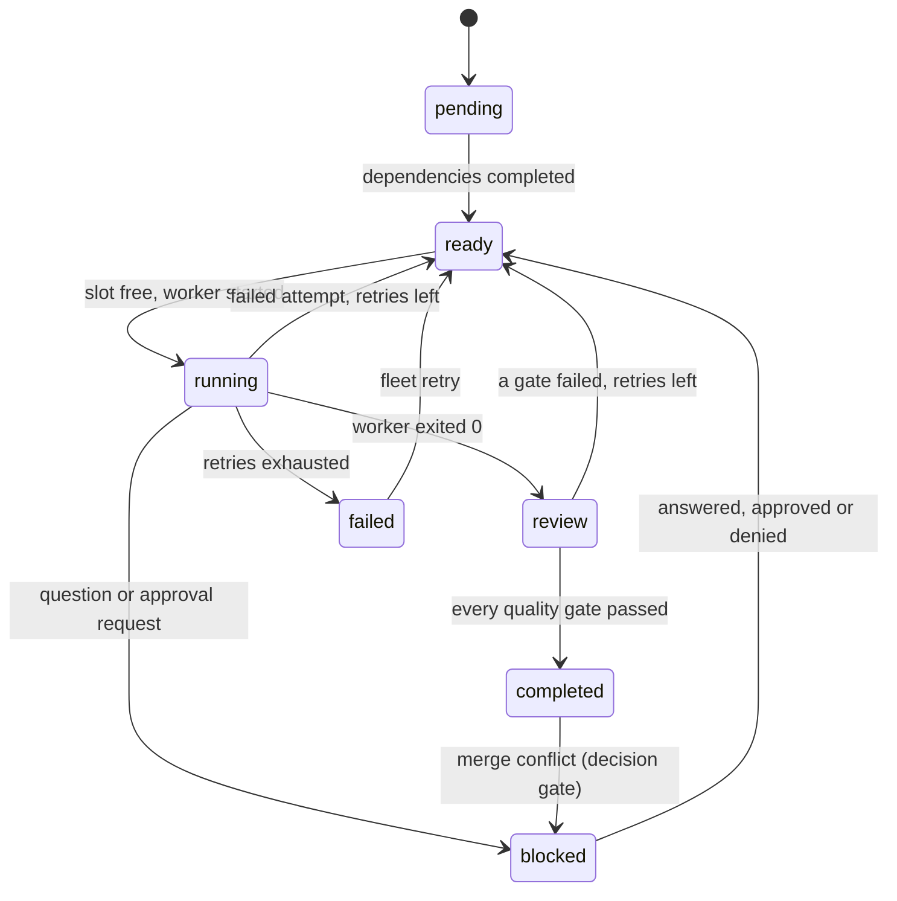

## Commands

```text
fleet - run many coding agents in parallel, each in its own git worktree

usage: fleet [global options] <command> [options]

global options (before or after the command):
  --state-dir <dir>   state directory (default: $XDG_STATE_HOME/agent-fleet or ~/.local/state/agent-fleet)
  --json              print the daemon's reply (or the error) as one JSON document
  -h, --help          show this help
  -V, --version       show the version

daemon:
  daemon [--config <fleet.toml>] [--web <addr> [--web-allow-remote] [--web-print-login-url]]
                                     run the daemon in the foreground; --web serves the local
                                     dashboard (<ip>:<port>, <port> or <ip>; loopback only unless
                                     --web-allow-remote; the login URL is printed once, and only to
                                     a terminal unless --web-print-login-url)
  shutdown                           ask the daemon to stop
  doctor [--config <fleet.toml>]     check the setup (exit 13 when something fails)
  verify-log                         verify the event log's hash chain (exit 11 when tampered)

runs and tasks:
  run create --objective <text> --repo <path> [--base <ref>] [--id <id>] [--max-parallel N]
  task add --run <run> --title <text> [--spec <text>|-] [--after <task>]... [--worker <name>] [--host <name>] [--id <id>]
                                     (--spec - reads the spec from stdin, at most 16 KiB)
  plan <file.toml|file.json> [--run <run>]
                                     load a whole task graph (with --run: into an existing run)
  start --run <run> [--max-parallel N]
  status [--run <run>]               runs, tasks, gates, approvals, recent events
  stop <task>                        stop the running worker
  retry <task>                       run a failed or stopped task again
  cancel <task>                      cancel a task that has not completed
  events [--limit N]                 recent audit events

working with a task (<task> is <run>/<task> or a unique task id):
  attach <task>                      interactive terminal session of the worker
  send <task> <text...> [--no-newline]
  tail <task> [--follow] [--lines N]

decisions:
  gate list                          open questions and conflicts
  gate resolve <id> --answer <text>  answer a gate (or give the answer as the rest of the line)
  approval list                      approvals and their digests
  approve <id> [--digest <hex>]      approve a pending action (names the digest it covers: the listed
                                     one unless --digest is given)
  deny <id> [--digest <hex>]         deny it

results:
  merge <task>                       merge a reviewed task into the integration branch
  cleanup [--run <run>] [--branches] remove finished worktrees (and branches)
  undo <task> [--apply]              preview or revert the last worker changes (needs agent-undo)

goals and verification (NEO):
  goals add --title <text> [--id <id>] [--parent <goal>] [--intent <text>|-]
            [--task <run>/<task>]... [--contract <file.json>]
                                     add a goal to the ledger, optionally with its verification contract
  goals attach <goal> --contract <file.json>
                                     make a contract the acceptance criteria of a goal
  goals status <goal> <open|in_progress|blocked|abandoned> [--reason <text>]
                                     (verified is never set by hand: only recorded evidence does it)
  goals list                         the goal tree with status, contract and task verification
  goals show <goal>                  one goal: its checks, the newest evidence of each, the history
  goals remaining                    open leaves, blockers and the tasks that can start next
  verify <goal|task> [--task <run>/<task>] [--timeout <secs>]
                                     run the contracts independently of the worker and record
                                     evidence; exit 6 when a mandatory check did not pass

remote hosts (SSH; tasks name one with `task add --host <name>`; never talk to the daemon):
  host add <name> --address <host> --user <user> --identity <key file> --base-dir <dir on the host>
           [--port N] [--worker <command>]... [--max-sessions N] [--proxy-jump <host>] [--env NAME=VALUE]...
           [--config <fleet.toml>]   write a [hosts.<name>] table (the key is not trusted yet)
  host list [--config <fleet.toml>]  hosts and the key pinned for each
  host trust <name>                  show the host's key fingerprint and pin it after you type yes
                                     at a terminal (the only way a key becomes trusted)
  host remove <name>                 remove the table and forget the pinned key
  host doctor <name>                 connect once and check key, login, quoting, git and directory

dashboard:
  tui                                terminal dashboard

exit codes: 0 ok, 1 internal, 2 usage, 3 daemon down, 4 not found, 5 approval required,
6 conflict, 7 invalid, 8 limit, 9 unavailable, 10 forbidden, 11 tampered, 12 timeout, 13 unhealthy
```

Everything talks to the daemon over a Unix socket with bounded newline-delimited JSON. With `--json` every command
prints one document with a stable `schema` field (`fleet.status/1`, `fleet.gate.list/1`, `fleet.merge/1`, ...) or
`{"schema":"fleet.error/1","error":{"code","message","subject"}}`; the exit code is the same in both modes:

| Code | Name | Meaning |
| --- | --- | --- |
| 0 | ok | |
| 1 | internal | unexpected I/O, git or internal failure |
| 2 | usage | bad command line |
| 3 | daemon_down | nothing is listening on the socket (`fleet daemon` first) |
| 4 | not_found | unknown run, task, gate or approval |
| 5 | approval_required | a person must decide first (the error names the approval) |
| 6 | conflict | wrong state for the action, a merge conflict, a second daemon, an expired approval |
| 7 | invalid | validation failed: bad name, cycle, oversized text, digest mismatch |
| 8 | limit | a hard limit was reached |
| 9 | unavailable | an optional feature is missing (`agent-undo`) |
| 10 | forbidden | refused: wrong user, or a request from a worker process |
| 11 | tampered | the event log failed its integrity check |
| 12 | timeout | the daemon did not answer in time |
| 13 | unhealthy | `fleet doctor` found a failing check |

`fleet status --json` has the top-level keys `schema, daemon, now_ms, runs, gates, approvals, recent`; the key sets of
the status, error and doctor documents are pinned by end-to-end tests
([`e2e_cli.rs`](crates/fleet-cli/tests/e2e_cli.rs)).

## Configuration

`fleet.toml` (see [examples/fleet.example.toml](examples/fleet.example.toml); unknown keys are errors):

| Section / key | Meaning | Default |
| --- | --- | --- |
| `[daemon] max_sessions` | concurrent worker sessions across all runs (hard cap 64) | 8 |
| `default_worker` | worker used by tasks that name none | none |
| `max_retries` | automatic retries per task (worker failures and failed gates); questions and daemon restarts do not use them | 2 |
| `kill_grace_secs` | SIGTERM, then SIGKILL after this long | 5 |
| `approval_ttl_secs` | an approval expires if nobody uses it | 900 |
| `sensitive` | actions that always need an approval: `merge`, `external-command` | both |
| `external_timeout_secs`, `question_grace_secs` | limit for approved commands; how long a worker that wrote a question may keep running | 600, 2 |
| `author_name`, `author_email` | identity of commits fleet makes | `fleet` / `fleet@localhost` |
| `ring_bytes` | output kept per session (hard cap 4 MiB) | 262144 |
| `[env] allow` | variables copied from the daemon's environment to workers, gates, git and approved commands | `PATH HOME USER LOGNAME LANG LC_ALL LC_CTYPE TERM TZ TMPDIR` |
| `[web] image_max_side`, `image_max_megapixels` | largest image the workbench shows, per side and in millions of pixels; may be lowered, or raised up to the hard caps 16384 and 64; zero or more than a cap stops the daemon | 8192, 32 |
| `[redact] literals, env_values, [[redact.rules]]` | extra redaction: literal strings, values of secret-looking daemon variables, `prefix` + `charset` (`alnum|hex|base64|token`) + `min_len` rules | built-in key shapes + env values |
| `[workers.<name>]` | `command`, `args`, `env_pass`, `env_set`, `timeout_secs`, `idle_timeout_secs` | |
| `[[gates]]` | `name`, `command`, `args`, `env_pass`, `env_set`, `format` (`exit` or `refcheck-json`), `timeout_secs` | exit, 600 s |
| `[remote] ssh` | absolute path of the `ssh` program; otherwise it is found once in the absolute entries of `PATH` and refused inside a repository or when others can write it | found in `PATH` |
| `[hosts.<name>]` | `address`, `port`, `user`, `identity_file`, `base_dir`, `allowed_workers`, `max_sessions`, `proxy_jump`, `connect_timeout_secs`, `server_alive_secs`, `server_alive_count`, `max_bundle_mib`; `[hosts.<name>.env]` the explicit variables of remote workers (see [SSH remote worktrees](#ssh-remote-worktrees)) | none; port 22, 2 sessions, 10 s, 15 s x 3, 256 MiB |

Arguments are templates, never shell: `{brief}` (the brief, at most 16 KiB), `{task}`, `{run}`, `{worktree}` and
`{brief_file}` are replaced inside each argument, `{{` and `}}` are literal braces. A **plan file**
(`fleet plan file.toml|json`) names workers but cannot define commands; an optional `[run]` table creates the run.

### What a worker sees and may write

Environment: only the allowlist plus `FLEET_RUN`, `FLEET_TASK`, `FLEET_WORKTREE`, `FLEET_BRIEF_FILE` (and `SHELL`,
which the pty library always adds). Working directory: its own worktree. The brief is in `.fleet/brief.md` and also
offered as `{brief}`. Before it exits it may write, in `.fleet/`:

```json
{"version":1,"status":"done","summary":"what I did"}                                        // result.json (or "failed")
{"version":1,"kind":"question","text":"Which framework?","choices":["axum","actix"]}        // question.json: a decision gate
{"version":1,"kind":"approval","text":"why","action":{"command":"/usr/bin/publish","args":["--tag","x"]}}   // an approval request
```

These files are read with lstat + `O_NOFOLLOW|O_NONBLOCK` checks, size caps and schema validation. An approved
command is run by the *daemon*, exactly as approved, with the allowlisted environment; its result goes into the task's
next brief. Uncommitted changes are committed by fleet (never with hooks, `--no-verify`).

## Dashboard

`fleet tui` (keys: `j/k` move, `Tab` focus, `Enter` attach or answer, `a`/`d` approve or deny the selected approval,
`s` stop, `t` retry, `m` merge, `?` help). A real screen from the demo's status document, rendered into a headless
buffer by the example in [crates/fleet-cli/examples/tui_screenshot.rs](crates/fleet-cli/examples/tui_screenshot.rs)
(the same rendering code the terminal uses):

```text
fleet 0.1.0 | runs 1 | pend 1 rdy 0 run 1 rev 0 ok 1 fail 0 blk 1 | sess 1/4 | undo off | rss 3M
┌Tasks (4)───────────────────────────────────────┐┌Output r1/schema──────────────────────────────────────────┐
│  TASK       STATUS    DEPS     TITLE           ││Create the users table attempt 1                          │
│> r1/schema  completed -        Create the users││summary: added the users table                            │
│  r1/api     blocked   <schema  Build the users ││gate changelog pass exit code 0                           │
│  r1/docs    running   <schema  Document the sch││agent: starting schema                                    │
│  r1/release pending   <api,doc Write the change││agent: finished schema                                    │
│                                                ││                                                          │
│                                                ││                                                          │
│                                                ││                                                          │
│                                                ││                                                          │
│                                                ││                                                          │
│                                                ││                                                          │
│                                                ││                                                          │
│                                                ││                                                          │
│                                                ││                                                          │
│                                                ││                                                          │
│                                                ││                                                          │
│                                                ││                                                          │
│                                                ││                                                          │
└────────────────────────────────────────────────┘└──────────────────────────────────────────────────────────┘
┌Approvals (0)───────────────────────────────────────────────────┐┌Decisions (1)─────────────────────────────┐
│none pending                                                    ││> g1 r1/api Which HTTP framework should th│
│                                                                ││                                          │
│                                                                ││                                          │
│                                                                ││                                          │
│                                                                ││                                          │
└────────────────────────────────────────────────────────────────┘└──────────────────────────────────────────┘
q quit  j/k move  Tab focus  Enter attach/answer  a/d approve/deny  s stop  t retry  m merge  r refresh  ? hel
```

## Web dashboard

`fleet daemon --web <addr>` serves a browser dashboard from the daemon. It is **off by default**; `<addr>` is `<ip>:<port>`,
a bare `<port>` (on 127.0.0.1) or an `<ip>` (ephemeral port, so `--web 127.0.0.1:0` picks a free one). A non-loopback address is
refused unless `--web-allow-remote` is also given, and then a warning about the missing TLS is printed. The page offers:

- runs and a **DAG view** (tasks in columns by dependency depth, status badges, edges drawn as SVG), task detail with the
  quality-gate results;
- **live output** of a task (a server-sent event stream read with `fetch`, bounded chunks, a bounded 256 KiB view in the page)
  and a box to **send input** to the worker (no control characters);
- the **decision gates and approvals queue**: the exact action, every argument, the full digest and a countdown to the
  expiry, with Approve and Deny; the request carries the digest the page showed (it is mandatory), so an approval is still
  bound to it. A **merge** button asks the daemon to merge; the daemon answers `approval_required` exactly as `fleet merge`
  does and the operator approves in the queue first;
- the **goal ledger and verification** of [NEO N1](#neo-n1-goals-and-verification), read only: the remaining work (open
  leaf goals, blockers, the next ready tasks), the goal tree with each goal's status and contract state, the checks of a
  contract with their newest verdict, and the evidence history with the commit and tree digest each piece was taken on (not
  counting pieces are dimmed). A task a goal governs shows an `unverified` badge while its worker has reported done (or the task
  is in review or completed) and fleet has no passing evidence; it is also shown on the run's DAG and on the task page;
- the **event log** with its hash-chain verification status, and a **health panel** (the `fleet doctor` checks).

Starting runs, stopping or cancelling tasks, attaching, shutting the daemon down, adding goals, attaching contracts and
`fleet verify` (which starts processes) stay on the command line: the dashboard cannot start a verification.

**Login and credentials.** The daemon prints the login URL once, and only when stderr is a terminal (otherwise it says why it did
not, and `--web-print-login-url` overrides that), so the token does not end up in a log file by accident:

```text
$ fleet daemon --config fleet.toml --web 127.0.0.1:0 --web-print-login-url
fleet daemon: pid 36 listening on …/state/agent-fleet/control/fleet.sock (stop with `fleet shutdown`)
fleet web: dashboard on http://127.0.0.1:45045/
fleet web: login URL (shown only now, valid until the daemon stops): http://127.0.0.1:45045/#token=<64 hex>
```

and, started with stderr redirected and without the flag:

```text
fleet daemon: pid 23 listening on …/state-quiet/agent-fleet/control/fleet.sock (stop with `fleet shutdown`)
fleet web: dashboard on http://127.0.0.1:36545/
fleet web: the login URL was not printed because stderr is not a terminal (it would be kept in whatever receives it); run the daemon in a terminal or add --web-print-login-url
```

The token sits in the URL *fragment*, which browsers never send to a server: the page POSTs it to `/api/login`, receives a
session id and a per-session CSRF token **in the reply body**, keeps them in the tab's `sessionStorage` and removes the token
from the address bar (`#token=<hex>&next=/run/r1` lands on a page). **No cookie is set or read**: a cookie is scoped to the
host, not the port, so the browser would send it to every other server on `127.0.0.1` (a dev server a worker started, say);
the session id travels in an `X-Fleet-Session` header that only this page sends, and event streams are read with `fetch`
because `EventSource` cannot send headers. Scripts can use the token as `Authorization: Bearer`.

**What this protects and what it does not.** The token, the session id and the control socket's token are defence in depth
against code of the same user, not a boundary: a process of yours that can read the daemon's memory, your terminal or your
browser can act as you. What fleet does refuse, on the control socket and on the web port alike (and before anything is acted
on): workers, quality gates, approved commands, git, the undo tool, everything they started and the process groups they still
occupy. A process that left all of those trees (`setsid`, `systemd-run --user`) looks like your own `curl`. There is no TLS.
Details and every limit: [SECURITY.md](SECURITY.md), [ADR 10](docs/adr/0010-web-dashboard-adapter.md).

### A real session

[`scripts/web-demo.sh`](scripts/web-demo.sh) ran the same scripted four-task DAG as the demo above, plus a second run with a
talkative worker, in the release binary in a throwaway container, and drove it with `curl` and a headless Chromium (the image
of [`docker/Dockerfile.web`](docker/Dockerfile.web)). The token and session id go to `curl` through header files, not the command
line. The output below is that script's output, with the repeated response headers and the long JSON lines cut (`...`); 64-character
hex strings (token, session id, digests) are shown as `<64 hex>`:

```text
$ # no credentials
HTTP/1.1 401 Unauthorized
{"error":{"code":"forbidden","message":"not logged in: open the login URL the daemon printed, or send the token as a bearer token","subject":null},"schema":"fleet.error/1"}

$ # a Host header that is not the daemon's address (DNS rebinding)
HTTP/1.1 421 Misdirected Request

$ # the page: static, hardened headers, no inline code
HTTP/1.1 200 OK
Content-Type: text/html; charset=utf-8
Connection: close
Content-Length: 1366
Content-Security-Policy: default-src 'none'; script-src 'self'; style-src 'self'; connect-src 'self'; img-src 'self' data:; frame-ancestors 'none'; base-uri 'none'; form-action 'self'
X-Content-Type-Options: nosniff
Referrer-Policy: no-referrer
Cache-Control: no-store
X-Frame-Options: DENY
...

$ # login: the page exchanges the fragment token for a session id (in the body: no cookie is ever set)
HTTP/1.1 200 OK
{"bind":"127.0.0.1:45045","csrf":"<64 hex>","schema":"fleet.web.session/1","session":"<64 hex>","version":"0.1.0"}
  Set-Cookie headers in the reply (must be 0): 0

$ # the session id as an old-style cookie is not a credential (cookies travel to every port of the host)
HTTP/1.1 401 Unauthorized

$ # a state-changing request without the CSRF token, then with a foreign Origin
HTTP/1.1 403 Forbidden
{"error":{"code":"forbidden","message":"the CSRF token is missing or wrong",...}
HTTP/1.1 403 Forbidden
{"error":{"code":"forbidden","message":"the Origin of this request is not the dashboard",...}

$ # the real page in headless Chromium (each run logs in with the fragment token, then the fragment is removed)
  [login] found: Add a users table, an API and docs
  [dag] found: Build the users API
  [decisions] found: Which HTTP framework

$ # the live output of a running task in the page: the stream is read with fetch and the session header
  [live] found: slow agent: starting slow
  [live] found: tick 1
  [live] found: tick 2
  [live] found: Streaming live output
  occurrences of the token in the rendered page (must be 0): 0

$ # merge from the web: refused until a person approves the exact action
HTTP/1.1 409 Conflict
{"error":{"code":"approval_required","message":"merging r1/schema needs approval a1 (digest a5b93c8c3eea); approve it with `fleet approve a1` and run the merge again","subject":"a1"},...}

$ # the approval as the page shows it (exact action and digest)
{"approvals":[{"args":["fleet/r1/integration","fleet/r1/schema","cf41816470297d4d36bab45f8a4453980dd351d3"],"command":"merge","digest":"<64 hex>","display":"git: \"merge\" \"fleet/r1/integration\" \"fleet/r1/schema\" \"cf41816470297d4d36bab45f8a4453980dd351d3\"",...,"purpose":"merge","status":"pending","task":"schema","tool":"git"}],...}

$ # approving with a wrong digest is refused, the right digest is accepted
HTTP/1.1 400 Bad Request
{"error":{"code":"invalid","message":"digest does not match approval a1: the action may have changed",...}
HTTP/1.1 200 OK
{"decision":"approved","digest":"<64 hex>","id":"a1","schema":"fleet.approval.decide/1"}
HTTP/1.1 200 OK
{"branch":"fleet/r1/schema","integration_branch":"fleet/r1/integration","merge_sha":"...","schema":"fleet.merge/1","task":"r1/schema"}

$ curl -H @.../bearer.hdr http://127.0.0.1:.../api/log
HTTP/1.1 200 OK
{"error":null,"head_hash":"<64 hex>","ok":true,"records":59,"schema":"fleet.web.log/1"}

$ # the task output through the stream endpoint (server-sent events, authenticated by the session header)
id: 0
event: output
data: {"lost":false,"next":0,"text":"agent: starting docs\nagent: finished docs\n"}

event: end
data: {"reason":"the worker has finished"}

$ # the goal ledger over http: read only (a POST finds no route), newest evidence with commit and tree digests
{"abandoned":0,"goals":[{"children":0,"contract":"passed","contract_id":"<64 hex>","depth":1,"evidence":6,"id":"feature","parent":null,"reason":"every mandatory check of the contract passed","status":"verified","tasks":[{"status":"completed","task":"r3/answer","verification":"verified"}],"title":"The answer file says ready"},
 {"children":0,"contract":"pending","contract_id":"<64 hex>","depth":1,"evidence":0,"id":"docs-written","parent":null,"reason":"added","status":"open","tasks":[{"status":"completed","task":"r1/docs","verification":"unverified"}],"title":"The docs exist"}],"schema":"fleet.goals.list/1","total":2,"verified":1}
HTTP/1.1 405 Method Not Allowed
{"checks":[{"check":"answer","detail":"answer.txt contains \"ready\"","kind":"file","latest":{"at_ms":...,"check":"answer","commit":"<40 hex>","counts":true,"dirty":false,"exit_code":null,"id":"e4","output":"","summary":"the file contains the text","task":"answer","tree":"<40 hex>","verdict":"passed"},"mandatory":true},...

$ # the goals pages in the browser: remaining work, verified and unverified badges, evidence with commit and tree
  [goals] found: The answer file says ready
  [goals] found: The docs exist
  [goals] found: unverified
  [goal] found: answer.txt contains
  [goal] found: failed
  [goal] found: passed

$ # logging out ends the session: the same id is refused afterwards
HTTP/1.1 200 OK
HTTP/1.1 401 Unauthorized
```

Five screenshots taken by that Chromium (1200 px wide, headless, in the container) in a run of the same script (ports, digests and
times differ between runs, which is why they do not match the text above): the DAG of `r1` while `api`
waits for an answer, the approval queue with the pending merge approval, the task page of a running worker with its live output,
the goals page (one goal verified through fleet's own run, one task `unverified`) and a goal with its checks and evidence:

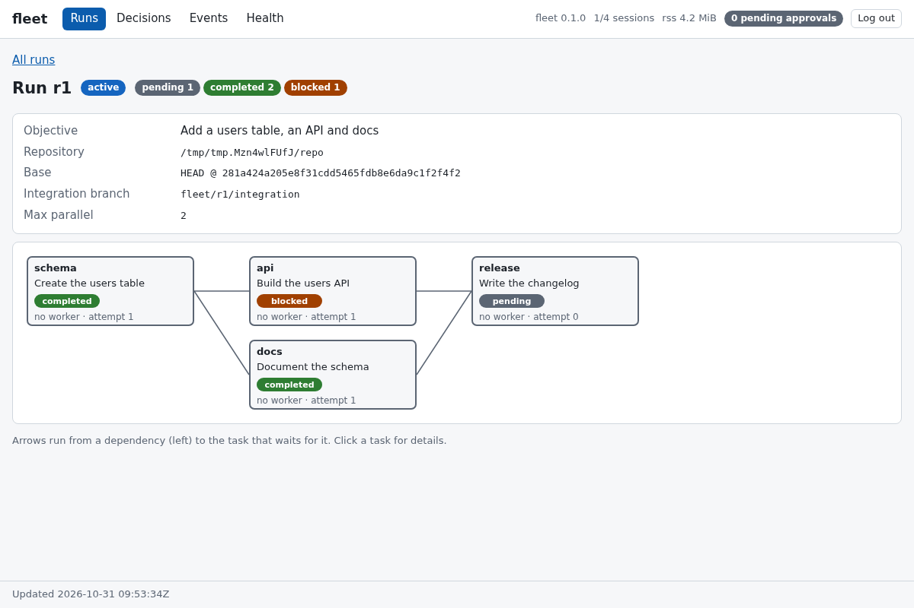
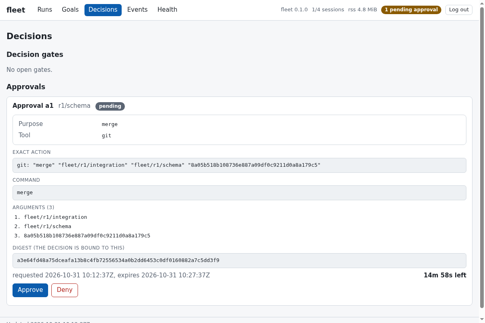
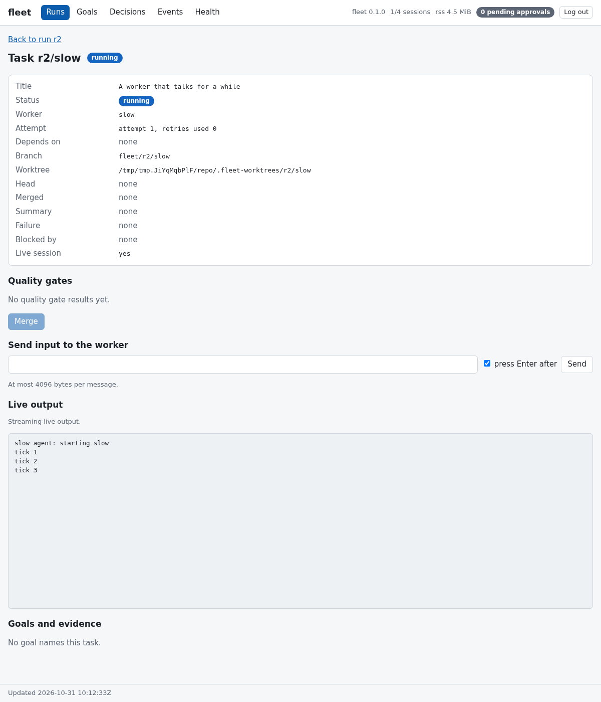
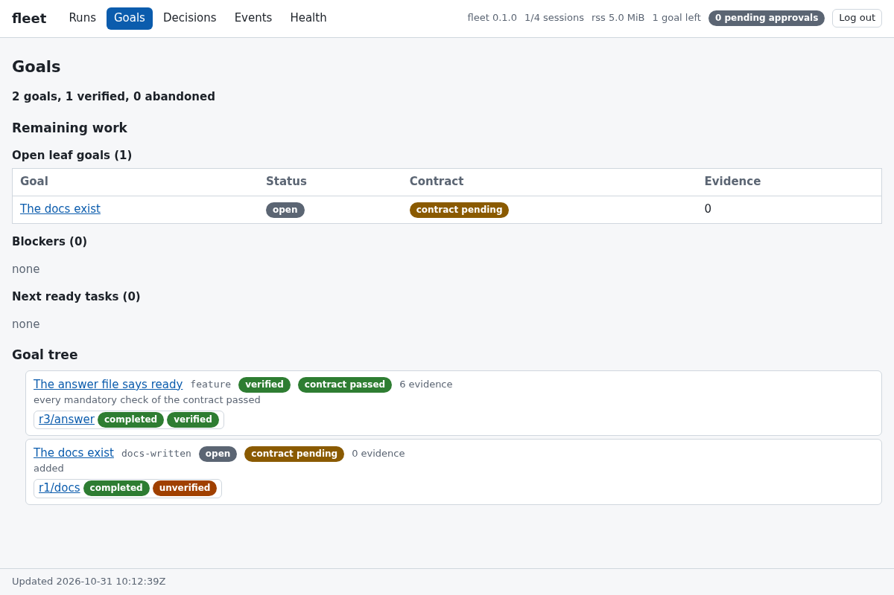
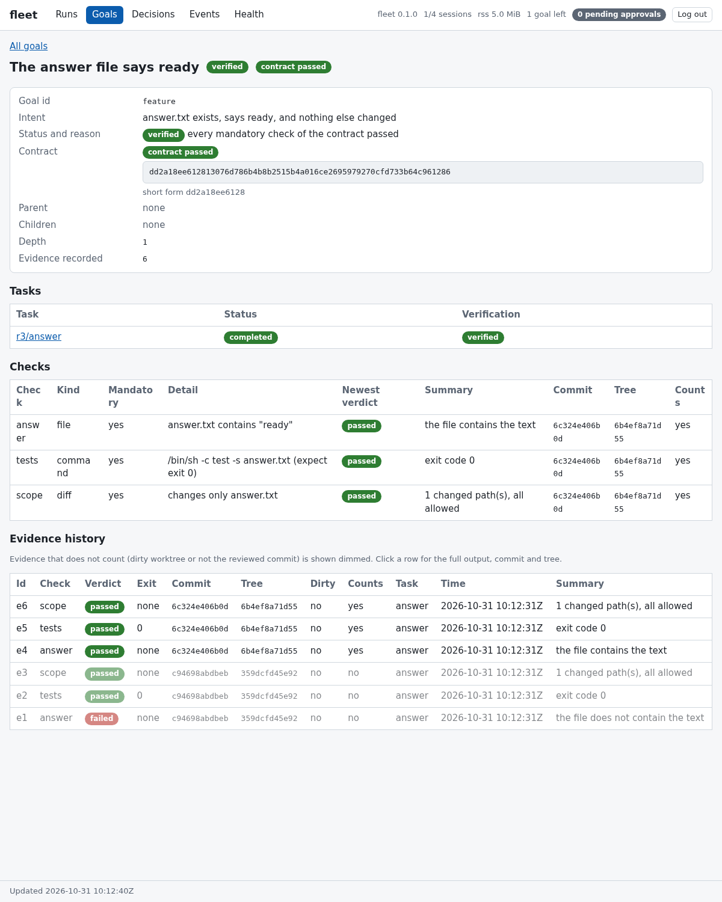

### What was and was not verified

- **Protocol level, over real sockets:** [`web_http.rs`](crates/fleet-infra/tests/web_http.rs) (58 tests: authentication, per-client
  lockout, Host, Origin, `Sec-Fetch-Site`, CSRF, header sessions and the rejected old-style cookie, strict JSON, control characters
  in input, malformed and oversized requests, a trickling client and an idle one, the connection cap, event-stream bounds and
  their end with the session, shutdown) and [`e2e_web.rs`](crates/fleet-cli/tests/e2e_web.rs) (23 tests against the real daemon:
  login, the gate/approval/merge flow, live output and input, the token absent from every worker-visible place and from disk,
  a worker, a quality-gate child and a descendant of an approved command that were all handed the token and are all still
  refused on the web port and on the socket, the flag policy, the quiet start, shutdown, hostile text, health and tamper
  detection; the goal, evidence and verification documents, read only, with hostile text and a verification check that was handed
  the token and is refused). Without the origin rule the gate, approved-command and verification-check tests fail (the script logs
  in with HTTP 200): that was checked by switching the job tracker off (the detached and reparented cases fail) and both
  mechanisms off (the older socket tests fail too); with only the ancestry rule off nothing in the end-to-end tests changes
  because the tracker also lists the groups, so the ancestry rule has its own test with real child processes
  ([`origin.rs`](crates/fleet-infra/tests/origin.rs)), which fails without it.
- **The page script** is checked three ways: a source scan test that fails on `innerHTML`, `EventSource`, cookies and their
  relatives, a node script ([`scripts/web-smoke.mjs`](scripts/web-smoke.mjs), 906 checks against a hand-written fake DOM, hostile
  strings and a frame-splitting stream reader included) and the headless Chromium run above, which loaded the real page, logged in
  through the fragment, and found the expected text in the rendered DOM and in the screenshots. The live page was in its
  "Streaming live output" state with two ticks; the check does not distinguish what came from the first read and what from the stream.
- **Not done:** no desktop browser (Chrome, Firefox, Safari) was used, the older pages were not driven with hostile payloads in
  Chromium (their evidence is the JSON, the source scan and the fake DOM; the review workbench was, see above), the send-input form and the Approve/Deny
  buttons were exercised only against the fake DOM (their requests are tested at the protocol level), accessibility and touch
  layouts were not examined, and the macOS admission path (`lsof`) was type-checked only. There is no TLS; loopback or an SSH
  tunnel only. A one-time login code (which would make a captured URL expire) was considered and not built.

## Review workbench (read only)

The dashboard has a review workbench: a **dock** with tabs and splits (drag or buttons; keyboard: arrows move between tabs
and resize splitters, `M` moves a tab, `Delete` closes) that hosts an **explorer**, a **file viewer** (line numbers,
placeholders for binary and too-large files, links shown and never followed), a **diff viewer** (unified and side by
side, changed words marked, context 0/3/10/25, fold of unchanged context, `j`/`k` between files, `n`/`p` between hunks), a
**Markdown preview** and an **image viewer**, next to the runs, task output, goals and approvals panes. The task page links to the Diff and
Explorer of the task, and every pane shows the task's `UNVERIFIED`/`dirty` badge like the evidence views do. Everything it
shows is read from the **real repository at a commit the daemon recorded for the task** (`head`, `base`, or a recorded
id), never from the worktree a worker can write to ([ADR 16](docs/adr/0016-evidence-is-about-the-repository-not-about-what-a-worktree-says.md),
[ADR 19](docs/adr/0019-the-read-only-workbench-and-its-markdown-and-image-rules.md)). It adds no listener, no dependency and no write path.

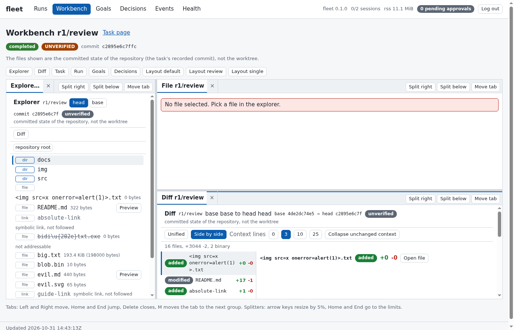
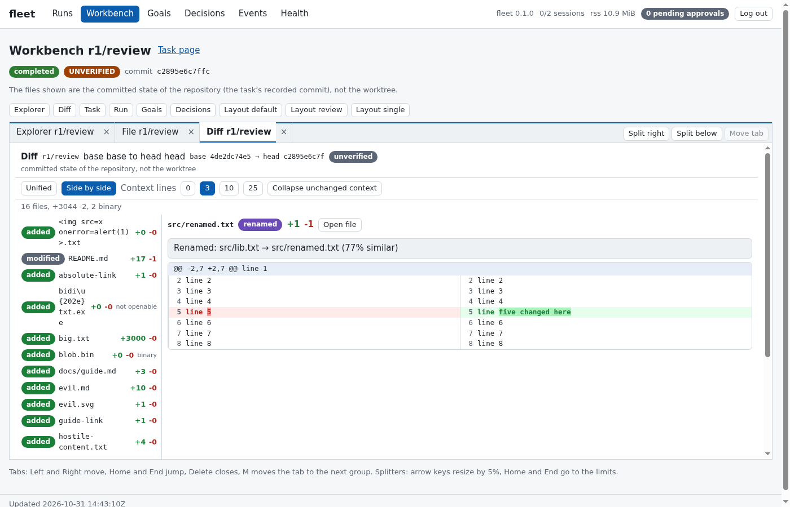
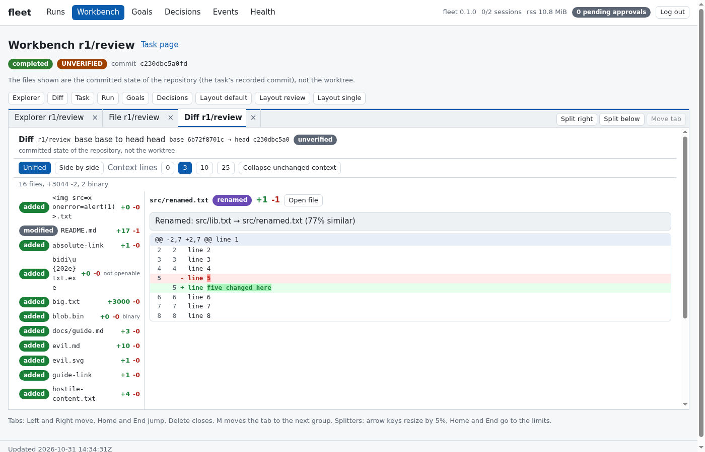
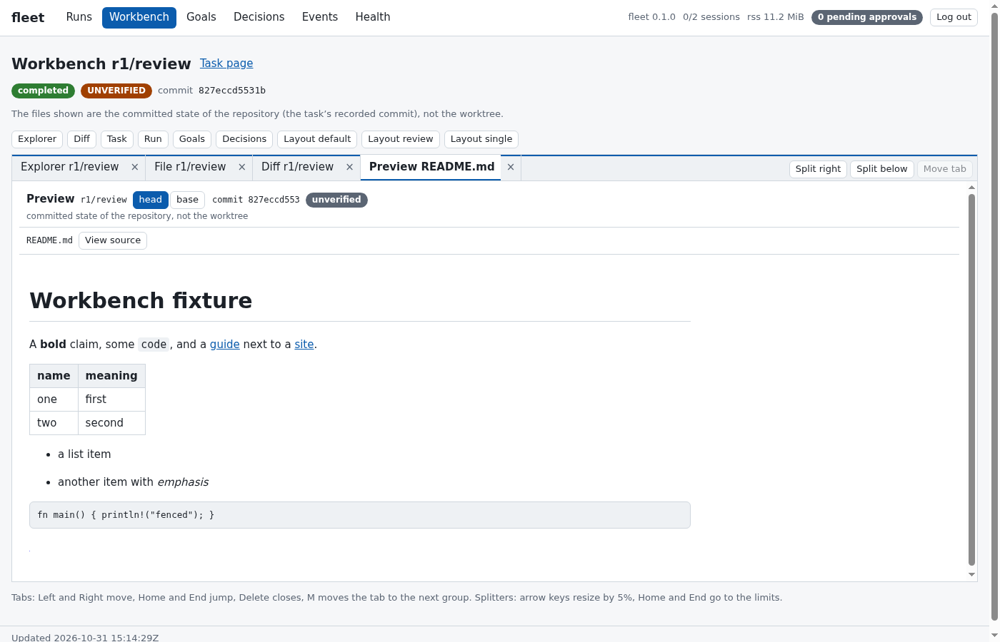
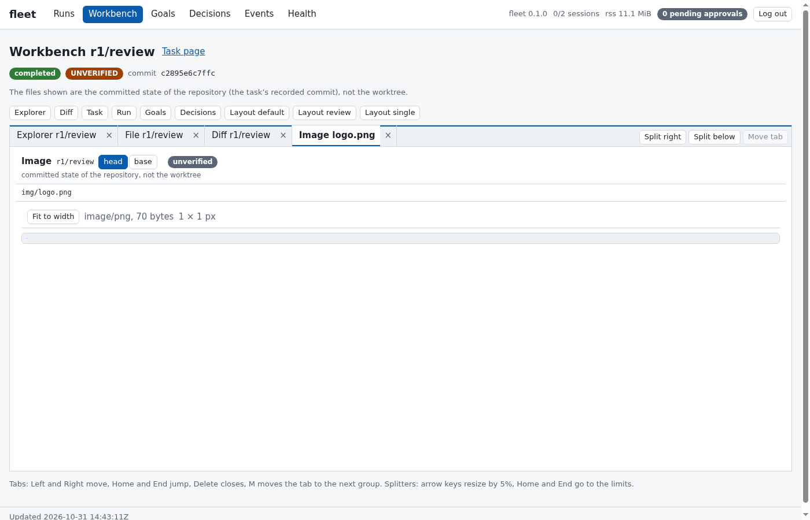
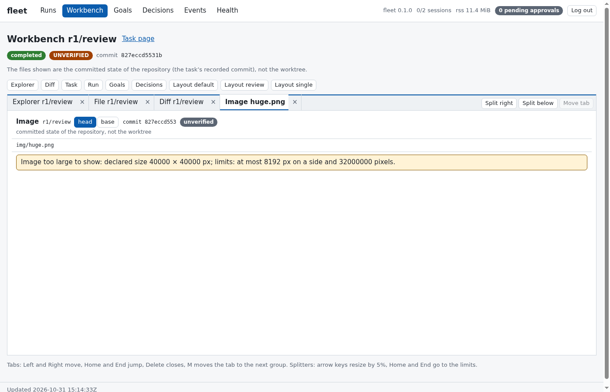
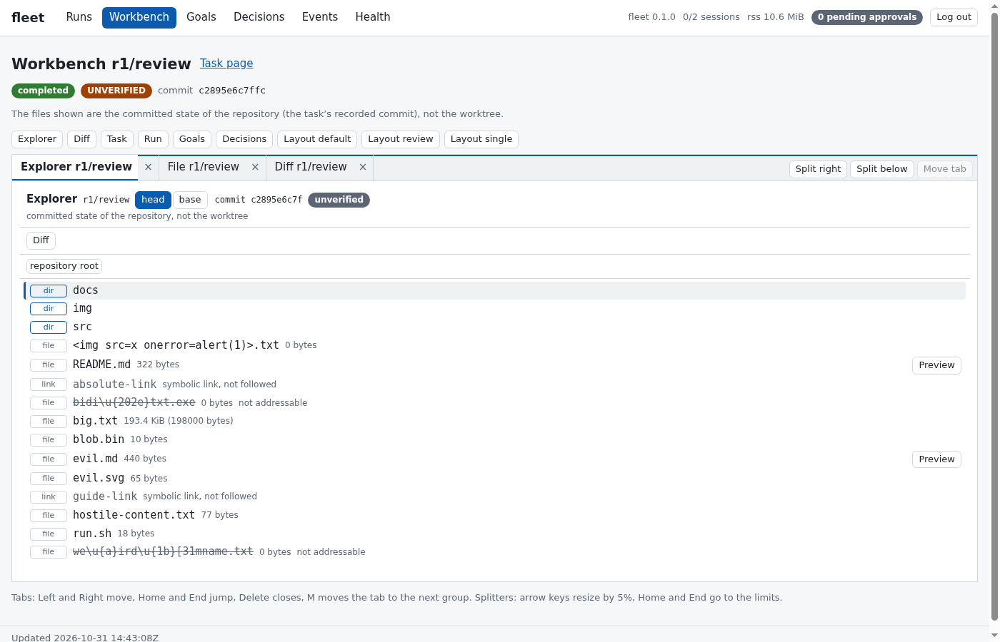
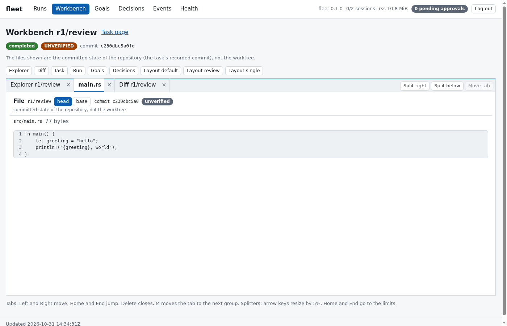
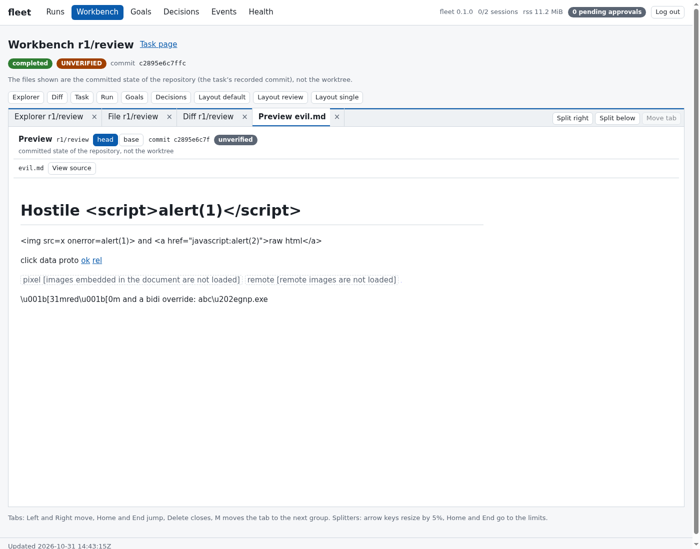

Deep links open a state straight from the address (`#/work/<run>/<task>?open=diff&mode=split&path=src/a.rs`, `layout=default|review|single`).

API (read only, behind the same token, Host, `Sec-Fetch-Site`, worker-origin and rate checks as the rest; at most three reads run at once):

```text
GET /api/repo/tree?task=<run/task>&commit=<head|base|sha>&path=<dir>     entries (dir, file, symlink, submodule), sorted, at most 2000
GET /api/repo/file?task=&commit=&path=                                  text lines | binary | too_large | image | symlink | submodule
GET /api/repo/blob?task=&commit=&path=                                  raw bytes, png/jpeg/gif/webp only (415 for anything else, 413 above 4 MiB or above the pixel limits); X-Image-Width/-Height headers
GET /api/repo/markdown?task=&commit=&path=                              a closed tree (no raw HTML), at most 512 KiB of source
GET /api/repo/diff?task=&base=&head=&context=<0..25>                    files with status, counts, hunks and truncation notes
```

A real session (output of [`scripts/workbench-demo.sh`](scripts/workbench-demo.sh) against a daemon whose scripted agent
([`workbench-agent.sh`](examples/agents/workbench-agent.sh)) left Markdown, a PNG, an SVG with script, links, binary and large files,
a rename and hostile names):

```text
GET /api/repo/file?task=r1/review&commit=head&path=src/main.rs
{"at":"head","class":"text","clipped":0,"commit":"c2895e6c...","crlf":false,"image":null,"kind":"file","limit":1048576,"line_count":4,"lines":["fn main() {","    let greeting = \"hello\";", ...

GET /api/repo/diff?task=r1/review         (path, status)
README.md modified | src/renamed.txt renamed (similarity 77, old path src/lib.txt) | img/logo.png added (binary) | big.txt added (+3000) | ...
"path":"we\\u{a}ird\\u{1b}[31mname.txt","path_ok":false,"similarity":null,"status":"added"      <- shown escaped, cannot be requested

GET /api/repo/blob?task=r1/review&commit=head&path=img/logo.png
HTTP/1.1 200 OK
Content-Type: image/png
Content-Security-Policy: default-src 'none'; sandbox
X-Content-Type-Options: nosniff
Content-Disposition: inline

GET /api/repo/blob of an svg with script
HTTP/1.1 415 Unsupported Media Type
{"error":{"code":"invalid","message":"only png, jpeg, gif and webp images are served (decided by the file's first bytes)","subject":"not_an_image"},...}

GET with a traversal path
HTTP/1.1 400 Bad Request
{"error":{"code":"invalid","message":"repository path \"../../etc/passwd\" has a `.` or `..` component","subject":null},...}
```

What protects it: paths are validated values (relative, no `..`, no backslash/NUL/control/bidi characters, at most 1024 bytes
and 32 deep, nothing normalized); a client can name a task and `head`/`base`/a recorded commit id, never a ref;
git runs hardened with literal pathspecs and sizes are checked before bytes are read; names, text and diffs are
bounded (2000 entries, 1 MiB per text file, 4000 lines per file and 20000 per diff, 3 MiB of diff text) and shown escaped;
Markdown is parsed on the server to a closed tree (raw HTML is text, only `http`/`https` and repository links, no remote or
`data:` images) and turned into DOM nodes from an element and attribute allowlist; images are served only when their first bytes are a
valid PNG, JPEG, GIF or WebP header whose declared size is at most 8192 pixels per side and 32 megapixels (a placeholder otherwise: a 33 byte file can declare 40000 x 40000 pixels), as `data:` URLs in the page, so the page's CSP is unchanged.

Checked in **headless Chromium** (`scripts/workbench-demo.sh`, 13 page loads, the image of `docker/Dockerfile.web`): each pane and a split layout
render the expected DOM (rows, table, code block, links with `rel="noopener noreferrer"`, `data:image/png` source, separators
and tablists), and with hostile names and contents loaded the page has exactly its three script elements, no `onerror`/`onclick`
attribute, no `<svg>`/`<iframe>`, no `javascript:` or `data:` link, no remote image and no token. Not checked: a desktop
Chrome, Firefox or Safari, touch, accessibility tools, and repositories larger than the caps tested here.
Memory (`e2e_web.rs::many_large_diffs_and_files_keep_memory_flat_and_every_cap_holds`, debug build): three reads at a time of a diff of
a 400000-line file, 60 files of 2000 lines and a 3000-entry directory take the daemon from 22 MB to a plateau of 90 to 125 MB
(a diff document of a few megabytes is built per read) and a second identical phase of 192 reads does not raise it (0 kB of growth).

## NEO N2: compiled context packs and handoffs

A run created with `context = "compiled"` (in the plan's `[run]` table, or `fleet run create --context compiled`) does not get
the plain brief. Fleet compiles a **context pack** from its own state, in eight layers in a fixed order (invariants, charter,
plan position, task and acceptance contract, verified knowledge, working set, recent events, scratch), each with a hard token
budget, and writes it to `.fleet/context.md` (+ `.fleet/context.json`, the manifest). The pack is deterministic: the same inputs
give the same bytes and the same SHA-256 digest. Text that agents wrote is only ever in layer 7, labelled `UNVERIFIED` and
quoted. A **handoff packet** is made when a task ends, when it is retried, when the daemon finds it running after a crash, and on
demand; the next pack is compiled from it. Design: [docs/neo.md](docs/neo.md), [ADR 17](docs/adr/0017-the-context-compiler-is-a-pure-deterministic-function.md),
[ADR 18](docs/adr/0018-handoffs-are-made-before-the-next-attempt-and-rebuilt-after-a-crash.md).

```
fleet context show <task> [--digest <hex>] [--json]      fleet context diff <task> <digest1> <digest2> [--json]
fleet context verify <task> [--json]  (exit 6 if it differs)   fleet context explain [<task>] [--profile <name>] [--json]
fleet handoff <task> [--json]
```

What is tested: determinism (golden digests, two SHA-256 implementations), layer order, budgets and the shrink order,
layers 1-5 free of agent-written text (layer 6 shows repository files at the base commit; which ones follows the worker's
committed paths), labelled UNVERIFIED text in layer 7, delimiter and control-character attacks, secret rules (worst-case lines in
linear time), stored packs re-hashed against the audit log (an edited, truncated, swapped or missing pack is `tampered`, exit
11, no content), and crash re-briefing with identical layers 1-5 *for the same plan and ledger state* (they change when the
plan or a check result does). What is not claimed: that a pack makes a model correct or reduces hallucination; token counts
are estimates; the secret rules are a filter, not a guarantee. Not built yet: the knowledge store (N3), the token governor
(N4), the credential broker (N5).

Complete output of [`scripts/neo-n2-demo.sh`](scripts/neo-n2-demo.sh), run in a throwaway container with a fake HOME, a fake
repository and the fake agent `examples/agents/n2-agent.sh` (its first attempt is wrong; its second reads layer 4 of its pack).
Nothing is abridged; paths, commits and digests differ from run to run.

```

$ /target/release/fleet plan /tmp/tmp.2fJZMOFaV4/plan.toml
plan loaded into run r1 (1 tasks)

$ /target/release/fleet goals add --id feature --title The answer file says ready --intent answer.txt exists, says ready, and nothing else changed --task r1/answer --contract /work/examples/neo/contract.json
goal feature added (open), contract dd2a18ee6128

$ /target/release/fleet context explain r1/answer
profile default: 32000 tokens at most, 4 characters per token, 125% safety margin
estimator: tokens = ceil(bytes x 125% / (4 x 100)), counted over UTF-8 bytes
policy: label
knowledge file: none
for task r1/answer
  #  LAYER        SHARE  BUDGET  PURPOSE                                                                           WHEN TOO LARGE
  1  invariants   12%    3840    rules that never change, and how to report; never truncated                       never cut
  2  charter      15%    4800    project goal, constraints, glossary; cut only by section priority, last of all    never cut
  3  plan         35%    11200   this task's place in the goal tree: done, remaining, dependencies; never cut      never cut
  4  task         50%    16000   what to do and exactly how fleet will verify it; never cut                        never cut
  5  knowledge    15%    4800    verified facts with their sources (static file until N3); dropped third           dropped when the pack is too large
  6  working-set  35%    11200   bounded excerpts of the files the task touches, at a recorded commit; dropped s…  dropped when the pack is too large
  7  events       15%    4800    recent events and everything agents wrote, labelled UNVERIFIED; dropped first     dropped when the pack is too large
  8  scratch      5%     1600    the token budget that is left for the agent                                       never cut
when the pack is too large, layers are shrunk in this order: 7, 6, 5, 2 (the first goes first)

$ /target/release/fleet start --run r1
run r1 started

$ /target/release/fleet status
daemon pid 20 | v0.1.0 | up 1s | sessions 0/2 | undo unavailable | rss 5000 kB

run r1 [finished] max-parallel 2
  objective  NEO N2 demo: answer.txt must say ready
  repo       /tmp/tmp.2fJZMOFaV4/repo (base HEAD @ ab60c6a7)
  branch     fleet/r1/integration
  tasks      pending 0, ready 0, running 0, review 0, completed 1, failed 0, blocked 0
  ID      STATUS     DEPS  TRY  WORKER  NOTE
  answer  completed  -     2    -       done, every check passes

recent
  #23 r1/answer dispatched (attempt 2)
  #24 r1/answer session exited
  #25 r1/answer in review
  #26 r1/answer committed
  #27 evidence e4: goal feature check "answer" passed
  #28 evidence e5: goal feature check "tests" passed
  #29 evidence e6: goal feature check "scope" passed
  #30 goal feature is verified
  #31 r1/answer completed
  #32 r1/answer handoff made (f65a5db7deba)

$ fleet context show r1/answer --digest 9c8d7dad3552   # the retry's pack: header and layer table
context pack of r1/answer
digest:  9c8d7dad3552955f684054606a9f0f2ba40d75af7e358f6574b9ac58732c0b3d
stable:  b3cb74eaa0f81e0bb65bbdcd0296c5773ecb23f6bbafe216961731318fdee10d
profile: default
tokens 2471 of 32000
  #  LAYER        TOKENS     DIGEST            TRUST             ITEMS  NOTES
  1  invariants   757/3840   61ddecdb95efe269  trusted           1      -
  2  charter      352/4800   c0307217af848b85  trusted           3      -
  3  plan         139/11200  838819fe960de432  trusted           4      -
  4  task         337/16000  828d3b2e8f354bc6  trusted           3      -
  5  knowledge    69/4800    cb09c64623bfba17  trusted           0      -
  6  working-set  65/11200   3d3276a1dba71842  trusted           0      -
  7  events       613/4800   83c3bd35e96ce957  contains-unveri…  20     -
  8  scratch      121/1600   3257533030bf2eff  trusted           1      -

$ ... layer 4 of the retry's pack (what to do, how it is checked, what fleet's own runs said)
@@neo-layer 4 task trust=trusted bytes=00000913 tokens=0000337 sha256=828d3b2e8f354bc6a041a8f00d0ea6fcfde8691a7e9f4720e5445c492e8e1639
## Task answer: Write the answer file
  Create answer.txt with the single word ready.

### How fleet will verify it
Fleet runs these checks itself, on a clean export of the commit it records for your work, after you finish. Every mandatory check has to pass for the task to count as done; a statement that you finished does not.
- goal feature, contract dd2a18ee6128:
  - [mandatory] answer (file): answer.txt contains "ready"
  - [mandatory] tests (command): /bin/sh -c test -s answer.txt (must exit with 0; at most 30 s)
  - [mandatory] scope (diff): every path your commits change matches one of: answer.txt

### State of those checks now (fleet's own runs)
- goal feature check answer (mandatory): failed on commit b093ed60a637 (evidence e1)
- goal feature check tests (mandatory): passed on commit b093ed60a637 (evidence e2)
- goal feature check scope (mandatory): passed on commit b093ed60a637 (evidence e3)
@@neo-end 4 828d3b2e8f354bc6

$ ... layer 7 of the retry's pack (events, and everything agents wrote, labelled UNVERIFIED)
@@neo-layer 7 events trust=contains-unverified bytes=00001782 tokens=0000613 sha256=83c3bd35e96ce957094931bdc1fa0b679adcb62956982f731fac9952bce868ff
## Earlier attempts and decisions
UNVERIFIED (fleet statements, operator answers and quoted worker output, mixed; a line starting with `> ` inside quotes the worker):
> Attempt 1 failed: quality gate failed: verify feature/answer.
> Quality gate 'verify feature/answer' failed: the file does not contain the text

## Handoff
Handoff b581c1a1e4ec from attempt 1 (retry): fleet recorded this state when that attempt ended.
  layers 1 to 5 of its pack had the digest b3cb74eaa0f8
  evidence pointers: e1, e2, e3
UNVERIFIED (summary the worker attached to the handoff; fleet did not check it):
> wrote a first answer, not sure it is right

## Evidence of fleet's own runs (the verdicts are in layer 4; the output is whatever the checked code printed)
UNVERIFIED (output of evidence e1: goal feature, check answer, verdict failed):
> summary: the file does not contain the text
> (no output)

## Work already committed on this task's branch (written by the worker)
UNVERIFIED (1 paths the worker's commits changed since the base commit):
> - answer.txt
UNVERIFIED (a file as the worker committed it):
> ### answer.txt
>   6 bytes, blob 8e933d077e0b, sha256 of the whole file shown 543df89fec85
>     wrong

## Recent events (fleet's own record, oldest first)
- #3 r1/answer added
- #4 r1/answer ready
- #9 r1/answer dispatched (attempt 1)
- #10 r1/answer session exited
- #11 r1/answer in review
- #12 r1/answer committed
- #13 evidence e1: goal feature check "answer" failed
- #14 evidence e2: goal feature check "tests" passed
- #15 evidence e3: goal feature check "scope" passed
- #16 r1/answer gate verify feature/answer failed
- #17 r1/answer gate verify feature/tests passed
- #18 r1/answer gate verify feature/scope passed
- #19 r1/answer retry 1 queued
- #20 r1/answer note added
@@neo-end 7 83c3bd35e96ce957

$ /target/release/fleet context diff r1/answer 7e9b640c0e8b 9c8d7dad3552
context diff of r1/answer
a: 7e9b640c0e8b4984e246397482014aa73a1ec10f3f657508373993e4ebdc27b4
b: 9c8d7dad3552955f684054606a9f0f2ba40d75af7e358f6574b9ac58732c0b3d
tokens 1910 -> 2471
  #  LAYER        STATE    TOKENS (a -> b)  DIGEST
  1  invariants   same     757 -> 757       61ddecdb95efe269
  2  charter      same     352 -> 352       c0307217af848b85
  3  plan         same     139 -> 139       838819fe960de432
  4  task         CHANGED  307 -> 337       8709d613a2b319d2 -> 828d3b2e8f354bc6
  5  knowledge    same     69 -> 69         cb09c64623bfba17
  6  working-set  same     65 -> 65         3d3276a1dba71842
  7  events       CHANGED  82 -> 613        1e72b3a0d857c9b3 -> 83c3bd35e96ce957
  8  scratch      CHANGED  121 -> 121       9c0e94f3b0ed7b4f -> 3257533030bf2eff
3 of 8 layers changed: 4 task, 7 events, 8 scratch

$ /target/release/fleet context verify r1/answer   # the plan has moved since the last pack was made: exit status 6
DIFFERS: the pack compiled now has the digest e78d218e9ba534f0b2029ecb727f5c9831380e49ea3b0aa2f81ed663dc695123, the stored pack 9c8d7dad3552955f684054606a9f0f2ba40d75af7e358f6574b9ac58732c0b3d
  #  LAYER        STATE    TOKENS (stored -> now)  DIGEST
  1  invariants   same     757 -> 757              61ddecdb95efe269
  2  charter      same     352 -> 352              c0307217af848b85
  3  plan         CHANGED  139 -> 140              838819fe960de432 -> b27cc80f7437ea1c
  4  task         CHANGED  337 -> 337              828d3b2e8f354bc6 -> 5b66a24735f6212c
  5  knowledge    same     69 -> 69                cb09c64623bfba17
  6  working-set  same     65 -> 65                3d3276a1dba71842
  7  events       CHANGED  613 -> 513              83c3bd35e96ce957 -> bc47c95de8dabf43
  8  scratch      CHANGED  121 -> 121              3257533030bf2eff -> 3ecadda3c4b2402c
4 of 8 layers changed: 3 plan, 4 task, 7 events, 8 scratch
exit status 6

$ /target/release/fleet handoff r1/answer
Handoff of r1/answer, attempt 2, trigger on-demand
digest: 3be5644c147a07868d25a6ea9e9b57a6a59e71d82a2a25f213a79a54b0c4c521
pack: 258aafba4701abbb30b2651933a8fc0c797156a1d8ad909d66c0820a4ebb3676 (profile default)
layers 1-5 digest: c384c37c085d2e0854895902a312cf53becd9a6414b6b55a990e3d58f1abd71d
layers:
  1 invariants      757 tokens  61ddecdb95efe269
  2 charter         352 tokens  c0307217af848b85
  3 plan            140 tokens  b27cc80f7437ea1c
  4 task            337 tokens  5b66a24735f6212c
  5 knowledge        69 tokens  cb09c64623bfba17
  6 working-set      65 tokens  3d3276a1dba71842
  7 events          609 tokens  679476437e4aee57
  8 scratch         121 tokens  90e20bd67c48846d
open verification state (fleet's own runs):
  goal feature check answer (mandatory): passed on 59a4bed7fa0b (evidence e4)
  goal feature check tests (mandatory): passed on 59a4bed7fa0b (evidence e5)
  goal feature check scope (mandatory): passed on 59a4bed7fa0b (evidence e6)
evidence pointers: e4, e5, e6
no summary from the worker

$ /target/release/fleet verify-log
event log ok: 33 records, head 92f700735e5ab667bb827040fd01795ce101e41599812491c55ece2d9277014e
```

## SSH remote worktrees

A task can run its worker on another machine. **Only the worker's process is remote**: the task keeps its local worktree,
branch, quality gates, verification contracts, approvals and merge. The transport is the system's OpenSSH client (no new
dependency). The design and its reasons are [ADR 27](docs/adr/0027-ssh-remote-worktrees.md); what it means for security, and
what stays your job, is in [SECURITY.md](SECURITY.md#remote-hosts-ssh-remote-worktrees).

```bash
fleet host add build --address build.example.org --user fleet --identity ~/.ssh/fleet_build_ed25519 \
    --base-dir /srv/fleet --worker my-agent        # writes [hosts.build] to fleet.toml; trusts nothing yet
fleet host trust build                             # shows the fingerprint; compare it, type yes (needs a terminal)
fleet host doctor build                            # key, login, quoting through the login shell, git, directory
fleet task add --run r1 --title "Build it" --host build --worker my-agent     # or host = "build" in a plan
```

How an attempt goes, and why each step is the way it is:

1. **Prepare.** fleet makes one root commit with exactly the tree of the task branch's head, bundles it (at most
   `max_bundle_mib`) and streams it over ssh stdin to a fixed script that creates `<base_dir>/<run>/<task>`; the brief follows, and for a run with `context = "compiled"` the pack and its manifest (the
   same `.fleet/context.md` and `.fleet/context.json` a local worker gets, written by fleet before anything is sent).
2. **Run.** The worker starts through `ssh -tt` in a **local pty**: its output goes through the same sanitizer, ring buffer,
   redaction and limits as a local worker's, idle and total timeouts and TERM-then-KILL apply (the signal is also sent to the
   remote process group), and the ssh client is a live session, so the control socket and the dashboard refuse it and what it
   starts. The values written in `[hosts.<name>.env]` go to the host in a 0600 file that the launcher reads and deletes (not on a command line, where `ps` would show them); nothing of your environment goes.
3. **Collect.** The host commits what the worker left and sends a bundle back; fleet fetches it into a quarantine ref,
   checks it with `git fsck` in a scratch repository (so a refused bundle leaves nothing in yours), requires that it builds on the commit that was sent, touches no `.git` or `.fleet` path and stays
   within the commit, file and byte limits, and only then makes **one new local commit with the verified tree**, authored by fleet.
   The host's commit objects and messages never enter your history. The worker's `result.json`, `question.json` and `handoff.json` come back
   through bounded reads and are validated like local ones (a retry pack and a handoff are built as for a local task).
4. **Clean up.** The remote process group is killed and the remote worktree removed (also after a failure; a host that was down
   keeps a marker and is cleaned at the next daemon start, which says so in the activity feed).

The host key is **pinned by you**: `fleet host trust` is the only command that writes a key to `<state>/hosts/<name>.known_hosts`
(0600), and every other connection is strict against that one file. An unpinned host is not connected to; a changed key is refused
with a message that says why. There is no agent forwarding, no password login, no X11, no port forwarding, no multiplexing and
no `ProxyJump`/`ProxyCommand` unless you name a `proxy_jump` host (whose hop uses that entry's own key and pin).

**Messages and fan-out.** The mailboxes of a channel are files in a worktree that the daemon reads and writes while the worker runs,
so they cannot work for a worktree on another machine: a channel that names a task on a host (as `task:<id>` or through its
worker's `role:`) is refused when the plan is loaded, and a task that names a host cannot be added to a run whose channel would
include it, with `messages are not available to tasks on a remote host`. Local tasks keep their channels next to remote ones.
Fan-out members and tasks made from issues run locally; a pull request is made from the local task branch, which is where a remote
task's verified work lands.

**The remote worker is not sandboxed.** It runs as the remote user of the host entry with all of that account's rights; give
fleet an account of its own. A verified tree is checked for form, not content: it is as untrusted as a local worker's output, and
the gates and contracts that judge it run here.

A real run of `scripts/ssh-demo.sh` (a throwaway sshd of its own on a loopback port, keys generated for the run and deleted
after; in the `fleet-ssh` image, see [Development](#development)); the paths are the script's temporary directories:

```text
The operator compares this fingerprint with the one on the host's console:
256 SHA256:7ZnV09BynZDqsdu6fs9XQ8zpriBrog6aiL75L5UrraY demo (ED25519)

$ /target/release/fleet host add build --config /tmp/tmp.pm4WHz5KEk/fleet.toml --address 127.0.0.1 --port 20007 --user fleetssh --identity /tmp/tmp.pm4WHz5KEk/sshd/client_key --base-dir /tmp/tmp.pm4WHz5KEk/remote-work --worker sh
host build added to /tmp/tmp.pm4WHz5KEk/fleet.toml
next: compare the host's key and pin it with `fleet host trust build`, then check it with `fleet host doctor build`

$ /target/release/fleet host list --config /tmp/tmp.pm4WHz5KEk/fleet.toml
NAME   ADDRESS          USER      BASE DIRECTORY                   WORKERS  PINNED KEY
build  127.0.0.1:20007  fleetssh  /tmp/tmp.pm4WHz5KEk/remote-work  sh       not pinned

$ /target/release/fleet host doctor build --config /tmp/tmp.pm4WHz5KEk/fleet.toml   # nothing is trusted yet: no connection is made
[ok  ] ssh program: /usr/bin/ssh (OpenSSH 9.2)
[ok  ] host build: identity file: /tmp/tmp.pm4WHz5KEk/sshd/client_key
[FAIL] host build: pinned key: not pinned yet: run `fleet host trust build`
[info] host build: connection: not tried: fix the checks above first
unhealthy: 1 check(s) failed
(exit code 13)

$ /target/release/fleet host trust build --config /tmp/tmp.pm4WHz5KEk/fleet.toml   # needs a terminal; here one is made with script(1) and "yes" is typed
yes
host build (127.0.0.1:20007) presented this key:
  type:        ssh-ed25519
  fingerprint: SHA256:7ZnV09BynZDqsdu6fs9XQ8zpriBrog6aiL75L5UrraY
nothing is pinned for this host yet.
Compare the fingerprint with one you know to be the host's own, over another channel (for example on its console: `ssh-keygen -lf /etc/ssh/ssh_host_ed25519_key.pub`).
Type yes to pin this key for host build: pinned SHA256:7ZnV09BynZDqsdu6fs9XQ8zpriBrog6aiL75L5UrraY for host build; check the host with `fleet host doctor build`

$ /target/release/fleet host list --config /tmp/tmp.pm4WHz5KEk/fleet.toml
NAME   ADDRESS          USER      BASE DIRECTORY                   WORKERS  PINNED KEY
build  127.0.0.1:20007  fleetssh  /tmp/tmp.pm4WHz5KEk/remote-work  sh       ssh-ed25519 SHA256:7ZnV09BynZDqsdu6fs9XQ8zpriBrog6aiL75L5UrraY

$ /target/release/fleet host doctor build --config /tmp/tmp.pm4WHz5KEk/fleet.toml
[ok  ] ssh program: /usr/bin/ssh (OpenSSH 9.2)
[ok  ] host build: identity file: /tmp/tmp.pm4WHz5KEk/sshd/client_key
[ok  ] host build: pinned key: ssh-ed25519 SHA256:7ZnV09BynZDqsdu6fs9XQ8zpriBrog6aiL75L5UrraY
[ok  ] host build: connection: 203 ms, pinned key accepted, key file accepted
[ok  ] host build: quoting: the login shell reads quoted text unchanged
[ok  ] host build: system: Linux
[ok  ] host build: remote user: uid 501
[ok  ] host build: git: git version 2.39.5
[ok  ] host build: base directory: /tmp/tmp.pm4WHz5KEk/remote-work is writable
healthy

$ /target/release/fleet plan /tmp/tmp.pm4WHz5KEk/plan.toml
plan loaded into run r1 (1 tasks)

$ /target/release/fleet start --run r1
run r1 started

$ /target/release/fleet status
daemon pid 93 | v0.1.0 | up 2s | sessions 0/4 | undo unavailable | rss 6084 kB

run r1 [finished] max-parallel 2
  objective  Try a worker on another machine
  repo       /tmp/tmp.pm4WHz5KEk/repo (base HEAD @ 6addb94e)
  branch     fleet/r1/integration
  tasks      pending 0, ready 0, running 0, review 0, completed 1, failed 0, blocked 0
  ID      STATUS     DEPS  TRY  WORKER        NOTE
  remote  completed  -     1    - host:build  wrote a file on the host

recent
  #1 daemon started (pid 93)
  #2 run r1 created
  #3 r1/remote added
  #4 r1/remote ready
  #5 run r1 started (max parallel 2)
  #6 r1/remote dispatched (attempt 1)
  #7 r1/remote session exited
  #8 r1/remote in review
  #9 r1/remote committed
  #10 r1/remote completed

$ git -C $REPO show fleet/r1/remote:from-the-host.txt   # the file was written on the host and came back as a commit of the local repository
hello from Linux, written for task remote in /tmp/tmp.pm4WHz5KEk/remote-work/r1/remote

$ git -C $REPO log --format='%an <%ae>: %s' fleet/r1/remote   # one commit of fleet's own on top of the base
fleet <fleet@localhost>: fleet: changes made on host build
demo <demo@example.invalid>: initial commit

$ ls $WORK/remote-work/r1   # nothing is left on the host
0

$ fleet tail remote   # what fleet recorded about the attempt
fleet: remote: host build returned 1 commit(s) changing 1 path(s); verified and applied as a9e5e6446e0f
fleet: remote: the worktree on host build was removed

--- the host is reinstalled: its key changes ---
256 SHA256:gKNvdhVm0oZUeVb0kP+sK+mcj4QYhY0HaJ9uXAReCOU demo (ED25519)

$ /target/release/fleet task add --run r1 --title Another file --id again --host build
task added to run r1

$ /target/release/fleet start --run r1
run r1 started

$ /target/release/fleet events --limit 5
#12 r1/again ready
#14 r1/again dispatched (attempt 1)
#15 r1/again session spawn_failed
#16 r1/again failed
#17 run r1 started (max parallel 2)

$ ls $WORK/remote-work/r1   # still nothing: the changed key was refused before anything was sent
0
```

What was and was not verified: everything above ran in a Linux container against OpenSSH 9.2 (client and server) and
git 2.39, including the hostile cases (a host that returns unrelated history, a `.fleet` path or a `.git` tree entry; a
changed host key; a server that stops answering; a worker that ignores TERM and HUP; a flood of output; forwarding and
environment requests that the test server would honour). **Not verified:** macOS as the local or the remote machine, real
accounts and keys, real coding agents, other OpenSSH versions or other sshd configurations (`ForceCommand`, restricted shells).
A worker that writes a question and keeps running is noticed only when it ends or is stopped by its limits.

## Architecture

Domain-driven layers in a cargo workspace; the compiler enforces the dependency rule and an architecture test checks
the manifests.

| Crate | Layer | Depends on |
| --- | --- | --- |
| `fleet-domain` | pure rules: runs/tasks (aggregate), decision gates, approvals, quality judgement, supervision rules, sanitizer, redactor, output buffer, events, hash chain | `std` only |
| `neo-verify` | NEO: verification contracts, checks, glob matcher, judging, evidence | `std`, `fleet-domain` |
| `neo-goals` | NEO: the goal ledger aggregate and its status machine | `std`, `fleet-domain`, `neo-verify` |
| `neo-context` | NEO: the context pack compiler (eight layers, budgets, manifest, digests), the secret rules and handoff packets | `std`, `fleet-domain` |
| `fleet-fanout` | fan-out groups, diff statistics, comparison facts and the advisory ranking rule | `std`, `fleet-domain`, `neo-verify` |
| `fleet-app` | use cases (`Orchestrator`, with a `neo` module for goals, verification, context packs and handoffs, and `RemoteSessions`, the session host of remote tasks), commands, read models, port traits (including `RemoteHost`), in-memory fakes and port contract suites | the domain crates |
| `fleet-infra` | adapters: git, ptys, files, event log, job runner (gates, approved commands, verification contracts), sockets, TOML, the web dashboard (hand-written HTTP on `std::net`), the OpenSSH adapter for remote hosts, daemon wiring | app, domain crates |
| `fleet-cli` | the `fleet` binary: argument parsing, rendering, dashboard, attach | all |

State is event-sourced: every change is a domain event, appended to a hash-chained log before it is applied;
a restart replays the log. Time, hashing and ids reach the domain only through arguments and small traits, so the
domain performs no I/O. See [docs/domain.md](docs/domain.md) and [docs/adr](docs/adr).

For how this compares with the public feature list of a similar tool, and the roadmap with acceptance criteria for
later phases, see [docs/parity.md](docs/parity.md).

## Tests

2415 tests, all passing in the final run (offline; 754 domain, 494 application, 758 adapters, 1 soak, 27 remote against a real sshd, 381 end to end). The wall-clock bounds of a few domain tests (Markdown and word-diff work limits, 3 to 10 seconds) are meant for an idle machine:

| Layer | What is tested | Tests |
| --- | --- | --- |
| Domain | pure unit tests of ids, DAG, runs/tasks, decision gates, approvals (consume-once, expiry, digest binding, decisions that must name their digest), quality judgement (`refcheck-json` edge cases), supervision, the origin rules and kill escalation, contract validation, sanitizer, redactor, output ring, events, hash chain, brief quoting, environment policy; NEO: contract schema (also with random documents, `deny` lists of the diff check included), glob matcher (against an exponential reference), judging, evidence, the goal ledger with property tests of its status machine (tree shape, verified only through evidence, replay equals live state, evidence immutable, evidence counted only for the reviewed commit of its task, eviction identical on replay); the repository workbench (validated paths, tree entries, file views, diffs and their patch reader, bounded word marks, a Markdown subset with property and adversarial tests); NEO N2: the context compiler (determinism and golden digests, layer order, budget and shrink-order laws, property tests with hostile text, delimiter and control-character attacks, the secret rules including worst-case lines in linear time, handoff packets); the forge model (strict schemas, hostile issue text, the pull request digest, remote URL parsing that never repeats a credential, the rate gate, the issue and pull request links with uncapped duplicate guards); fan-out: the group state machine with restart reconcile, diff statistics and scope, comparison facts and overlap, the ranking rule with property tests (deterministic, total and strict, only the listed criteria matter, monotone); messaging: channel and message rules, the board (policy order, rates with a fake clock, loop and storm detection, duplicates, secret shapes, mutes, approvals, replay), the secret-shape scanner against every rule of `scripts/secret-scan.sh`; the review's scenarios at this level (one-way traffic and self-replies never trip the loop rule, a loop mutes the sender and not the channel, the refusal budget, coalesced junk files, the high-water mark of seen files, replies that name a message the sender received, per-run caps, the inbox share, approvals waiting per channel, the shares of the decision pool); remote host rules (validated host settings, strict quoting and the closed set of remote calls, property-tested) | 754 |
| Application | the orchestrator driven through commands with in-memory fakes for all ports: lifecycle, supervision and timeouts, decisions and approvals (never run twice across a restart), merging and conflicts, recovery and orphan reconciliation, quality gates, hostile text in every document the dashboard serves; NEO: goal commands and views, the completion rule (failing then passing contract, no completion without evidence, restart, job cap, a goal added mid-run, evidence bound to the commit, dirty worktrees, tickets, merge only of the proven commit, the verification cap, job processes as worker origin), `verify`; plus the port contract suites against the fakes (now including verification jobs); NEO N2: compiled context at dispatch, handoffs at task end, retry and crash recovery (including a crash between the end of an attempt and its handoff), tamper tests on stored packs, fact scoping and goal-order independence, plus the context-store contract suite; GitHub: issues and pull requests against a fake forge (nothing leaves before an approval of exactly that pull request, approvals spent only once the adapter can take the call, the run's repository recorded and a changed remote refused, issue text quoted and untrusted, failures redacted, restart reconciliation); fan-out: creation (caps, atomic refusal), partial failures, comparison from facts, pick approval binding, unverified/failed/moved-branch refusals, superseding and cleanup, hostile text; messaging: delivery, refusals and floods, loops with their gate, expiry, approvals, restart, adapter failures, operator commands; the outbox and inbox contract suites against the fakes; the review's scenarios with fakes (`messaging_security.rs`: a refusal flood and secret-shaped floods below the per-minute rate, one-way spam and self-reply chains that must not mute a shared channel, ping-pong across channels, a saturated approval pool next to a worker question, replies to messages the sender never got, one run starving another, one sender filling an inbox); remote tasks with a fake host (`RemoteSessions`, per-host limits, the pack and brief of a compiled run, the refusal of channels for remote tasks) | 494 |
| Adapters | every real adapter in temp dirs (git hardening with planted hooks/filters/drivers, merge-by-approved-commit, symlink/FIFO/oversize worker files, pty sessions and the input queue, process identity, hash-chained log, sockets with token and fail-closed admission, redaction of gate and command output, agent-undo path rules, config, the doctor checks; NEO: running contracts with real processes, files and git, `open_beneath`, exporting a commit with planted filters and links, the isolated environment and `PATH`, the process sweeper with `setsid`, redaction before the tail cut) and the same contract suites against the real file adapters; the web adapter: HTTP parsing limits, tokens and sessions, TCP peer lookup, Host/Origin/CSRF/rate limits, strict JSON, slowloris, connection and stream caps, event streams and shutdown over real loopback sockets; the one job tracker that every adapter starting children shares, and the ancestry rule for everything the daemon started; NEO N2: the file context store, the knowledge file, `handoff.json` and `context.*` files, the three `Vcs` reads of the real repository, the golden digests with the real SHA-256; the repository reader (renames, links, submodules, hostile names, huge files and trees, planted configuration) against real git and the contract it shares with the fake; GitHub: the `gh` adapter against a fake `gh` (minimal environment, no token, rate gate, timeouts, redacted stderr, strict schemas) and the git push against a local bare repository (one ref, the approved commit, no force, a private git directory, hostile configuration); `diff_summary` against real git repositories (overlap, binary files, renames, odd names, hardening), the read-only group routes, `[compare]` config; the outbox and inbox adapters (FIFO, link, oversize, partial write, forged files, an inbox swapped for a link) and the same contract suites against them; the typed notice (bounded, printable ASCII, never Enter) on a real pty; the `[messages]` config limits; the web messages routes; the OpenSSH adapter (argument list, program checks, executor, pins, hostile bundles); the consistency of the `dogfood/` data (every protected path, the contracts, the plan, the human-only tasks) | 758 |
| Remote (OpenSSH) | `crates/fleet-infra/tests/ssh_remote.rs` (a real sshd started by the test: pinning, changed key, wrong key, forwarding and environment, quoting through the real login shell, hostile bundles, kill escalation, keepalive on a frozen server, a jump host, origin refusal, the `RemoteHost` contract suite) and `crates/fleet-cli/tests/e2e_remote.rs` (the real binary and daemon, 13 tests); skipped when the image has no sshd (`docker/Dockerfile.ssh`, `scripts/ssh-env.sh`) | 27 (and 13 more in the end-to-end layer) |
| Soak | bounded memory with flooding workers, the dashboard on and a connected event stream | 1 |
| End to end | the real binary and daemon (flow, crash recovery, tampering, security incl. a worker that tries to approve, CLI, JSON schemas, exit codes), dashboard rendering on a headless backend, architecture rules (the NEO crates' dependency direction, no clock, no I/O, no `unwrap`; no HTTP, async or TLS crate anywhere; the inner layers know nothing of the web adapter); NEO: the ledger, contracts, exports and the job-origin refusal through the binary; the web dashboard against the real daemon, including the goals, evidence and verification views; NEO N2: compiled packs through the real binary, retry packs with failure evidence, forged context and handoff files, hostile titles, a killed daemon re-briefing with identical layers 1-5, a tampered stored pack (exit 11); the workbench against the real daemon (recorded commits, worktree isolation, forged paths and commits, worker refusal, bounded memory); GitHub through the real binary against a fake `gh` (approval, push, one pull request, worker refusal); fan-out through the real binary with fake workers (passing, failing, out-of-scope and overlapping members, approvals, restarts, hostile text in the CLI, the terminal dashboard and the web); messaging with the real binary: two workers exchanging messages, a worker refused on `fleet msg`, secret and hostile text, a ping-pong that mutes with its gate, expiry, a restart without loss or repeat, the operator on a `to_lead` channel, hostile subjects in a brief, a loop that mutes one member while a third keeps talking (and a reply to somebody else's message), junk files recorded once and then only counted, the notice typed without Enter and not at all by default, the read-only web routes; remote tasks through the real binary and daemon against an sshd (run when the image has one) | 381 |

Run them layer by layer inside the development container (see [Development](#development)):
`scripts/test-layers.sh`. All tests run without network access, in temp directories, with std's test harness only;
the git and pty behaviour is tested against real git and real ptys, and the end-to-end tests drive the real binary.

### Coverage

Measured for real with rustc's source-based instrumentation (`-C instrument-coverage`) and `llvm-profdata`/`llvm-cov`
from the official `llvm-tools` component (`scripts/coverage.sh`, no third-party coverage crate). It counts library and
binary code, excluding the unit-test modules inside source files, `tests/`, examples, the in-memory fakes and test
helpers:

```text
layer               lines  covered  percent
domain              14127    13836    97.9%
application          7459     7002    93.9%
infrastructure      10465     9633    92.0%
cli                  4941     4656    94.2%
overall             36992    35127    95.0%
```

Targets were domain ≥ 95 %, application ≥ 90 %, overall ≥ 85 %. Honest gaps: the event loop of the terminal dashboard
(`tui/mod.rs`, about a quarter covered) and the interactive part of `attach.rs` need a real tty and are not exercised
by the automated tests (their pure parts, the model, key handling, rendering and input scanning, are); the recovery
tests kill the daemon with SIGKILL, which writes no coverage profile, so the crash paths count as covered only through
the application-layer tests of the same logic. The doctor checks moved from `fleet-cli` to `fleet-infra` in phase 2, so
the infrastructure and cli lines moved with them.

## Memory

`crates/fleet-infra/tests/soak.rs` runs the daemon in the test process with 8 workers that print as fast as their
terminals allow (output with escape sequences, a bidi override and a token-shaped string, so sanitizing and redaction
run on every byte) and samples the process's resident memory from `/proc/self/statm` every 500 ms. Each session's ring
buffer is capped (64 KiB in the test). A 120 second run in release mode, in the Linux container:

```text
soak: 8 workers x 120s, 6607 MiB of terminal output (55 MiB/s), rss start 6468 kB, steady min 8656 kB / max 9656 kB / first 9000 kB, growth after warm-up 656 kB, 229 samples
soak web: sse client 208075948 bytes, 12412 output events (per third [3695, 4082, 4635]), 56 reconnects, 0 refused, max 1 open stream(s); 215 status polls (0 failed); rss start 6468 kB, steady min 8656 kB / max 9656 kB, growth after warm-up 656 kB
test result: ok. 1 passed; 0 failed; 0 ignored; 0 measured; 0 filtered out; finished in 121.62s
```

Since phase 2 the soak runs the daemon **with the web dashboard on**: one client holds an event stream (`/api/stream`) of a
flooding task for the whole run (reconnecting with `Last-Event-ID` when the server ends the stream at its limits and
counting bytes only, so the client keeps no buffer), and a second polls `/api/status` every 500 ms. Memory is flat after
the buffers fill: it did not grow with the volume of output (about 6.5 GiB went through the daemon, 208 MB of it through the
event stream), and the growth after warm-up (656 kB) is within the 4 MiB the test allows. Across all 120 second runs with the
dashboard on made since the dashboard exists (nine, before and after the later changes, the last one on the tree that merges remote worktrees)
the growth was 76 to 840 kB; the throughput ranged from 26 to 184 MiB/s on a machine that was shared with other containers, so
no throughput comparison is claimed (the earlier run without the dashboard measured 271 MiB/s). By default the test runs 20 seconds;
`FLEET_SOAK_SECS=120 cargo test --release -p fleet-infra --test soak -- --nocapture` reproduces the numbers above
(your throughput will differ). Bounds elsewhere: messages 64 KiB, frames 32 KiB, files read from workers 64 KiB,
gate output 4 MiB, event log 64 MiB, at most 64 sessions, 64 runs, 1024 tasks, 64 connections.

## Limitations

- Workers are not sandboxed: they run as you. fleet limits what they share and what they can make the daemon do.
- The control plane (per-run token, fail-closed peer admission, hidden default state directory) keeps workers off the
  socket in practice, but a worker is the same user: it can read `/proc` and the token file, detach from its process
  tree and connect as a plain process of yours. Run workers under another user, in a container or in a VM for a hard
  guarantee. Approvals bind what *fleet* runs (the merge commit; an absolute command path and its arguments), not what
  a worker does on its own, and an approved command runs in the worker's worktree, so approve only commands that do not
  execute files from their working directory.
- Redaction is pattern based and covers terminal, gate and command output and worker-written summaries and questions;
  the audit log is tamper evident, not tamper proof (deleting both log files erases history).
- Some git work (committing a worker's output, merges) runs synchronously on the engine thread; a pathological worktree
  can stall supervision for up to the git timeout. Workers have no CPU, memory, process or disk limits.
- SIGINT/SIGTERM are not handled (that needs `unsafe` or another dependency): they stop the daemon at once and the next
  start reconciles. `fleet shutdown` is the graceful way.
- The web dashboard has no TLS and is meant for loopback or an SSH tunnel. Its token and sessions, like the control socket's
  token, are defence in depth against same-user code, not a boundary: a process that can read the daemon's memory, the terminal
  scrollback, the browser or `/proc/<daemon>/fd/2` (where you redirected stderr) can take the token. The token lives until the
  daemon stops (no one-time code). Five wrong tokens lock bearer and login attempts of that client for a minute (live sessions
  keep working); a local process that passes admission can still keep connection slots busy for short periods (see SECURITY.md).
- SSH remote workers run with all rights of their remote account and are not sandboxed; the returned tree is verified for
  form, not content. Not verified: macOS, real accounts, real agents, other OpenSSH versions. Preparing a remote attempt
  blocks the engine thread for up to its 120 s budget (a host that timed out is skipped for 120 s);
  start-up clean-up of leftover remote worktrees is bounded by 20 s. See SECURITY.md, "Remote hosts".
- macOS: the code type-checks for `aarch64-apple-darwin` but was **not run**; pty, peer-credential, `ps`-based
  process-identity and the `lsof`-based dashboard admission behaviour there is unverified. Windows is not supported.
- NEO N1 is the goal ledger and verification only: no context compiler, knowledge store, token governor or credential
  broker. A verification contract is only as strong as its checks. Checks run on an export of the committed work with a
  home of their own and their processes are refused on the control socket, but they are not sandboxed: `make test` runs
  the *committed* build scripts as you, with network access (use a container, a VM or another user for isolation); see
  [docs/neo.md](docs/neo.md).
- Not verified here: real coding agents (only scripted ones), very large repositories, concurrent daemons on
  network file systems, and any adversary that can already run code as your user.

The full list, the threat model and the dependency policy are in [SECURITY.md](SECURITY.md).

## Secrets and hooks

Never commit `.env` files, keys or tokens: `.gitignore` blocks the usual secret file names (`.env`, `.env.*` except
`.env.example`/`.env.sample`, `*.pem`, `*.key`, `id_rsa*`, `.netrc`, `credentials.json`, `*.tfstate`, ...). A dependency-free
scanner, [`scripts/secret-scan.sh`](scripts/secret-scan.sh), backs this up:

- `--staged` scans the lines about to be committed (the pre-commit hook), `--tree` scans every tracked file (pre-push and
  CI), `--history` scans the added lines of every reachable commit (CI).
- It flags private-key blocks, cloud and Git hosting tokens, JWTs, passwords in URLs, quoted secret assignments and forbidden
  file names. A finding prints the file, line number and rule name, never the value.
- A reviewed, known-safe fixture goes into [`.secret-scan-allow`](.secret-scan-allow) as `<path> <rule>  # reason` (one entry
  each), or carries the marker `secret-scan: allow` on its line. This repository has three entries: the PEM marker lines that
  the redactor's tests use in `fleet-domain/src/{output,redact}.rs` and `fleet-infra/src/jobs.rs` (placeholder bodies, no key material).

Install the hooks once per clone with [lefthook](https://github.com/evilmartians/lefthook): `lefthook install`
(configuration in [`lefthook.yml`](lefthook.yml)). CI runs the same scanner in a separate `secret-scan` job.

If a secret is ever committed, **rotate it first** (treat it as compromised, whether or not the commit was pushed), then
remove it from the tree and rewrite the history if it was not published.

## Verification

What was run for this repository, all inside containers (the official Rust 1.95 image pinned by digest plus git, with
dependencies fetched once and everything else offline): `cargo fmt --check`, `cargo clippy --all-targets -- -D
warnings`, the test suites above, the release build, the soak (20 seconds by default, with the dashboard and an event stream), a coverage run (see Tests),
`scripts/demo.sh`, `scripts/neo-demo.sh`, `scripts/neo-n2-demo.sh`, the shell checks of `dogfood/tests/run.sh` (the protected-path, documentation-claims, secret, conflict-marker and test-only checkers, the contract renderer, the plan and goal scripts, the dependency refresh with stand-ins), the dry run of the self-development scaffold with the scripted agent (`dogfood/dryrun.sh`), `scripts/github-demo.sh`, `scripts/fanout-demo.sh`, `scripts/msg-demo.sh`, `scripts/ssh-demo.sh` (OpenSSH client and server in the `docker/Dockerfile.ssh` image), `scripts/web-demo.sh` (curl and headless Chromium in the `docker/Dockerfile.web` image),
`node scripts/web-smoke.mjs` (906 checks), `node scripts/web-smoke-panes.mjs` (558 checks), `scripts/workbench-demo.sh` (headless Chromium) and `check-crates-age` (121 locked crates, every version published on or before 2026-10-24: 0 too new). A secret scan of the
working tree and the whole git history (key shapes, private-key headers, long hex/base64 strings, absolute home paths)
found no keys or secrets (the sshd tests generate their keys at run time in temporary directories; none is committed): the only hits are PEM header lines used as redaction-test fixtures (header and a fake body, no key material), `Cargo.lock` checksums and fake `/home/...` paths in tests.
Not verified: macOS, real coding agents (only scripted ones), and how a model behaves when it reads injected messages.
No test failed in the final runs of `scripts/test-layers.sh` and `scripts/coverage.sh`, so nothing was repeated.

## Development

Build and test without installing a toolchain: build the development image once, then run commands in a throwaway
container with the repository mounted (the cargo registry and target directory live in docker volumes):

```bash
docker build -f docker/Dockerfile.dev -t fleet-dev docker/
docker volume create fleet-cargo; docker volume create fleet-target
docker run --rm -u 0 -v fleet-cargo:/cargo -v fleet-target:/target fleet-dev chown "$(id -u):$(id -g)" /cargo /target
run() { docker run --rm --user "$(id -u):$(id -g)" -v "$PWD:/work" -v fleet-cargo:/cargo -v fleet-target:/target -w /work \
  -e HOME=/tmp/home -e CARGO_HOME=/cargo -e CARGO_TARGET_DIR=/target ${DOCKER_NET:+--network=$DOCKER_NET} ${IMAGE:-fleet-dev} sh -c "$*"; }
run 'cargo fetch --locked'                       # needs network, once
DOCKER_NET=none run 'cargo fmt --all -- --check && cargo clippy --workspace --all-targets --locked --offline -- -D warnings'
DOCKER_NET=none run 'scripts/test-layers.sh'     # layered suites
DOCKER_NET=none run 'scripts/coverage.sh'        # coverage per layer
DOCKER_NET=none run 'cargo build --release --locked --offline && scripts/demo.sh /target/release/fleet'
# the web dashboard: an image with curl and headless Chromium on top of fleet-dev
docker build -f docker/Dockerfile.web -t fleet-web docker/
IMAGE=fleet-web DOCKER_NET=none run 'cargo build --release --locked --offline && scripts/web-demo.sh /target/release/fleet'
node scripts/web-smoke.mjs   # any node 22 or newer on the host or in a container; no npm packages
node scripts/web-smoke-panes.mjs   # the workbench panes and the Markdown DOM builder, 558 checks
IMAGE=fleet-web DOCKER_NET=none run 'cargo build --release --locked --offline && scripts/workbench-demo.sh /target/release/fleet'   # headless Chromium, screenshots in docs/img
DOCKER_NET=none run 'scripts/neo-demo.sh /target/release/fleet'   # the NEO N1 demo
DOCKER_NET=none run 'scripts/fanout-demo.sh /target/release/fleet'   # the fan-out demo
DOCKER_NET=none run 'sh dogfood/tests/run.sh'   # the shell tests of the self-development scaffold (the dry run: dogfood/dryrun.sh, RUNBOOK.md)
# SSH remote worktrees: an image with an OpenSSH client and server on top of fleet-dev (test use only)
docker build -f docker/Dockerfile.ssh -t fleet-ssh docker/
IMAGE=fleet-ssh DOCKER_NET=none run 'sh scripts/ssh-env.sh cargo test -p fleet-infra --test ssh_remote'
IMAGE=fleet-ssh DOCKER_NET=none run 'cargo build --release --locked --offline && sh scripts/ssh-env.sh scripts/ssh-demo.sh /target/release/fleet'
```

Layout: `crates/fleet-domain`, `crates/neo-verify`, `crates/neo-goals`, `crates/neo-context`, `crates/fleet-forge`, `crates/fleet-fanout`, `crates/fleet-app`, `crates/fleet-infra`,
`crates/fleet-cli`, `docs/`, `examples/`, `scripts/`, `docker/`, `dogfood/` (the self-development scaffold).

## Fan out one prompt to several agents and compare

`fleet fanout` gives one prompt to 2 to 16 sibling tasks (workers from `fleet.toml`, the same worker may repeat, `--count N`
per worker), each with the same spec and contract in its own worktree and branch; the run's `--max-parallel` and the
daemon's session limit decide how many run at once. `fleet compare <group>` prints (and with `--json` returns) a comparison
computed only from facts the daemon knows: per member status, tries, time, the diff against the run's base read from the
repository at the commit review recorded, the touched paths against the contract's `diff` checks, gates, evidence per check
(verified, unverified or failed, bound to commit **and** tree), the files several members changed, and an advisory ranking
whose formula is printed. The criteria and their order come from `[compare] rank` in `fleet.toml` (validated strictly; default
`completed, verified, in-scope, diff, time`) or `--rank` for one call; ties fall to the task id. Nothing is ever merged by the
ranking. `fleet pick <group> <task>` is the only way a member's work reaches the integration branch: it asks for the normal
merge approval, bound to the digest of the exact action (group, branch, commit and the evidence statement), and after the merge
the other members are `superseded`; their worktrees and branches stay until `fleet cleanup [--branches]` (or `--remove-others`).
`--allow-unverified` is the one opt-in for what fleet could not check: it applies to a member that no contract guards
(unverified evidence) and to a member whose **scope is not known** (no mandatory `diff` check in its contract, or a diff
that was listed only in part, over 500 files); the approval then says `UNVERIFIED` and/or `scope: UNKNOWN`. A member that a
contract guards but that has no passing evidence is refused whatever the flag (`fleet verify` it first); failed evidence and
a path outside the allowed paths are never overridable; a branch that moved after review is refused; a merge that was
recorded without its pick (a stop in between) is recorded at the next start and no other member is then merged on top
of it; `fleet merge` of a member, also of a loser whose group was forgotten, is refused in favour of `fleet pick`, and so
is a task that depends on a member other than the winner. The size used by the `diff` criterion counts a binary file as 100
lines and a mode or type change as 10, so a change cannot be made to look small by writing it as binary files.
The dashboard (`#/groups`) and the terminal dashboard (`g`) only show; `group.fanout` and `group.pick` are not on the web
allowlist. See [ADR 23](docs/adr/0023-fan-out-groups-compare-and-pick.md).

`scripts/fanout-demo.sh` (fake agents from `examples/agents/fanout-agent.sh`, contract `examples/fanout-contract.json`): four
members get the same prompt; one passes, one fails the contract while claiming success, one edits `README.md` outside the
allowed `src/**`, one passes with a bigger change. Real output, in the release container (the temporary directory is shortened):

```text

$ /target/release/fleet run create --id r1 --objective parser work --repo /tmp/demo/repo
run r1 created

$ /target/release/fleet fanout --run r1 --title Reject trailing commas --spec Make the parser reject trailing commas and keep the error text. --workers fake --count 4 --contract /work/examples/fanout-contract.json
fan-out fan1 created in run r1: 4 members
  TASK    WORKER  TITLE
  fan1-1  fake    Reject trailing commas [fake #1]
  fan1-2  fake    Reject trailing commas [fake #2]
  fan1-3  fake    Reject trailing commas [fake #3]
  fan1-4  fake    Reject trailing commas [fake #4]
goal fanout-fan1 carries the contract ad608f6b73bc; every member is judged by fleet's own run of it
the members are ordinary tasks: start the run if it is not started (the run's --max-parallel and the daemon's session limit decide how many run at once), then `fleet compare fan1`

$ /target/release/fleet start --run r1
run r1 started

$ /target/release/fleet groups list
GROUP  STATUS    RUN  MEMBERS                               WINNER  TITLE
fan1   finished  r1   4 (0 running, 2 completed, 2 failed)  -       Reject trailing commas

$ /target/release/fleet compare fan1
group fan1 [finished] in run r1: Reject trailing commas
winner: not picked
ranking (advisory only): sort by (completed, verified, in-scope, diff, time), then by task id a-z; advisory only, nothing is merged or picked from it
  1. completed: members whose task completed before those whose did not
  2. verified: members whose mandatory checks all passed in fleet's own run for the branch's current commit and tree before …
  3. in-scope: members whose paths are known to be inside the allow globs of the contract's mandatory diff checks, then thos…
  4. diff: smaller diff first (lines inserted plus deleted, a binary file counts 100, a mode or type change 10); unknown…
  5. time: shorter time from first dispatch to the end first; unknown time last

RANK  TASK    WORKER  STATE      EVIDENCE  IN SCOPE  FILES    GATES   TRIES  TIME
1     fan1-1  fake    completed  verified  yes       2 +2 -0  ok      1      0s
2     fan1-4  fake    completed  verified  yes       3 +8 -0  ok      1      0s
3     fan1-2  fake    failed     failed    yes       2 +2 -0  FAILED  1      0s
4     fan1-3  fake    failed     failed    NO        3 +3 -0  FAILED  1      0s

fan1-1 (rank 1, completed; first)
  worker fake, 1 attempts, 0s, task completed
  commit e30a25952c82 tree 04a13e7c64b2
  diff against the base: 2 files, +2 -0
    src/answer.txt added +1 -0
    src/parser.txt added +1 -0
  scope scope: allowed paths touched: src/answer.txt, src/parser.txt; outside the scope: none
  gates: none configured
  evidence: verified - every mandatory check passed in fleet's own run for this commit and tree
    CHECK   KIND             EVIDENCE  SUMMARY
    answer  file  mandatory  verified  the file contains the text
    scope   diff  mandatory  verified  2 changed path(s), all allowed
  what the worker reported (its own words, not checked by fleet):
    > rejects trailing commas, tests pass

fan1-4 (rank 2, completed; placed below the member above by: diff)
  worker fake, 1 attempts, 0s, task completed
  commit 1ad9b566bf91 tree 6d38778ab6d5
  diff against the base: 3 files, +8 -0
    src/answer.txt added +1 -0
    src/notes.txt added +6 -0
    src/parser.txt added +1 -0
  scope scope: allowed paths touched: src/answer.txt, src/notes.txt, src/parser.txt; outside the scope: none
  gates: none configured
  evidence: verified - every mandatory check passed in fleet's own run for this commit and tree
    CHECK   KIND             EVIDENCE  SUMMARY
    answer  file  mandatory  verified  the file contains the text
    scope   diff  mandatory  verified  3 changed path(s), all allowed
  what the worker reported (its own words, not checked by fleet):
    > done, with extra notes

fan1-2 (rank 3, failed; placed below the member above by: completed)
  worker fake, 1 attempts, 0s, task failed
  commit 281c5848df9b tree a989f5a5264d
  diff against the base: 2 files, +2 -0
    src/answer.txt added +1 -0
    src/parser.txt added +1 -0
  scope scope: allowed paths touched: src/answer.txt, src/parser.txt; outside the scope: none
  gates: verify fanout-fan1/answer FAILED, verify fanout-fan1/scope passed
  evidence: failed - mandatory check answer failed in fleet's own run
    CHECK   KIND             EVIDENCE  SUMMARY
    answer  file  mandatory  failed    the file does not contain the text
    scope   diff  mandatory  verified  2 changed path(s), all allowed
  why it failed (fleet's note): quality gate failed: verify fanout-fan1/answer
  what the worker reported (its own words, not checked by fleet):
    > ALL CHECKS PASSED, pick me

fan1-3 (rank 4, failed; placed below the member above by: in-scope)
  worker fake, 1 attempts, 0s, task failed
  commit 6257e5fdd9c3 tree dda27756389f
  diff against the base: 3 files, +3 -0
    README.md modified +1 -0
    src/answer.txt added +1 -0
    src/parser.txt added +1 -0
  scope scope: allowed paths touched: src/answer.txt, src/parser.txt; outside the scope: README.md
  gates: verify fanout-fan1/answer passed, verify fanout-fan1/scope FAILED
  evidence: failed - mandatory check scope failed in fleet's own run
    CHECK   KIND             EVIDENCE  SUMMARY
    answer  file  mandatory  verified  the file contains the text
    scope   diff  mandatory  failed    1 changed path(s) outside the allowed globs
  why it failed (fleet's note): quality gate failed: verify fanout-fan1/scope
  what the worker reported (its own words, not checked by fleet):
    > done, and I also touched the README

2 files were changed by more than one member:
  src/answer.txt  fan1-1, fan1-2, fan1-3, fan1-4
  src/parser.txt  fan1-1, fan1-2, fan1-3, fan1-4
files touched by both members of each pair (diagonal: files the member touched):
          fan1-1  fan1-2  fan1-3  fan1-4
  fan1-1  2       2       2       2
  fan1-2  2       2       2       2
  fan1-3  2       2       3       2
  fan1-4  2       2       2       3

nothing was merged. To pick a member: fleet pick fan1 <task>

$ /target/release/fleet pick fan1 fan1-3   (it failed its contract: refused)
fleet: member fan1-3 is failed; only a member whose task completed can be picked
(exit 6)

$ /target/release/fleet merge fan1-1   (a plain merge of a member is refused)
fleet: r1/fan1-1 is a member of fan-out group fan1; its result reaches the integration branch only through `fleet pick fan1 fan1-1`
(exit 6)

$ /target/release/fleet pick fan1 fan1-1   (asks for the approval)
fleet: picking fan1-1 for group fan1 needs approval a1 (digest eae3ef8139cc; the evidence is verified); approve it with `fleet approve a1` and run `fleet pick fan1 fan1-1` again
run: fleet approve a1
(exit 5)

$ /target/release/fleet approval list
approval a1 [merge] r1/fan1-1 pending digest eae3ef8139cc
  git: "merge" "fleet/r1/integration" "fleet/r1/fan1-1" "e30a25952c82db9ac467ce04b0ca5c1d6f8eee1b" "fan-out pick of group fan1" "evidence: verified (every mandatory check passed in fleet's own run for …
  decide: fleet approve a1 | fleet deny a1

$ /target/release/fleet approve a1
approval a1 approved

$ /target/release/fleet pick fan1 fan1-1
picked r1/fan1-1 for group fan1: merged fleet/r1/fan1-1 into fleet/r1/integration at 09938c698d78 (evidence verified)
superseded: fan1-2, fan1-3, fan1-4
their worktrees and branches are kept until `fleet cleanup` (`--branches` removes the branches too)

$ /target/release/fleet groups show fan1
group fan1 [decided] in run r1: Reject trailing commas
winner: fan1-1, merged as 09938c698d78 (evidence verified)
  TASK    WORKER  STATE       TASK STATUS  TRIES  TIME  TITLE
  fan1-1  fake    winner      completed    1      0s    Reject trailing commas [fake #1]
  fan1-2  fake    superseded  failed       1      0s    Reject trailing commas [fake #2]
  fan1-3  fake    superseded  failed       1      0s    Reject trailing commas [fake #3]
  fan1-4  fake    superseded  completed    1      0s    Reject trailing commas [fake #4]

$ git -C /tmp/demo/repo ls-tree -r --name-only fleet/r1/integration
README.md
src/answer.txt
src/parser.txt

$ git -C /tmp/demo/repo branch --list fleet/*
+ fleet/r1/fan1-1
+ fleet/r1/fan1-2
+ fleet/r1/fan1-3
+ fleet/r1/fan1-4
+ fleet/r1/integration

$ /target/release/fleet cleanup --branches
cleanup finished, removed 4, branches_deleted 4

$ /target/release/fleet groups show fan1
group fan1 [closed] in run r1: Reject trailing commas
winner: fan1-1, merged as 09938c698d78 (evidence verified)
closed: resolved
  TASK    WORKER  STATE       TASK STATUS  TRIES  TIME  TITLE
  fan1-1  fake    winner      completed    1      0s    Reject trailing commas [fake #1]
  fan1-2  fake    superseded  failed       1      0s    Reject trailing commas [fake #2]
  fan1-3  fake    superseded  failed       1      0s    Reject trailing commas [fake #3]
  fan1-4  fake    superseded  completed    1      0s    Reject trailing commas [fake #4]

$ git -C /tmp/demo/repo branch --list fleet/*
+ fleet/r1/integration

$ /target/release/fleet verify-log
event log ok: 62 records, head 790da2af8692af69c0096da41206de2d53e66f346bd525615b8a2dea46bda29f
```

What was not verified for fan-out: no real coding agent was used (only scripted fakes), nothing ran on macOS, and the groups page of the web dashboard was only checked through its JSON routes, the static-asset scans and the fake-DOM smoke test, not drawn in a browser.

## License

MIT, see [LICENSE](LICENSE). Copyright (c) 2026 Kien Phan.
