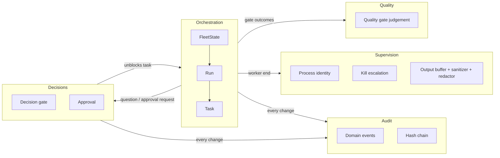

# Domain language and context map

The terms below mean the same thing in the code (`crates/fleet-domain`), the tests, the command
line and the README. When a word is used in one of those places with another meaning, that is a bug.

## Glossary

| Term | Meaning |
| --- | --- |
| **Fleet** | The set of all runs, decision gates and approvals one daemon manages (`FleetState`, the aggregate root the application layer loads and saves). |
| **Run** | One objective with its task DAG, a repository, a base commit and an integration branch `fleet/<run>/integration`. Aggregate (`Run`). |
| **Task** | A unit of work inside a run: title, spec, dependencies, worker, status, attempts. Entity inside `Run`. Id is unique inside its run; `run/task` names it globally. |
| **DAG** | The dependency graph between tasks of a run. Cycles, self dependencies, unknown and duplicate dependencies are rejected when tasks are added (`dag::order_new_tasks`). |
| **Status** | `pending` (waiting for dependencies), `ready` (waiting for a slot), `running` (a worker session is active), `review` (worker done, quality gates pending), `completed`, `failed`, `blocked` (waiting for a human, a conflict resolution or a failed dependency). |
| **Worker** | A configured agent command (`[workers.<name>]` in `fleet.toml`) started in a pty for one attempt of a task. |
| **Attempt** | One dispatch of a task. Attempts are bounded by the retry budget (`max_retries`); a restart of the daemon or a question does not consume it. |
| **Session** | The live pty, process group and output buffer of one attempt. |
| **Brief** | The text a worker receives: task, objective, work it builds on, notes from earlier attempts and the reporting contract. Text written by a worker or by a tool it ran is *quoted*: a dependency's summary is one line marked as the worker's, and notes quote worker output line by line (`> `) under fleet's own one-line statements, so it cannot pose as a heading or as an operator note. |
| **Contract** | The files a worker may write in `.fleet/`: `result.json` and `question.json`. Worker-controlled input; read with lstat/O_NOFOLLOW checks and size caps, validated by the domain (`contract.rs`). |
| **Quality gate** | A configured command run in the worktree after the worker finished; the task completes only when every gate passes. Format `exit` (exit code 0) or `refcheck-json` (JSON report with `summary.errors`). |
| **Decision gate** | A question that blocks a task until a human answers it: raised by a worker (`question.json` kind `question`) or by fleet (merge conflict). Resolved with `fleet gate resolve`. Called *gate* in the CLI. |
| **Approval** | A human decision bound to the digest of one exact action (tool, command, arguments, task id), with an expiry and single use. Requested by fleet (merge) or on behalf of a worker (`question.json` kind `approval`), never by the worker directly. A worker-requested command is an absolute program path, always labelled with the fixed tool `command`. The approval is consumed, and `external_command_started` recorded, at the moment the command is started (before it is launched): a command is never started twice, and a started command that never reports back (daemon restart) is recorded as `external_command_ran` with an unknown outcome. |
| **Action / digest** | What an approval is about, and the SHA-256 over its canonical form. Using an approval re-computes the digest of what is about to run. The human-visible form quotes the command and every argument. |
| **Purpose** | `merge`, `external-command` (the daemon runs a command a human approved for a worker) or `manual` (a plain yes/no). |
| **Sensitive action** | An action kind that always needs an approval: `merge` and `external-command` (configurable list). |
| **Worktree** | `<repo>/.fleet-worktrees/<run>/<task>`: a git worktree on branch `fleet/<run>/<task>`, created from the run's base commit. The user's checked-out branch and working tree are never touched. |
| **Integration branch** | `fleet/<run>/integration`, in its own worktree; completed task branches are merged into it with `--no-ff`. A conflicting merge is aborted and the task is blocked behind a decision gate. |
| **Event** | A fact recorded by the system (`DomainEvent`). State is rebuilt by replaying events. |
| **Audit log** | The append-only, hash-chained file of events (`events.log`) plus its head file. Tamper-evident, not tamper-proof. |
| **Orphan** | A session recorded as running by an earlier daemon process. After a restart it is checked (pid *and* start time) and stopped, and its task is queued again. |
| **Port** | A trait the application layer needs from the outside world (`fleet-app::ports`). **Adapter**: its implementation in `fleet-infra`. |
| **Origin check** | Control requests from a worker, or from a process a worker started, are refused. |

## Layers and the dependency rule

```
fleet-domain   pure rules: entities, value objects, aggregates, domain services, events.
               std only. No I/O, clock, randomness, processes, files, network.
fleet-app      use cases (Orchestrator), commands/replies, read models, port traits,
               in-memory fakes and port contract suites (feature `testing`). Depends on fleet-domain only.
fleet-infra    adapters: git, ptys, files, hash-chained log, job runner, sockets, TOML config, daemon wiring.
               Depends on fleet-app and fleet-domain.
fleet-cli      the `fleet` binary: argument parsing, terminal output, dashboard, attach. Depends on all of the above.
```

Each arrow points inward and the compiler enforces it: a crate cannot use what it does not list in
its `Cargo.toml`. `crates/fleet-cli/tests/architecture.rs` also checks the manifests.

## Bounded contexts



| Context | Aggregates and services | Relationship |
| --- | --- | --- |
| Orchestration | `FleetState`, `Run`/`Task`, `dag`, retry policy, brief, env policy | Core. Others serve it. |
| Decisions | `Decision`, `Approval`, `Action` | Customer/supplier with Orchestration: a worker end may open a decision, a decision may unblock a task. Linked by ids only, never by object reference. |
| Quality | `quality::evaluate_exit`, `evaluate_refcheck`, `gate_feedback` | Conformist: the `refcheck-json` contract is defined by the external tool. |
| Supervision | `ProcessIdentity`, `SupervisionPolicy`, `KillEscalation`, `is_worker_origin`, `OutputBuffer`, `Sanitizer`, `Redactor` | Supplier of facts (how a session ended) consumed by Orchestration. |
| Audit | `DomainEvent`, `chain` | Published language: every other context records its facts as events. |

Anti-corruption: git, the pty library, the optional undo tool and the refcheck report format are
reached only through ports or through neutral values (`Value`), so none of their types appear in
the domain.
