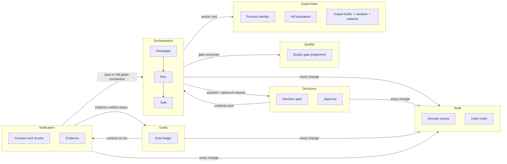

# Domain language and context map

The terms below mean the same thing in the code (`crates/fleet-domain`), the tests, the command
line and the README. When a word is used in one of those places with another meaning, that is a bug.

## Glossary

| Term | Meaning |
| --- | --- |
| **Fleet** | The set of all runs, decision gates and approvals one daemon manages (`FleetState`, the aggregate root the application layer loads and saves). |
| **Run** | One objective with its task DAG, a repository, a base commit and an integration branch `fleet/<run>/integration`. Aggregate (`Run`). |
| **Task** | A unit of work inside a run: title, spec, dependencies, worker, status, attempts. Entity inside `Run`. Id is unique inside its run; `run/task` names it globally. |
| **DAG** | The dependency graph between tasks of a run. Cycles, self dependencies, unknown and duplicate dependencies are rejected when tasks are added (`dag::order_new_tasks`). |
| **Status** | `pending` (waiting for dependencies), `ready` (waiting for a slot), `running` (a worker session is active), `review` (worker done, quality gates pending), `completed`, `failed`, `blocked` (waiting for a human, a conflict resolution or a failed dependency). |
| **Worker** | A configured agent command (`[workers.<name>]` in `fleet.toml`) started in a pty for one attempt of a task. |
| **Attempt** | One dispatch of a task. Attempts are bounded by the retry budget (`max_retries`); a restart of the daemon or a question does not consume it. |
| **Session** | The live pty, process group and output buffer of one attempt. |
| **Brief** | The text a worker receives: task, objective, work it builds on, notes from earlier attempts and the reporting contract. Text written by a worker or by a tool it ran is *quoted*: a dependency's summary is one line marked as the worker's, and notes quote worker output line by line (`> `) under fleet's own one-line statements, so it cannot pose as a heading or as an operator note. |
| **Contract** | The files a worker may write in `.fleet/`: `result.json` and `question.json`. Worker-controlled input; read with lstat/O_NOFOLLOW checks and size caps, validated by the domain (`contract.rs`). |
| **Quality gate** | A configured command run in the worktree after the worker finished; the task completes only when every gate passes. Format `exit` (exit code 0) or `refcheck-json` (JSON report with `summary.errors`). |
| **Decision gate** | A question that blocks a task until a human answers it: raised by a worker (`question.json` kind `question`) or by fleet (merge conflict). Resolved with `fleet gate resolve`. Called *gate* in the CLI. |
| **Approval** | A human decision bound to the digest of one exact action (tool, command, arguments, task id), with an expiry and single use. Requested by fleet (merge) or on behalf of a worker (`question.json` kind `approval`), never by the worker directly. A worker-requested command is an absolute program path, always labelled with the fixed tool `command`. The approval is consumed, and `external_command_started` recorded, at the moment the command is started (before it is launched): a command is never started twice, and a started command that never reports back (daemon restart) is recorded as `external_command_ran` with an unknown outcome. |
| **Action / digest** | What an approval is about, and the SHA-256 over its canonical form. Using an approval re-computes the digest of what is about to run. The human-visible form quotes the command and every argument. |
| **Purpose** | `merge`, `external-command` (the daemon runs a command a human approved for a worker) or `manual` (a plain yes/no). |
| **Sensitive action** | An action kind that always needs an approval: `merge` and `external-command` (configurable list). |
| **Worktree** | `<repo>/.fleet-worktrees/<run>/<task>`: a git worktree on branch `fleet/<run>/<task>`, created from the run's base commit. The user's checked-out branch and working tree are never touched. |
| **Integration branch** | `fleet/<run>/integration`, in its own worktree; completed task branches are merged into it with `--no-ff`. A conflicting merge is aborted and the task is blocked behind a decision gate. |
| **Event** | A fact recorded by the system (`DomainEvent`). State is rebuilt by replaying events. |
| **Audit log** | The append-only, hash-chained file of events (`events.log`) plus its head file. Tamper-evident, not tamper-proof. |
| **Orphan** | A session recorded as running by an earlier daemon process. After a restart it is checked (pid *and* start time) and stopped, and its task is queued again. |
| **Port** | A trait the application layer needs from the outside world (`fleet-app::ports`). **Adapter**: its implementation in `fleet-infra`. |
| **Origin check** | Control requests from a worker, from a process a worker started, or from anything the daemon itself started (quality gates, approved commands, git, the undo tool, their descendants and the process groups they run in) are refused. The web dashboard applies the same rule to the process at the other end of each TCP connection (*admission*). |
| **Dashboard** | The local web UI served by `fleet daemon --web <addr>` (`fleet-infra::web`): a thin adapter over a handful of the daemon's own commands, never a second implementation of them. Off by default. |
| **Web token** | 256 random bits generated at daemon start, held in memory, printed once on the operator's terminal as a login URL (token in the fragment). Opens the dashboard as `Authorization: Bearer` or, exchanged by `POST /api/login`, as a session. Never stored, logged or passed to a worker. Not the control token. |
| **Web session** | A browser's login: a random id returned by `POST /api/login`, kept in the page's `sessionStorage` and sent in the `X-Fleet-Session` header (never a cookie: cookies are not isolated by port), with its own **CSRF token** that the page sends in `X-CSRF-Token` with every state-changing request. Bounded in number and lifetime, forgotten at daemon restart; an event stream ends when its session does. |
| **Admission** | The check at accept that decides whether a connecting process may talk to the daemon at all: not a worker, not started by one, identifiable (control socket: `SO_PEERCRED`; dashboard: the process holding the client's end of the TCP connection). Fails closed. |
| **Event stream** | The dashboard's server-sent events for one task's output: sanitized text in bounded chunks, ended after a lifetime or byte budget (the browser reconnects with the last offset). |
| **Goal** | A node of the goal ledger: id, parent, title, intent, status, the tasks that work on it, an optional verification contract and the evidence recorded for it (`neo-goals::Goal`). |
| **Goal ledger** | The forest of goals and their evidence (`neo-goals::Ledger`, an aggregate). A projection of the event log like the fleet state, so it survives a restart. A tree by construction (a parent exists before its children and never changes), bounded in depth, fan-out, goals and evidence. |
| **Goal status** | `open`, `in_progress`, `blocked`, `abandoned` (set by an operator) and `verified`, which only recorded evidence (and verified children) can set or take away. |
| **Verification contract** | The acceptance criteria of a goal: a list of checks (`neo-verify::VerificationContract`). Identified by the SHA-256 of its canonical text (the *contract id*); parsed with a strict schema and size caps. |
| **Check** | One item of a contract: a command with an expected exit code, a `refcheck-json` gate, a file assertion (exists, sha256, contains) or a diff constraint (the work touches only the allowed path globs). *Mandatory* by default; an optional check is run and recorded but never decides. |
| **Evidence** | What fleet itself saw when it ran one check on a clean export of a commit: contract id, check, verdict, exit code, bounded redacted output, run, task, commit, tree, whether the worktree was dirty, and the time (`neo-verify::Evidence`). A value object: created once, recorded as an event, never edited. It *counts* only if it was not dirty and its commit is the one the task's last review recorded. |
| **Verdict** | `passed`, `failed` (the check ran and the result was wrong) or `error` (it could not be evaluated: timeout, cannot start, unreadable file). Only `passed` passes. |
| **Contract state** | `pending` (a mandatory check has no evidence yet), `passed` (the newest evidence of every mandatory check passed) or `failed`. A later run replaces an earlier one in either direction. |
| **Governed task** | A task named by a goal (not abandoned) that has a contract. It completes only after fleet's own run of every such contract passed, and is merged only as the commit that was proven. |
| **Export** | A fresh private directory holding exactly the files of one commit (no worktree state, no git state, no outward links), in which verification checks run. |
| **Job origin** | The process groups of the children the daemon runs on behalf of workers (gates, approved commands, checks, the undo tool, git) and their detached descendants, listed in the one shared job tracker: refused by the origin check on the control socket and on the web port, like workers. |
| **Task verification** | How a task stands with regard to its contracts: `none`, `pending` (the worker is not done), `unverified` (the worker reported or the task is in review, and fleet has no passing evidence), `failed`, `verified`. |
| **Remaining** | What is left: open leaves (goals with nothing but their own criteria between them and `verified`), blockers (blocked goals, blocked or failed tasks of unfinished goals) and the tasks that can start next. |

## Layers and the dependency rule

```
fleet-domain   pure rules: entities, value objects, aggregates, domain services, events.
               std only. No I/O, clock, randomness, processes, files, network.
neo-verify     verification contracts, glob matcher, judging, evidence. std and fleet-domain only. Pure.
neo-goals      the goal ledger and its status machine. std, fleet-domain and neo-verify only. Pure.
fleet-app      use cases (Orchestrator, including the neo module), commands/replies, read models, port traits,
               in-memory fakes and port contract suites (feature `testing`). Depends on the domain crates only.
fleet-infra    adapters: git, ptys, files, hash-chained log, job runner (gates, approved commands and
               verification contracts), sockets, TOML config, the web dashboard (hand-written HTTP on
               std::net), daemon wiring. Depends on fleet-app and the domain crates.
fleet-cli      the `fleet` binary: argument parsing, terminal output, dashboard, attach. Depends on all of the above.
```

Each arrow points inward and the compiler enforces it: a crate cannot use what it does not list in
its `Cargo.toml`. `crates/fleet-cli/tests/architecture.rs` also checks the manifests, and that the
domain crates (the first three) read no clock, draw no random numbers and touch no I/O.

## Bounded contexts



| Context | Aggregates and services | Relationship |
| --- | --- | --- |
| Orchestration | `FleetState`, `Run`/`Task`, `dag`, retry policy, brief, env policy | Core. Others serve it. |
| Decisions | `Decision`, `Approval`, `Action` | Customer/supplier with Orchestration: a worker end may open a decision, a decision may unblock a task. Linked by ids only, never by object reference. |
| Quality | `quality::evaluate_exit`, `evaluate_refcheck`, `gate_feedback` | Conformist: the `refcheck-json` contract is defined by the external tool. |
| Supervision | `ProcessIdentity`, `SupervisionPolicy`, `KillEscalation`, `is_worker_origin`, `OutputBuffer`, `Sanitizer`, `Redactor` | Supplier of facts (how a session ended) consumed by Orchestration. |
| Audit | `DomainEvent`, `chain` | Published language: every other context records its facts as events. |
| Goals | `Ledger`, `Goal` (`neo-goals`) | Customer of Verification: a goal is verified when the contract's state is `passed` and its children are verified. Linked to tasks by `run/task` names only. |
| Verification | `VerificationContract`, `Check`, `Evidence`, `judge`, `Glob` (`neo-verify`) | Supplier to Goals and, through the review flow, to Orchestration: a governed task completes only after a passing run. Conformist for `refcheck-json` (same judgement as the quality gate). |

Anti-corruption: git, the pty library, the optional undo tool and the refcheck report format are
reached only through ports or through neutral values (`Value`), so none of their types appear in
the domain.

## Workbench glossary (phase 5.1)

| Term | Meaning |
| --- | --- |
| **Workbench** | The read-only review panes of the dashboard (explorer, file, diff, Markdown, image) in a dock with tabs and splits. ADR 17. |
| **RepoPath** | A validated, relative path inside a repository at a commit (`fleet_domain::repo::RepoPath`); never a path on disk. |
| **Recorded commit** | A commit the daemon recorded for a task: the run's base, the task's head or its merge commit. The only commits a client may name (with `head` and `base`). |
| **RepoTarget / RepoBrowser** | The task's repository and recorded commits resolved by the orchestrator, and the use case that reads them through the `RepoReader` port on the caller's thread. |
| **DiffSet** | Files with status, counts, hunks and truncation markers between two recorded commits; bounded in files, hunks, lines and bytes. |
| **FileView** | Text with line offsets, an image, or a placeholder (binary, too large), a symlink's target text or a submodule's commit. |
